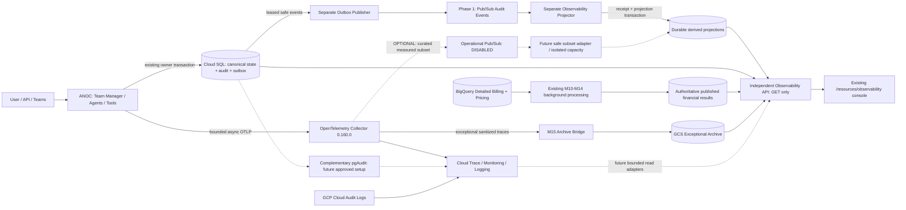

# 26 — Hybrid Event-Driven Observability + Auditability

Approved architecture, refined by the user on 2026-10-11. This specification
supersedes dashboard/distribution assumptions in docs 00–25 without changing
business authority, accounting, privacy or milestone gates. **Phase-1 LOCAL
implementation exists and is locally validated.** Production runtime wiring, Google
transport and authenticated push ingress now exist with mocked local validation;
production deployment/live behavior is NOT validated. M16 is **INCOMPLETE**, C41/C42 are not PASS,
M17 is **UNSTARTED**. Cloud deployment: **NOT EXECUTED — USER APPROVAL REQUIRED**.

## Authoritative architecture

Local substitution: SQLite disposable DB + `FakeEventTransport`, with explicit
`hybrid.local.compose(..., isolated_local=True)` injection. Class A writes owning canonical state, immutable safe critical audit
reference and outbox in one transaction. Classes B/C/D use explicit consistency boundaries in document 27. There is no request-path network publication. Publisher
and projector are separate components; `hybrid.projector_app` provides a separate
local ingress boundary, disabled by default. No production cloud client or
credentials discovery is imported by the hybrid package.

**Operational Telemetry Pub/Sub is OPTIONAL / SCALE-TRIGGERED and DISABLED.**
Full unsampled OTLP replication is not a Phase-1 requirement. The audit stream
provides implemented lifecycle activity independently of trace sampling. A later
operational branch needs a measured use case, curated typed subset, cost/capacity
assessment and separate approval. Existing OTLP / Cloud / exceptional archive
runtime pathways and Collector pin are unchanged.

## Canonical owners and the implemented event catalogue

| Evaluated event | Local capture owner / classification |
|---|---|
| run.accepted | M7 `Repository.persist`: first successful durable RUNNING snapshot. A first snapshot already terminal emits terminal only; acceptance is UNKNOWN / NOT CAPTURED. Acceptance occurrence uses trusted `started_at`; **not synchronous pre-provider business admission**. |
| turn.bound | M7 durable first turn binding; real session/run/turn/trace references only. |
| governance.progression.recorded | CaseProgressionStore same-transaction CAS revision reference; no grounded evidence/action body. |
| run.terminal | Same M7 SQL transaction that persists a new terminal state; terminal canonical write and audit/outbox roll back together. |
| agent.execution.started/completed/failed | Implemented class-C actual execution journal; bounded fail-open, not complete crash history. |
| model.attempt.started | M10 `Repository.start`: durable STARTED transition before transport. |
| model.attempt.completed | M10 `Repository.finished`: durable PROVIDER_FINISHED transition. Means provider attempt finished, not successful accounting or entire business turn. |
| model.usage.captured | M10 `Repository.materialize`: successful new immutable base ledger record; references that record. Never duplicates quantities/cost. |
| tool.execution.started/completed/failed | Implemented class-C actual dispatch/direct tool journal; derived execution record, no span authority. |
| approval.requested/approved/rejected/expired/consumed | Implemented class-B public durable ADK event metadata; separate idempotent journal reconciliation. |
| authorization.decided and action lifecycle | Implemented class-D controlled Teams egress: durable intent before dispatch, UNKNOWN after ambiguity, no replay. |
| accounting.debt.created | M10 failed final capture, expired dispatched attempt with missing observation, or newly exhausted inbox persistence retries. |
| accounting.debt.resolved | M10 successful materialization with a retained canonical gap reason or exhausted inbox; same ledger transaction. |

The nine legacy event types plus 24 strict execution-journal event types are admitted by capture/publisher/projector.
Legacy conceptual v1 names remain decodable for compatibility but cannot enter the
runtime capture/projector. No later governance functionality is implemented early.
M7 Coordinator remains asynchronous and coalesces progress; capture cannot prove
that a run exists before the first durable snapshot or after an unpersisted crash.
Historical gaps are **UNKNOWN / NOT CAPTURED**. Events are **CAPTURED** at their
actual SQL transition; the run occurrence timestamp can precede that commit.
RECONSTRUCTED requires an explicitly versioned authorized reconstruction, not a
sampled span. No backfill or complete historical population is claimed.

## Envelope and M15 privacy

Strict v1 JSON, maximum 16 KiB: globally unique stable UUID `event_id`, schema
version, class AUDIT, finite type/environment/producer, UTC occurrence timestamp,
aggregate type/UUID/version, optional trusted run/turn/trace IDs, and safe typed
payload: UUID source reference, positive source version, CAPTURED/RECONSTRUCTED,
finite status/agent where applicable. The event identity is UUIDv5 of schema,
environment, event type, aggregate identity and transition version. Sender-controlled
raw strings cannot substitute for canonical source UUIDs. Source lookup never
selects arbitrary SQL/table names. Optional early/background correlation stays null.

M15 `privacy_policy.REGISTRY` registers qualified audit fields with the existing
SAFE/RESTRICTED/PROHIBITED classifications. Envelope admission checks that policy
and strict typed values at capture, publisher and consumer. Unknown fields fail
closed. No prompts, responses, Teams/knowledge/attachment bodies, credentials,
authorization headers, hidden reasoning, SQL, tool arguments or unrestricted command
payloads enter outbox, event transport, failure records or projections. Failures
store finite codes and hashes of safe event identities, never payload or exception
text. IDs never become metric labels. Broker access does not grant UI access.

## Transactional outbox and migration

Additive revision **d26a1b7c9e40**, directly after **c16f4a8b2d90**. Recovered
historical revisions and the reconciliation merge remain byte-for-byte unchanged.
Six application-owned tables:

- `observability_critical_audit`: immutable reference envelope + canonical digest.
- `observability_audit_outbox`: envelope copy, aggregate sequence, digest, created/
  occurred timestamps, PENDING/LEASED/RETRYING/DEAD/PUBLISHED, attempts, availability,
  UUID lease token/expiry, publication time and finite last failure code.
- `observability_projection_receipt`: environment/event ID, digest, occurrence/
  processing timestamps and duplicate count; atomic with projection mutation.
- `observability_projection_failure`: safe failure identity/code, attempts,
  last timestamp and RETRY/DEAD/RESOLVED state.
- `observability_run_projection`: run/correlation, lifecycle version, status,
  latest event occurrence/processing time and lag in seconds.
- `observability_agent_projection`: fixed agent model-start/model-finish/ledger-record
  counts and freshness; **not token/cost or complete agent-execution accounting**.

The existing owning SQL transaction controls commit; Capture never commits or
calls transport. Invalid capture aborts that transaction. Hash conflict cannot
silently overwrite audit history. Local upgrade/downgrade was tested only on a
disposable SQLite DB; the full historical graph is checked offline. Shared Cloud
SQL migration was NOT EXECUTED. Disposable PostgreSQL remains unavailable; PostgreSQL
locks/WAL/IAM and online migration are not validated. Downgrade drops these derived
and audit tables and loses their contents: production rollback should disable new
capture/workers and retain additive tables rather than automatically downgrade.

The old `OutboxRecord` interface is a legacy conceptual contract; actual runtime
state and names are defined by `hybrid.models`, migration and the lifecycle above.
No automatic migration, schema creation, cleanup or remote grants occur at startup.

## Publisher, transport, backpressure and crash recovery

Default bounds: batch 100 (max 1000), serial transport concurrency 1, lease 30s
(5–300), max attempts 10 (1–100), backoff 1s exponentially capped at 60s, queue 128
(max 4096), projector inflight 32 (max 256), processing deadline 10s, shutdown 3s.
All bindings are explicit; capture/publication/projector/operational Pub/Sub flags
are disabled by default. Production-enabled transport is not wired in this pass.

`OutboxStore.claim` selects due/expired rows in an environment-scoped short SQL
transaction using PostgreSQL SKIP LOCKED and conditional updates; per-event UUID
lease tokens reject late/wrong acknowledgements. Network publication occurs after
claim commit with a bounded timeout, outside SQL locks. Successful acknowledgement
marks PUBLISHED only with the live lease. Failure schedules RETRYING; exhaustion or
invalid integrity becomes visible DEAD debt. Expired leases are reclaimable, with
bounded attempts. A slow batch can outlive a lease; late acknowledgements then fail
and recovery redelivers safely. Published rows are retained; no purge policy or
operator replay endpoint is invented. Durable backlog cannot be silently dropped.

`EventTransport` / `DeliveryTransport` protocols isolate future Pub/Sub adapters.
The local fake has bounded capacity, at-least-once redelivery, retry backoff and
maximum attempts; its final dead counter retains no raw event bodies. It is
**not durable**: a process crash after confirmed publication can lose its queue.
Production Pub/Sub durability is therefore a deployment requirement, not local
proof. Crash tests use an explicitly isolated test spool to represent a delivered
message across process death; this is test infrastructure, not a production broker.
Publisher retry resends an event; it never calls a model, agent, tool or command.

## Projector semantics and ordering

Revalidate envelope/environment/catalogue before receipt admission. Receipt and
approved projection updates commit together. Identical repeated event IDs leave
business projection values unchanged (duplicate counter increments); different
digest becomes explicit CONFLICT without overwriting the original receipt or state.
Transient processing failure rolls back receipt/projection and records safe RETRY;
retry exhaustion becomes DEAD, successful retry retains failure history as RESOLVED.
Invalid and conflict deliveries are acknowledged/quarantined locally after recording
safe failure; future Pub/Sub DLQ/ACK policy needs production adapter validation.

No global ordering assumption. Run lifecycle sequence 1 = accepted, 2 = terminal;
terminal cannot regress even when delivered first. Agent model counters are additive
only after receipt dedup, and occurrence watermark cannot regress. Attempt/debt
transition versions distinguish deterministic identities; they are not an ordering
contract for financial state, which remains in M10. No alert evaluator, cost/token
recomputation, business authority mutation or automated remediation is performed.

## GET read plane and UI impact

`GET /api/observability/hybrid/activity?environment=development&limit=50` is added
to the independent reader. Server-enforced operational capability and environment
scope apply; User cannot read it. FinOps inherits no raw content or broader technical
access. It returns safe run activity, model-agent counts, occurred/processed/lag,
page outcome counts, outbox pending/leased/retrying/dead/oldest age, and processing
processed/duplicate/conflict/invalid/retry/dead snapshots. No event payload is exposed.

Runs are bounded to 100 and agent vocabulary is fixed. Processing/debt scans return
at most 1000 rows plus a truncation sentinel; count scope explicitly says
`returned_page_and_bounded_processing_snapshot`, never historical totals. Empty
healthy tables mean an empty observed projection, not a complete historical zero.
Missing schema/reader returns safe 503. Reader uses its existing query-only pool,
capacity and a 2s endpoint deadline; no worker/FinOps job starts on GET. Published
M10–M14 endpoints remain financial truth. Frontend adds a strict matching DTO/client
and shared fixture tests; no M17 UI panel/navigation redesign is implemented.
Settings remains effective read-only; no IaC/configuration mutation through UI.

## Near-real-time and focused performance evidence

See [local measurement](validation/HYBRID_PHASE1_LOCAL_MEASUREMENT.json) and
[validation report](validation/HYBRID_PHASE1_LOCAL_REPORT.md). SQLite/fake-transport
explicit ticks measure actual event occurrence → projection commit and read delay;
no propagation SLO or Pub/Sub/Cloud SQL latency guarantee is claimed. Normal local
publisher polling adds up to 100ms; queue/backoff/DB latency can add more.

Focused M10 STARTED transaction baseline versus capture-enabled measures typed
creation + immutable audit/outbox SQL only, separately from asynchronous workers.
Four alternating batches of 50 operations per arm; admission preparation excluded.
There are no network/provider calls in the measured request transaction. Absolute
wall/process CPU delta is reported without claiming total ANOC overhead. M16 C41/C42
need full unchanged acceptance reruns; this focused test does not make either PASS.

## Existing operational telemetry and later audit layers

The Google distribution 0.160.0 supports `googlecloudpubsubexporter`:
[pinned Google manifest](https://github.com/GoogleCloudPlatform/opentelemetry-operations-collector/blob/v0.160.0/google-built-opentelemetry-collector/manifest.yaml),
[pinned exporter contract](https://github.com/open-telemetry/opentelemetry-collector-contrib/blob/v0.160.0/exporter/googlecloudpubsubexporter/README.md).
Capability was verified locally without starting a cloud exporter. Existing dormant
example/no-op branch is an evaluation artifact only. Native OTLP protobuf/CloudEvents
is not this JSON envelope; any later curated branch needs an explicit safe adapter,
identity/dedup rules, reserved audit capacity and measured cost justification.

Exceptional sanitized OTLP → M15 archive bridge → GCS remains independent. pgAudit
and GCP Cloud Audit Logs complement application audit; they do not replace it or
supply token accounting. Future pgAudit setup requires literal masking, parameter
logging off, finite class/retention/access review and explicit restart/extension/IAM
approval; parameter logging off alone cannot hide literals. See
[Cloud SQL pgAudit](https://docs.cloud.google.com/sql/docs/postgres/pg-audit).

EUR, unsampled append-oriented M10 ledger, separate estimated/billed values,
M11 billing/pricing, M12 allocation/reconciliation, M13 unit economics and M14
budgets/forecasts remain authoritative. Sampling cannot sample accounting. Rebuild
from retained safe events is future work; historical missing data remains unknown.

## Activation and provisioning gates

[Resource manifest](GCP_HYBRID_OBSERVABILITY_RESOURCE_MANIFEST.md) separates **PHASE 1
MINIMUM**, **OPTIONAL / SCALE-TRIGGERED**, **PHASE 2**. Exact proposed development
names are review inputs, not confirmed owner bindings or approval. Future work:
deployed Pub/Sub adapter/authenticated push validation, separate workload
identities/table grants/network, reviewed capture activation, Cloud SQL/PostgreSQL
migration validation, existing reconciliation backup/recovery prerequisites, cost
sizing and full M16 regression/performance gates. No shared cloud/DB operation has
been performed. **Ready for Phase-1 GCP provisioning: NO.** Local pipeline readiness
does not authorize or validate production activation. M17 remains unstarted.

## Production-readiness implementation supplement

[Production readiness](HYBRID_PHASE1_PRODUCTION_READINESS.md) is authoritative for
real disabled-default composition, Google adapter, authenticated request-driven push,
runtime choice, exact configuration, grant SQL, combined offline rollout and local
performance/failure receipts. [Coverage matrix](AUDIT_COVERAGE_MATRIX.md) records all
inspected domains and material gaps: full auditability is NOT achieved. This updates
previous local-only deployment assumptions while preserving the diagram above.
Read-only cloud inspection confirmed europe-west4 and project number 995771529960.
Terraform fmt/validate locally PASS; no plan/apply. Docker unavailable; PostgreSQL
rehearsal NOT EXECUTED. Provisioning readiness NO; no cloud/shared DB mutation.

## Execution journal extension

[Document 27](27_EXECUTION_AUDIT_JOURNAL_AND_CONTROLLED_EGRESS.md) defines implemented lifecycle facts, controlled egress, A/B/C/D consistency and append-only journal guarantees. It supersedes previous DEFERRED classifications for scoped implemented adapters, without claiming exhaustive coverage. Full auditability remains NO. New execution outbox rows are immutable journal references.
