# Execution Audit Journal and Controlled Action Egress

Implemented and locally validated on 2026-10-11, conditional on explicit disabled-by-default flags. Full auditability: **NO**. M16: **INCOMPLETE**. No external changes; M17 unstarted. This implements the latest user-approved local architecture and supersedes the earlier design-only stop. See [coverage](AUDIT_COVERAGE_MATRIX.md) and [remaining gaps](AUDIT_OWNERSHIP_GAP_DESIGN.md).

## Authority and durable flow

Business owners retain conversational, evidence, approval, command and accounting authority. The immutable execution journal is authoritative only for the lifecycle facts actually recorded. Its physical table is the existing `observability_critical_audit`, not a second historical truth. Deterministic UUIDv5 event identity binds environment/type/actual source ID/revision; a conflicting hash is rejected. Journal and outbox insert together. New execution outbox rows contain references, not mutable payload truth; publishers hydrate and verify the immutable journal. Legacy payloads and hashes remain compatible.

```mermaid
flowchart LR
    businessOwner["Existing business owner"] --> journal["Immutable execution journal"]
    journal --> outbox["SQL outbox in journal transaction"]
    outbox --> publisher["Outbox publisher"]
    publisher --> pubsub["PubSub audit transport"]
    pubsub --> projector["Idempotent projector"]
    projector --> projection["Derived timeline and activity records"]
    projection --> reader["RBAC and environment scoped reader"]
```

No request-path PubSub publication. Delivery retries journal events only. Projector receipt, timeline and activity changes share a transaction. Occurrence chronology uses timestamp/event UUID; arrival time remains explicit. Late arrivals require a fresh cursor snapshot. Run audit reads are bounded to 100 and return PARTIAL, never infer complete history from an empty page.

## Consistency classes

| Class | Boundary implemented | Guarantee and limitation |
|---|---|---|
| A | Case evidence selection delta in successful CAS revision transaction; existing M7/M10 owner transactions | Owner state, journal and outbox commit or roll back together. Exact source tuples remain in Case/financial owners. |
| B | DatabaseSessionService public append metadata for actual approval/provenance state deltas | Content-free facts commit with ADK event. Journal/outbox follow separately and reconcile idempotently on owner-authorized session reads. Not a shared SQL transaction; no autonomous recovery worker/checkpoint. |
| C | Session create/access, actual ObservedAgent iteration, actual retrieval invocation, actual ADK tool dispatch/direct Teams wrapper | Real execution UUID and bounded fail-open capture. SQL journal/outbox atomic with each other, not execution. Crash/outage can lose facts. No fake closed/resumed sessions or span-derived events. |
| D | Existing Teams policy decision, durable action intent and dispatch boundary | Decision receipt and AUTHORIZED action record/journal commit before egress. Remote effect and acknowledgement cannot be atomic with SQL. UNKNOWN is first-class; audit never retries remote work. |

## Implemented adapters and identity

Session create/access are observed actual successful operations; access is not resume. Agent executions receive distinct real UUIDs per actual iterator, including actual parent agent execution when active. IDs remain scoped to execution and closed handles cannot become parents. Retrieval has a distinct real handle, namespace/type, counts, duration and finite result; query/doc bodies excluded. Case evidence is a comparison of exact authoritative identity tuples against the previous revision in successful CAS. ADK committed turn source references point to actual event/turn revisions, not copied source content.

ADK tools use the actual pinned dispatcher call boundary. Direct Teams tools use the same normalized lifecycle contract and avoid duplicate handles inside ADK. These class-C facts populate a derived ToolExecutionRecord; they do not add a business dispatch gate. Approval records requested/approved/rejected/expired/consumed only when that state transition actually commits; computed expiry alone is not a transition. No cancellation event is invented.

The model/accounting bridge carries the actual agent execution ID where known; omitted IDs preserve existing financial/event digests. Run/turn/session/model-attempt/tool/approval/action/authorization/retrieval IDs are linked only when actual owners supplied them. Early M10 STARTED and execution API continuation can lack run/turn; missing correlation remains unknown. Actor references are safe actual IDs where available, never invented identity from text. Source reference access remains governed by business RBAC.

## Controlled action egress

```mermaid
flowchart LR
    approval["Existing trusted approval"] --> authority["Existing authorize write policy"]
    authority --> receipt["Durable authorization decision"]
    receipt --> intent["Durable AUTHORIZED intent"]
    intent --> dispatch["Durable DISPATCHING and attempt ID"]
    dispatch --> gateway["Controlled final Teams gateway"]
    gateway --> external["External side effect once"]
    external --> acknowledgement["Acknowledgement receipt or UNKNOWN"]
    acknowledgement --> completion["Business adapter completion receipt"]
```

The current mutating integration is Teams createChat/sendMessage via PowerAutomate, including direct API and ADK tool execution. Both reuse unchanged business authorization and request payload. The final gateway denies naked writes in controlled mode, operation mismatches and reused lease handles. Equipment/procedure commands that the existing application does not execute are not newly enabled.

Authorization receipts contain finite decision/reason/policy and actual proposal reference. Allowed receipt + action record + action.authorized share SQL transaction. DISPATCHING + actual request/attempt ID + dispatch event commit before requests.post. Before-network exceptions are FAILED; any exception after entering the remote call is conservatively UNKNOWN. Successful adapter response produces ACKNOWLEDGED; original proposal consumption precedes COMPLETED. COMPLETED means this adapter returned and consumed its in-memory proposal, not remote equipment success or guaranteed subsequent ADK commit.

Audit/ack storage failure after remote success never resends, rewrites a fact, or changes business result. If UNKNOWN cannot persist, the durable record stays DISPATCHING; the read API explicitly reports its current outcome as UNKNOWN. Current action summaries are separate from immutable snapshot chronology, bounded to 100 per run. No reconciliation dispatch worker exists. A future business retry must follow existing approval/idempotency policy; this journal does not authorize one.

## Database, privacy and deployment

Additive migration `e27b2c8d0f51` after `d26a1b7c9e40` creates action intent, derived activity and timeline tables, finite state/domain/action checks and run indexes. PostgreSQL trigger rejects journal UPDATE/DELETE even by owner. SQLite local doubles lack that trigger; production guarantee is the tested PostgreSQL trigger plus restricted roles. Role SQL grants publisher SELECT journal, narrowly scoped ANOC action-state updates, projector derived writes, reader SELECT; no runtime DDL/delete. Existing FK/CHECK/index graph rehearsed; no historical migration modified.

Secrets, prompt/response, hidden reasoning, Teams bodies, query/document/attachment content, tool args/results and raw policy/context are excluded. Strict typed allowlists apply at capture, publication, projection and read. Identity references remain RESTRICTED; operational capability and environment scope are enforced server-side. FinOps alone gains no operational audit/content privilege. Settings configuration remains read-only; this pass adds DTO/client only.

Both flags are false by default. Production binding requires the real database session backend. No cloud transport, schema mutation or background job is automatically enabled. Activation/deployment/shared migration requires exact user approval. Recovery remains independently blocked: inspected Cloud SQL backups and PITR were disabled and backup list empty; no restore validation exists. Human reader verification and exact deployment bindings also remain outstanding.

## Local validation and performance

[PostgreSQL receipt](validation/EXECUTION_JOURNAL_POSTGRES_REHEARSAL.json): PostgreSQL18.6/vector0.8.7, historical reconstruction through merged graph, 19 revisions to new head, role positive/negative probes, immutable journal trigger, index/FK/CHECK parity, second upgrade NO_OP, owned container/volume removed. Schema-only disposable data; no GCP/shared migration.

[Measurement](validation/EXECUTION_JOURNAL_MEASUREMENT.json): 30 capture fixtures per eight domains with separate construction, validation, serialization/hash, journal and outbox phases. Capture wall cost 2.14–2.61ms/fact on local SQLite. Real empty-corpus retrieval owner baseline/enabled adds 5.51ms wall and 4.54ms CPU per operation for two facts. Phase timers overlap and must not be summed. Other domain rows are capture fixtures, not measured business-owner deltas. No transport/GCP/WAL/live-load claims. C41/C42 remain NOT PASS.

Tests cover actual public durable ADK handoff and recovery after sink failure, actual Runner/agent/retrieval/model correlation, source privacy, class-A CAS, transaction rollback/dedup/conflicts, reversed projection order, snapshot late arrival, RBAC/environment scope, dispatch uncertainty/no replay, durable intent failure gate and existing business regression parity. Remaining gaps prevent full coverage and milestone completion.
