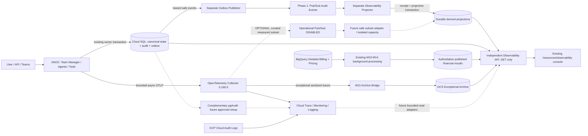

# SLOPANOC OBSERVABILITY + SRE + FINOPS BUILD PACK — ALL IN ONE


---

# FILE: README.md

# SLOPANOC Production Observability + SRE + FinOps Build Pack

## Purpose

This `.docs/` directory is the authoritative implementation contract for building a production-grade **Observability + Reliability + FinOps Control Plane** for SLOPANOC.

The goal is not "more logging". The finished system must answer, for every prompt and for the platform as a whole:

1. What is happening right now?
2. Where is a turn blocked, slow, failed, waiting, retrying or stalled?
3. Which agent, model, tool or dependency is responsible?
4. What governed decisions were made and which server-owned boundary made them?
5. What did the turn cost, what generated that cost, and how does estimated cost reconcile to provider billing?
6. Is the service meeting SLOs and consuming error budget?
7. Can support reconstruct a turn end-to-end by `run_id` without reading raw server logs?
8. Can FinOps allocate and optimize spend without gaining access to sensitive conversation content?

## Read order

1. `00_MASTER_BUILD_CONTRACT.md`
2. `01_TARGET_ARCHITECTURE.md`
3. `02_TELEMETRY_DATA_CONTRACT.md`
4. `03_INSTRUMENTATION_AND_RUNTIME.md`
5. `04_RELIABILITY_TIMEOUTS_ERRORS.md`
6. `05_STORAGE_APIS_AND_UI.md`
7. `06_SRE_SLOS_METRICS_ALERTS.md`
8. `07_FINOPS_ARCHITECTURE.md`
9. `08_FINOPS_DATA_MODEL_AND_UNIT_ECONOMICS.md`
10. `09_SECURITY_PRIVACY_RETENTION_SAMPLING.md`
11. `10_DASHBOARDS_RUNBOOKS_OPERATING_MODEL.md`
12. `11_SLOPANOC_INTEGRATION_MAP.md`
13. `12_IMPLEMENTATION_ROADMAP.md`
14. `13_TEST_VALIDATION_ACCEPTANCE.md`
15. `14_CODEX_EXECUTION_GUIDE.md`
16. `15_DEFINITION_OF_DONE.md`
17. `16_PRODUCTION_TELEMETRY_BACKEND.md`
18. `17_INFRASTRUCTURE_OBSERVABILITY.md`
19. `18_STRUCTURED_LOGGING_STANDARD.md`
20. `19_AI_QUALITY_OUTCOMES.md`
21. `20_FINOPS_ACCOUNTING_DURABILITY.md`
22. `21_SLO_FORMULAS_AND_INITIAL_TARGETS.md`
23. `22_RELEASE_CONFIG_CORRELATION_CI.md`
24. `23_TERRAFORM_AND_OBSERVABILITY_AS_CODE.md`
25. `24_CONTINUOUS_PROFILING.md`
26. `25_OBSERVABILITY_CONSOLE_AND_READ_PLANE.md`
27. `26_HYBRID_EVENT_DRIVEN_OBSERVABILITY.md`

`ALL_IN_ONE.md` is generated from all files for agents that prefer a single context document.

## Existing SLOPANOC assets to preserve and extend

Always inspect the **current working tree** before coding. Local uncommitted conversational-orchestration changes may be newer than the remote branch.

Known integration points include:

- `backend/api/chat_service.py` — canonical turn pipeline and SSE execution.
- `backend/api/app.py` — FastAPI endpoints/lifespan.
- `backend/api/perf_timing.py` — existing timing instrumentation.
- `backend/api/run_trace.py` — existing run-scoped tracing.
- `backend/tools/knowledge/diagnostic_trace.py` — deep knowledge/governance diagnostics.
- `backend/context/assembly.py` — Context Engineering Broker.
- `backend/conversation/*` — TurnPlan, threads, authority, provenance and pending interaction where present.
- `backend/agents/*` — Team Manager and specialists.
- `backend/tools/*` — knowledge, Teams and other tools.
- `src/` — React/Vite frontend and SSE handling.

These are load-bearing. Do not replace them casually.

## Non-negotiable decisions

1. **OpenTelemetry is the telemetry foundation.** Use standard trace/metric/log concepts and extend with `slopanoc.*` attributes only where needed.
2. **`chat_service` owns the root turn trace.** Do not create a parallel turn executor.
3. **Existing diagnostic traces become specialized telemetry producers, not a second observability platform.**
4. **No hidden chain-of-thought is logged or persisted.** Record structured decisions, safe identifiers, timings and bounded metadata only.
5. **FinOps is first-class.** Runtime usage/cost accounting is part of the platform, not a later dashboard.
6. **Usage/cost ledger coverage is 100%.** Traces may eventually be sampled; cost usage may not.
7. **Every external wait has a timeout and a span.** No indefinite `Processing your request...` state.
8. **High-cardinality identifiers belong in traces/ledgers, not metric labels.**
9. **Observability must observe itself.** Track exporter failures, dropped telemetry, overhead and observability cost.
10. **Telemetry never becomes evidence or authority.** It can explain execution but cannot grant command authority or select governed evidence.
11. **Production telemetry topology is fixed.** SLOPANOC exports OTLP to an OpenTelemetry Collector; the Collector exports traces to Cloud Trace, metrics to Cloud Monitoring and logs to Cloud Logging.
12. **Production active-run truth is durable.** Cloud SQL stores cross-instance run status; process-local memory is only a fast execution-local cache.
13. **Production logs are structured JSON.**
14. **Infrastructure observability includes Cloud Run, Cloud SQL, Gemini/Vertex, Graph, BigQuery, GCS, knowledge and Collector health.**
15. **Primary FinOps reporting currency is EUR while retaining native provider currency.**
16. **Detailed Billing + Pricing exports are primary accounting inputs; FOCUS is supplemental.**
17. **Observability infrastructure is managed as code with Terraform.**
18. **Browser/backend correlation uses W3C Trace Context.**
19. **CI enforces telemetry vocabulary, redaction, cardinality, span lifecycle and cost-ledger coverage.**
20. **Continuous profiling is part of the production build.**


## Quality target

A successful turn must be reconstructable as a timeline similar to:

```text
RUN 7bd...
00.000  UI prompt submitted
00.018  API received
00.032  Session loaded
00.044  Turn planning started
01.313  Planning model completed
01.320  TurnPlan accepted
01.327  Thread resolved
01.349  Context selected
01.358  Incident Manager started
01.361  Teams tool started
05.822  Microsoft Graph completed
05.839  Incident Manager completed
05.850  Synthesis started
07.013  Synthesis completed
07.019  Final authority selected
07.023  Provenance completed
07.026  Command egress completed
07.051  Persistence completed
07.055  message.completed emitted
07.069  Browser received completion
07.078  UI rendered
TOTAL 7.078 sec
```

A stuck turn must identify the blocking point:

```text
status: STALLED
current_stage: teams.graph.read_messages
elapsed: 42.8 sec
last_progress: 31.6 sec ago
agent: incident_manager
dependency: microsoft_graph
run_id: 7bd...
```

FinOps must be able to show per-turn and aggregate cost, including estimated and reconciled values.

## Observability Console + Separate Read Plane — architecture workstream

[25_OBSERVABILITY_CONSOLE_AND_READ_PLANE.md](25_OBSERVABILITY_CONSOLE_AND_READ_PLANE.md)
is authoritative for the primary operational route `/resources/observability`,
configuration-only Settings and an independently deployable GET-only read API.
It supersedes historical Settings-first dashboard placement; existing M7–M15
security, telemetry and financial semantics remain authoritative. Introduced after
the M16 baseline: documentation only, not M17. M16 C41/C42 remain FAIL and final
CPU/regression acceptance must be rerun after integration.

## Hybrid event-driven architecture — 2026-10-11

Read [26 — Hybrid Event-Driven Observability + Auditability](26_HYBRID_EVENT_DRIVEN_OBSERVABILITY.md) for the approved two-lane architecture and authoritative Mermaid.
Critical audit/accounting remains Cloud SQL durable with same-transaction outbox;
operational telemetry stays async OTLP -> Collector, including an optional sanitized
Pub/Sub branch. A separate publisher/projector supplies derived read models; the
separate GET-only read plane is preserved. No duplicate business/accounting truth.
The [resource manifest](GCP_HYBRID_OBSERVABILITY_RESOURCE_MANIFEST.md) lists future
Phase 1/2/optional resources; no provisioning/migration is authorized or executed.
Local Phase-1 owner-transaction capture, SQL outbox, bounded publisher, fake
transport, projector, durable projections and GET/DTO contracts are implemented
and locally validated. Production adapter/verified ingress and PostgreSQL/cloud
validation remain pending. Operational Telemetry Pub/Sub is OPTIONAL / SCALE-TRIGGERED,
disabled and curated only after measured need. M16 INCOMPLETE,
C41/C42 not PASS, M17 UNSTARTED. Doc 26 supersedes synchronous ANOC read assumptions.

## Phase-1 production-readiness update — 2026-10-11

Production-readiness local implementation now adds real opt-in ANOC/Case composition, lazy Google Pub/Sub transport, authenticated push, and review-only Terraform/SQL. Read [coverage](AUDIT_COVERAGE_MATRIX.md) and [production readiness](HYBRID_PHASE1_PRODUCTION_READINESS.md). No deployment/shared migration; PostgreSQL rehearsal unavailable; full auditability and M16 acceptance remain incomplete.

Audit completeness/rehearsal follow-up: [owner gap design](AUDIT_OWNERSHIP_GAP_DESIGN.md),
[human reader identity contract](HYBRID_READER_IDENTITY_CONTRACT.md),
[recovery requirements](HYBRID_RECOVERY_REQUIREMENTS.md),
[PostgreSQL 18 rehearsal evidence](validation/HYBRID_POSTGRES_REHEARSAL.json).
Full auditability NO; no new owners/events because material business semantics require
design resolution; local PostgreSQL PASS; M16 INCOMPLETE; provisioning NO.

## Execution journal status — 2026-10-11

Read document 27 for the locally implemented Execution Audit Journal and Controlled Action Egress. Current coverage and ownership-gap documents supersede earlier design-only stop classifications. Full auditability NO; M16 INCOMPLETE; no external changes. See [implementation](27_EXECUTION_AUDIT_JOURNAL_AND_CONTROLLED_EGRESS.md), [coverage](AUDIT_COVERAGE_MATRIX.md) and [remaining gaps](AUDIT_OWNERSHIP_GAP_DESIGN.md).

---

# FILE: 00_MASTER_BUILD_CONTRACT.md

# 00 — Master Build Contract

## Mission

Build a production-grade **Observability + Reliability + FinOps Control Plane** for SLOPANOC.

The finished platform must include:

- distributed traces,
- correlated structured logs,
- metrics,
- active-run visibility,
- model/agent/tool/dependency instrumentation,
- timeouts, watchdogs and structured failures,
- admin observability APIs,
- frontend progress and trace views,
- SRE SLOs and alerts,
- 100% AI usage ledger,
- runtime cost estimation,
- provider billing ingestion and reconciliation,
- direct/shared/unallocated cost allocation,
- unit economics,
- budgets, forecasting and anomaly detection,
- RBAC, redaction, retention and sampling,
- dashboards and runbooks.

This work must not change SLOPANOC's application governance semantics.

## Architectural planes

### Telemetry plane
Records what happened:
- traces,
- spans,
- events,
- logs,
- metrics,
- current stage,
- timing,
- bounded safe metadata.

### Reliability plane
Controls approved runtime protection:
- deadlines/timeouts,
- safe retries,
- cancellation,
- watchdog/stall detection,
- circuit breaking where justified,
- structured error taxonomy.

### FinOps plane
Records and reconciles:
- model tokens,
- request counts,
- retried usage,
- infrastructure/service usage,
- estimated cost,
- billed cost,
- allocation,
- unit economics,
- budgets/forecast.

### Governance plane
Existing application governance remains authoritative:
- TurnPlan,
- Context Broker,
- knowledge selection,
- applicability,
- ProcedureAction,
- Command Authority,
- approval,
- command egress,
- TurnAuthority,
- claim provenance.

Telemetry may mirror these decisions but never replace or influence them.

## Fixed production decisions

These decisions are approved and must not be re-opened by the coding agent:

- OTel Collector -> Cloud Trace / Cloud Monitoring / Cloud Logging.
- Cloud SQL is the durable cross-instance active-run status store; in-memory state is a cache.
- Production logs are structured JSON.
- Infrastructure telemetry covers Cloud Run, Cloud SQL, Gemini/Vertex, Graph, BigQuery, GCS, knowledge, network dependencies and the Collector.
- Initial SLO targets are defined in `21_SLO_FORMULAS_AND_INITIAL_TARGETS.md` and later recalibrated from baseline evidence.
- Operational Trace Store: Google Cloud Trace, full interactive traces/spans with fixed 30-day provider retention for ordinary and exceptional traces.
- ExceptionalTraceArchive: separate sanitized full exceptional OTel traces with a 90-day primary archive retention requirement in dedicated environment-isolated GCS storage. Days 0–30 use Cloud Trace plus archive; days 31–90 use archive only. Summaries/logs/metrics do not substitute. Archive deletion becomes policy-eligible after its horizon; lifecycle deletion is asynchronous and soft delete is separate. See doc 16 for the safe schema, pluggable OTLP bridge and local validation boundary.
- Aggregate metrics: minimum 13-month analytical access requirement, not an artificial deletion TTL. Longer provider retention satisfies the horizon at documented resolution; no promise of original-resolution data for 13 months.
- FinOps ledger/billing analytical retention target: 24 months, subject to enterprise policy.
- Sampling starts at 100%; later healthy general-chat traces may be reduced to 10–20%, while failed/timeout/stalled/safety/governed turns remain 100%.
- FinOps ledger is immutable/idempotent/accounting-grade with durable recovery.
- Primary billing source: Detailed Billing Export + Pricing; FOCUS is supplemental.
- Reporting currency: EUR, retaining native provider currency.
- Quality/value telemetry covers governed-answer rate, operator acceptance, FTC where measurable, incident resolution, escalation, troubleshooting completion, action success and automation-artifact success.
- Every trace correlates Git SHA, release/revision, model, prompt/agent/tool/schema/config versions.
- Browser/backend propagation uses W3C Trace Context.
- Terraform is the observability-as-code standard.
- CI/CD contains observability contract gates.
- Continuous profiling is included.
- RBAC roles: User, Operator, Developer/SRE, FinOps, Admin, Auditor; FinOps cannot read conversation/Teams content by default.
- Observability cost is budgeted and alerted as part of total SLOPANOC cost.

## Production invariants

### Trace invariants
- one user turn -> one canonical root trace;
- stable `trace_id`, `run_id`, `turn_id`, `session_id`;
- child work uses parent/child spans;
- every terminal turn ends exactly once as `COMPLETED`, `FAILED`, `TIMEOUT` or `CANCELLED`;
- `STALLED` is a watchdog state/event and may later transition to a terminal state;
- all spans are closed in success and failure paths.

### Safety invariants
Never store by default:
- passwords,
- access tokens,
- API keys,
- authorization headers,
- full Teams message bodies,
- full knowledge document text,
- attachment contents,
- full prompts/responses,
- hidden chain-of-thought.

### FinOps invariants
- every billable model call creates a durable usage record;
- every turn can roll up child usage;
- `estimated_cost` and `billed_cost` are separate;
- pricing is versioned;
- cost estimates are reproducible;
- usage/cost ledgers are never trace-sampled;
- shared allocation stores method, driver, version and confidence;
- unallocated cost is visible.

### SRE invariants
- all blocking external calls have configured deadlines;
- no request remains indefinitely ambiguous;
- active-run current stage is queryable;
- observability exporter failure is itself measurable;
- safety violations such as unauthorized command exposure have zero tolerance.

## Target package

Prefer a modular package resembling:

```text
backend/observability/
├── __init__.py
├── config.py
├── schemas.py
├── attributes.py
├── stages.py
├── tracing.py
├── metrics.py
├── logging.py
├── instrumentation.py
├── model_instrumentation.py
├── tool_instrumentation.py
├── dependency_instrumentation.py
├── watchdog.py
├── errors.py
├── redaction.py
├── persistence.py
├── repositories.py
├── api_models.py
├── finops/
│   ├── usage_ledger.py
│   ├── pricing.py
│   ├── estimator.py
│   ├── reconciliation.py
│   ├── allocation.py
│   ├── unit_economics.py
│   ├── budgets.py
│   └── forecasting.py
└── exporters/
    ├── otlp.py
    └── local.py
```

Adapt names to repository conventions, but do not collapse all responsibilities into a monolith.

## Configuration

Add explicit environment-driven settings, including at minimum:

```text
SLOPANOC_OBSERVABILITY_ENABLED
SLOPANOC_OTEL_ENABLED
SLOPANOC_OTEL_EXPORTER_OTLP_ENDPOINT
SLOPANOC_OTEL_SERVICE_NAME
SLOPANOC_OTEL_ENVIRONMENT
SLOPANOC_TRACE_SAMPLE_RATE
SLOPANOC_TRACE_ERRORS_ALWAYS
SLOPANOC_TRACE_GOVERNED_TURNS_ALWAYS

SLOPANOC_MODEL_TIMEOUT_SECONDS
SLOPANOC_GRAPH_TIMEOUT_SECONDS
SLOPANOC_KNOWLEDGE_TIMEOUT_SECONDS
SLOPANOC_DATABASE_TIMEOUT_SECONDS
SLOPANOC_STORAGE_TIMEOUT_SECONDS
SLOPANOC_WATCHDOG_STALL_SECONDS
SLOPANOC_HEARTBEAT_SECONDS

SLOPANOC_FINOPS_ENABLED
SLOPANOC_FINOPS_CURRENCY
SLOPANOC_FINOPS_PRICE_SOURCE
SLOPANOC_FINOPS_BILLING_PROJECT
SLOPANOC_FINOPS_BILLING_DATASET
```

Critical policy must not be hidden in magic constants.

## Delivery rule

Implement milestone by milestone. Each milestone must leave the repository importable, migration-safe and compatible with existing safety controls.

## Operational read plane and console placement

Doc [25](25_OBSERVABILITY_CONSOLE_AND_READ_PLANE.md) separates operations reads
from the ANOC business/agent runtime. `/resources/observability` is the primary
console inside the existing shell; Settings retains effective policy/configuration.
The reader never invokes models/agents/tools/commands, mutates business authority
or runs financial jobs on GET. Existing M7–M15 truths remain unchanged. This is
an architecture workstream, not M17; M16 acceptance is not waived.

## Approved hybrid audit/event planes

[26 — Hybrid Event-Driven Observability + Auditability](26_HYBRID_EVENT_DRIVEN_OBSERVABILITY.md) adds critical Cloud SQL audit + same-transaction outbox and a separate
outbox publisher and Phase-1 audit Pub/Sub. Operational Telemetry Pub/Sub is
OPTIONAL / SCALE-TRIGGERED, disabled, curated only after measured need,
and projection-only service. ANOC request paths contain no direct operational
Pub/Sub publication. Existing run/turn/terminal/attempt/usage/governance owners
remain authoritative; dashboard status/aggregates are derived. Telemetry is NEVER
EVIDENCE / NEVER AUTHORITY. Resource authoring/review does not authorize activation,
shared migrations or M17. Existing fixed Google destinations remain intact.

---

# FILE: 01_TARGET_ARCHITECTURE.md

# 01 — Target Architecture

## Overview

The target is a unified Operational Intelligence platform:

```text
                               SLOPANOC
                                  |
             +--------------------+--------------------+
             |                                         |
       TELEMETRY PLANE                           COST PLANE
             |                                         |
       OpenTelemetry                              Usage Ledger
       /     |      \                         /       |       \
   Traces   Logs   Metrics                 Tokens   Runtime   Storage/API
       \      |      /                         \       |       /
        \-----+-----/                           Cost Engine
              |                                      |
        Observability Store                    Allocation/Reconciliation
              |                                      |
       SRE / Operations                         Unit Economics
              \                                      /
               \---------------+--------------------/
                               |
                         CONTROL PLANE
                    /             |             \
                 SRE UI         FinOps UI      Governance
```

## Root turn

`backend/api/chat_service.py` is the canonical turn pipeline and should own the root trace.

```text
UI prompt
  ↓
HTTP/SSE request
  ↓
ROOT TURN SPAN
  ├─ session load
  ├─ attachments
  ├─ TurnPlan
  ├─ thread/pending interaction
  ├─ Context Broker
  ├─ agents
  ├─ model calls
  ├─ tools
  ├─ dependencies
  ├─ final authority
  ├─ provenance
  ├─ command egress
  ├─ persistence
  └─ SSE completion
       ↓
browser receive/render
```

Synchronous and SSE consumers must observe the same execution.

## Span topology

Example:

```text
slopanoc.turn
├── session.load
├── planning
│   └── gen_ai.request
├── thread.resolve
├── context.select
├── agent.team_manager
│   ├── gen_ai.request
│   └── tool.incident_manager
│       └── agent.incident_manager
│           ├── gen_ai.request
│           └── tool.teams_read
│               └── http.microsoft_graph
├── authority.select
├── provenance.build
├── command_egress
├── persistence.final_answer
└── sse.complete
```

Specialist internals must be child spans even when nested ADK AgentTool execution is not visible in the outer event stream.

## Correlation IDs

Mandatory:
- `trace_id` — telemetry identity;
- `span_id` — span identity;
- `run_id` — trusted SLOPANOC run identity;
- `turn_id` — user-turn identity;
- `session_id` — conversation identity.

Conditional:
- `thread_id`,
- `case_id`,
- `fault_id`,
- `approval_id`,
- `execution_id`,
- `knowledge_id`,
- `source_id`.

Rules:
- trusted server boundaries generate/validate correlation IDs;
- user-provided identifiers are not trusted automatically;
- high-cardinality IDs are allowed in traces/ledgers, not metric labels.

## Active-run architecture

Maintain a live operational state for each active run:

```text
run_id
trace_id
turn_id
session_id
status
current_stage
current_agent
current_tool
current_dependency
started_at
stage_started_at
last_progress_at
```

For single-instance dev this may be memory-backed. In production, Cloud SQL is the durable cross-instance source of truth for active-run status; process-local memory is only an execution-local cache. Support must never depend on request stickiness.

## Storage layers

1. **Active-run registry** — current stage/stall diagnosis.
2. **Trace store** — detailed historical execution.
3. **Operational summary DB** — required Cloud SQL summaries for cross-instance run lookup, support and SLOPANOC-specific operational status.
4. **Usage/cost ledger** — durable FinOps truth, unsampled.
5. **Cloud/provider billing store** — normalized financial truth.

Do not stuff detailed trace history into ADK session state.

## Frontend

Normal user:
- safe progress labels,
- optional run ID/details,
- terminal failure/retry state.

Admin/SRE:
- active runs,
- waterfall,
- agent/tool/dependency tree,
- errors/retries/timeouts,
- governance summary,
- token/cost summary.

FinOps:
- spend,
- forecast,
- unit economics,
- allocation,
- anomalies,
- no raw conversation content.

## Existing traces

### `backend/tools/knowledge/diagnostic_trace.py`
Keep it as a domain diagnostic producer. Its outputs remain observability-only and never evidence.

### `backend/api/perf_timing.py`
Audit and converge useful timings into spans/metrics. Avoid two independent timing truths.

### `backend/api/run_trace.py`
Audit and adapt into the canonical active-run/trace design rather than maintaining a second registry.

## Overhead budget

Initial engineering targets:
- instrumentation CPU overhead < 3% typical turn;
- synchronous instrumentation overhead < 10 ms excluding provider/export network;
- exporters batch/asynchronously send;
- trace export failure does not block final answer;
- cost-ledger writes are bounded and coverage failures are observable.


## Production telemetry backend

The production topology is fixed:

```text
Application -> OTLP -> OpenTelemetry Collector
                         |-> Cloud Trace
                         |-> Cloud Monitoring
                         `-> Cloud Logging
```

BigQuery is used for FinOps billing/reconciliation analytics.

See `16_PRODUCTION_TELEMETRY_BACKEND.md`.

## Production active-run state

Cloud SQL is the cross-instance source of truth for active run status.

Process-local memory may mirror the currently executing run for low-latency updates, but support/admin lookup must not depend on instance affinity.

Persist:
- run_id,
- trace_id,
- turn_id,
- session_id,
- status,
- current_stage,
- current_agent/tool/dependency,
- started_at,
- stage_started_at,
- last_progress_at,
- heartbeat_at,
- terminal_at.

Writes occur on material stage transitions, watchdog events, terminal transition and bounded heartbeat interval—not every micro-event.

## Exceptional full-trace archive — approved M15 planning adaptation

B01 is RESOLVED BY ARCHITECTURE ADAPTATION, not waived. Google Cloud Trace remains
the Operational Trace Store with 30-day full-span retention. ExceptionalTraceArchive
preserves sanitized full exceptional traces for a 90-day primary archive horizon:
days 0–30 in both stores, days 31–90 in the archive only. Operational summaries,
logs, metrics and financial records are separate and cannot satisfy full-trace retention.

After producer allowlisting, environment checks and Collector redaction, eligible
exceptional traces flow through a stable OTLP exporter to an Exceptional Trace
Archive Bridge and a dedicated environment-isolated GCS archive bucket. Cloud Trace
export stays independently available. This observability component is never evidence,
command authority, business persistence or a second application event store.
The transport-independent contract, safe OTLP schema and local sink are in
`16_PRODUCTION_TELEMETRY_BACKEND.md`. No cloud mutation is required for M15 local
validation; deployment/IAM/GCS lifecycle/live validation remain separately approved.

## Independent operational read runtime

[25_OBSERVABILITY_CONSOLE_AND_READ_PLANE.md](25_OBSERVABILITY_CONSOLE_AND_READ_PLANE.md)
extends this topology: ANOC producers → durable/published observability data →
independent protected GET-only read API → `/resources/observability` within the
existing product shell. Console polling must not consume ANOC workers in production.
Independent compute/pools/health and bounded shared-data access are required;
reader failure never becomes a synchronous business dependency. Telemetry export,
financial workers and governance ownership are preserved. No deployment is implied.

## Hybrid topology precedence

The overview above describes logical capabilities, not synchronous ANOC coupling.
The authoritative service/dataflow Mermaid is in [26 — Hybrid Event-Driven Observability + Auditability](26_HYBRID_EVENT_DRIVEN_OBSERVABILITY.md): critical records/outbox
commit atomically in SQL; operational OTLP fans out after Collector privacy to
Google destinations, exceptional archive and optional telemetry Pub/Sub. Separate
publisher/projector, read API and background FinOps jobs isolate work. SQL canonical
active-run/terminal state remains authority; projected operational views disclose
source version/freshness/coverage. GCP Cloud Audit Logs and pgAudit complement
application audit; none changes conversation/business governance.


## Local Phase-1 hybrid refinement — 2026-10-11

[Doc 26](26_HYBRID_EVENT_DRIVEN_OBSERVABILITY.md) defines the locally implemented
authoritative owner transaction → audit/outbox → bounded publisher → fake transport
→ projector → durable projection → independent GET reader. Additive revision
`d26a1b7c9e40` descends from `c16f4a8b2d90`; no shared schema was changed.
`GET /api/observability/hybrid/activity` exposes bounded safe lifecycle/freshness/debt
DTOs with server RBAC/environment scope; no worker runs on reads. M15 policy applies
to typed audit fields; projections do not duplicate M10–M14 financial truth.
Operational Telemetry Pub/Sub is **OPTIONAL / SCALE-TRIGGERED**, disabled, limited
to a future curated measured subset. Full unsampled OTLP replication is not Phase-1
minimum. Existing OTLP/cloud/archive pathways remain unchanged. Local SQLite/fake
validation is not PostgreSQL/Pub/Sub qualification. M16 remains INCOMPLETE; C41/C42
are not PASS; M17 remains UNSTARTED. No cloud mutation or deployment authorization.

## Execution journal status — 2026-10-11

Execution journal is authoritative only for recorded lifecycle facts; business owners retain authority. A/B/C/D boundaries and controlled egress are implemented locally; full auditability NO. See [implementation](27_EXECUTION_AUDIT_JOURNAL_AND_CONTROLLED_EGRESS.md), [coverage](AUDIT_COVERAGE_MATRIX.md) and [remaining gaps](AUDIT_OWNERSHIP_GAP_DESIGN.md).

---

# FILE: 02_TELEMETRY_DATA_CONTRACT.md

# 02 — Telemetry Data Contract

## Purpose

Define one canonical vocabulary so traces, logs, metrics, UI and FinOps describe the same runtime.

No production code may invent arbitrary stage/status/error names without updating this contract.

## Stage vocabulary

### Request/session
```text
request.received
request.validated
session.load.started
session.load.completed
attachments.started
attachments.completed
```

### Orchestration
```text
planning.started
planning.model.started
planning.model.completed
planning.completed
planning.failed
thread.resolve.started
thread.resolve.completed
pending_interaction.resolve.started
pending_interaction.resolve.completed
source_requirements.completed
```

### Context
```text
context.selection.started
context.selection.completed
context.item.selected
context.item.excluded
```

### Agents
```text
agent.started
agent.completed
agent.failed
agent.team_manager
agent.technical_authority
agent.incident_manager
agent.problem_manager
agent.automated_operations
```

### Models
```text
model.request.started
model.first_token
model.request.completed
model.request.failed
model.request.timeout
```

### Tools/dependencies
```text
tool.started
tool.completed
tool.failed
tool.timeout
knowledge.search.started
knowledge.search.completed
teams.list_chats.started
teams.list_chats.completed
teams.read_messages.started
teams.read_messages.completed
database.query.started
database.query.completed
storage.operation.started
storage.operation.completed
```

### Governance/finalization
```text
knowledge.selection.completed
procedure_action.resolved
command_authority.completed
approval.requested
approval.completed
authority.selected
provenance.completed
command_egress.completed
synthesis.started
synthesis.completed
persistence.started
persistence.completed
sse.started
sse.completed
turn.completed
turn.failed
turn.timeout
turn.cancelled
run.stalled
heartbeat
```

## Status vocabulary

```text
PENDING
RUNNING
COMPLETED
FAILED
TIMEOUT
CANCELLED
STALLED
```

`STALLED` is a watchdog state/event; it does not have to be terminal.

## Trace event schema

Conceptually:

```python
class TraceEvent:
    event_id: str
    trace_id: str
    span_id: str
    parent_span_id: str | None
    run_id: str
    turn_id: str
    session_id: str
    timestamp: datetime
    stage: str
    status: str
    agent: str | None
    tool: str | None
    dependency: str | None
    thread_id: str | None
    duration_ms: float | None
    metadata: dict[str, SafeValue]
    error_code: str | None
```

All metadata passes central redaction/allow-list validation.

## OTel resource attributes

Set once per process:
- `service.name=slopanoc`,
- service version/build commit,
- deployment environment,
- cloud provider/platform/region.

Never put session/run IDs in resource attributes.

## Span attributes

Low/medium cardinality:
- `slopanoc.stage`,
- `slopanoc.agent`,
- `slopanoc.tool`,
- `slopanoc.dependency`,
- `slopanoc.domain`,
- `slopanoc.dialogue_act`,
- `slopanoc.authority_mode`,
- `slopanoc.source_mode`,
- `slopanoc.outcome`,
- `slopanoc.retry_count`,
- `slopanoc.error_code`.

Trace-only high cardinality:
- run/turn/session/thread/case/fault IDs.

Use standard OpenTelemetry HTTP/DB/GenAI conventions where available.

## Model telemetry

Required:
- provider,
- model,
- operation role,
- agent,
- input/output tokens,
- cached tokens where available,
- total latency,
- first-token latency where available,
- retries,
- finish status/reason,
- tool/function-calling mode,
- error class.

Do not store hidden reasoning or full prompts/responses by default.

## Tool telemetry

Required:
- tool,
- owning agent,
- latency,
- attempt,
- outcome,
- timeout/retry,
- safe result count/category.

## Context Broker telemetry

Capture:
- candidates,
- selected/excluded counts,
- selected domains,
- token footprint estimate,
- exclusion reason counts,
- policy/version,
- target thread ID in traces.

Never dump full context payloads.

## Governance telemetry

Capture structured summaries only:
- TurnPlan,
- primary/supporting agents,
- source requirements,
- final authority,
- provenance counts by source class,
- command authority decision,
- approval decision,
- egress kept/removed counts.

## Metric cardinality

Allowed labels:
- environment,
- agent,
- tool,
- dependency,
- model/provider,
- domain,
- status,
- error code,
- operation category.

Never labels:
- run/turn/session/user/chat/case/fault IDs,
- raw error strings,
- prompt text.

## FinOps usage event

Each billable usage event contains:

```text
usage_event_id
timestamp
run_id
turn_id
trace_id
span_id
provider
service
sku/model
operation
agent
domain
quantity
unit
input_tokens
output_tokens
cached_tokens
request_count
retry_count
estimated_cost
currency
price_version
pricing_source
usage_estimated
environment
use_case_key
```

No sampling.

## Versioning

Store:
- telemetry schema version,
- cost schema version,
- pricing schema version.

Breaking changes require migrations or compatibility views.


## Release/configuration correlation attributes

Resource/process:
- `service.version`
- `slopanoc.git_sha`
- `slopanoc.release_id`
- `slopanoc.cloud_run_revision`

Turn/model:
- `slopanoc.model_version`
- `slopanoc.agent_contract_version`
- `slopanoc.prompt_version`
- `slopanoc.tool_schema_version`
- `slopanoc.turn_plan_schema_version`
- `slopanoc.telemetry_schema_version`
- `slopanoc.cost_schema_version`
- `slopanoc.pricing_version`
- `slopanoc.config_version`

High-cardinality values remain trace-only, never metric labels.

## M0 code ownership and compatibility

`backend/observability/` owns the inert version-1 contract. `stages.py` owns the exact
stage/status sets above; `errors.py` implements the codes in doc 04. `attributes.py`
owns release/resource/span keys and metric cardinality. `schemas.py` owns telemetry,
cost and pricing schema version constants (integer 1), event/span/log/run/usage
shapes and Settings/RBAC/effective-config definitions. Breaking changes require
explicit version/compatibility updates; M0 does not activate runtime instrumentation.

Normative telemetry statuses are uppercase. Lowercase status and span-like stage
names in illustrative UI/API examples are projections, not extra vocabulary.
Span operations (such as `session.load`) are separate from lifecycle stages
(`session.load.started`). Existing public SSE codes remain unchanged; explicit
one-way mappings in stages.py document compatibility. `heartbeat` is an internal
stage; future `processing.heartbeat` is an SSE envelope type. No runtime adapter
is installed in M0. Broad legacy perf boundaries are not guessed into fine stages.

SafeValue initially accepts only allowlisted nonnegative integer counts. Unknown,
nested, restricted identifier and free-text metadata is rejected by default.
Restricted identifiers have explicit correlated fields and require sink authorization.
Strings containing query/command/request/error text are not safe merely when bounded.
Metric labels require registered keys and bounded server-owned value sets.

Release/resource conventions include `deployment.environment.name`, `cloud.region`,
`gen_ai.request.model` and `gen_ai.provider.name`, plus the slopanoc keys above.
Per-run IDs never belong to resource metadata. Prompt version also identifies the
system-instruction contract. Values are supplied by trusted deployment/runtime owners
later; absent versions are not fabricated.

The code README defines Settings section IDs/names, future server RBAC, read-only
configuration and migration ownership. FinOps schemas are unsampled accounting
contracts only; estimated/billed values remain separate and corrections append
referenced events. No active registry, ledger, exporters, DB objects or M8 UI exists
as a result of M0.

## M1 compatible foundation extensions

Canonical Stage/RunStatus/ErrorCode sets and telemetry/cost/pricing schema version 1
are unchanged. OperationalEvent in the existing schemas.py owner registers
telemetry.initialized, telemetry.degraded, telemetry.shutdown and telemetry.legacy_log
as infrastructure log/sample operations, not new turn stages. LogRecord message must
match its typed event_name. No raw exception or free-text message accepted.

ResourceMetadata permits slopanoc.telemetry_schema_version="1" as process metadata.
Optional service/release/region/revision attributes are trusted Settings values;
missing local values remain absent. Schema URL 1.40.0 is explicitly selected from
semantic-conventions 0.62b1; API/SDK/OTLP HTTP/proto/common pin 1.41.1. SDK and semantic
schema versions are distinct. No GenAI body/HTTP header/SQL capture is enabled.

The existing ObservabilityConfig gains explicit mode/protocol/queue/batch/export/flush
caps and release metadata. Existing enabled endpoint configs default to OTLP. None/local
modes require no endpoint and are development-only; production enabled mode is OTLP,
with TLS except explicitly declared loopback Cloud Run sidecar. Disabled flags remain
off. No alternate config or environment reader introduced.

EffectiveConfiguration adds typed exporter_mode, collector_endpoint_configured,
service_name, environment and telemetry_schema_version alongside existing fields;
all entries remain read_only=True. Its configuration hash excludes endpoints/secrets.
No protected API or UI is created. Logging/metric export gates revalidate data before
serialization; frozen nested metadata is not treated as safe without validation.

## M2 compatible root-lifecycle extensions

`tracing.Operation` registers span operation names independently of the unchanged
canonical Stage set: `slopanoc.turn`, `request`, `session.load`, `attachments`,
`orchestration`, `planning`, `thread.resolve`, `pending_interaction.resolve`,
`context.select`, `finalization`, `persistence.final_answer`, `sse.complete`.
`tracing.TURN_EVENTS` admits only the applicable M2 lifecycle events; detailed
model/tool/dependency events are not enabled. The existing `agent.team_manager`
stage identifies coarse orchestration progress, not an agent-invocation span.
No new business stage or model/agent/tool/dependency instrumentation is introduced.

The typed span/event projection additionally admits `slopanoc.status` (RunStatus),
`slopanoc.run_id`, `slopanoc.session_id`, `slopanoc.turn_id`, optional thread/fault
identifiers (strict Identifier format), `slopanoc.turn_id_origin` (`adk` or
`execution`) and `slopanoc.config_version` (16 lowercase hex characters).
Restricted identities come from server-owned correlation, never user text/baggage;
field-format validation does not grant access. Unknown attribute/event names, raw
exception events, links, descriptions, tracestate and free-text payloads remain
excluded before queueing. Collector applies the same narrow operation/event/typed
field projection. Arbitrary metadata remains count-only, not a string dictionary.

Before an ADK event exposes this run's invocation ID, internal progress has no
conversational turn ID. Once observed, genuine invocation ID is bound once and
shared across nested tasks. Early phase records join through run/trace identity;
no prior-history fallback is consulted. Terminal runs with no observed invocation
use `pre-adk:<trusted-run-id>` with origin `execution`; this is never a history,
attachment or rewind key. Origin `adk` identifies an actual observed invocation.
Root and terminal events carry final correlation; previously closed early child
spans are not rewritten. Existing strict M0 Correlation records are unchanged;
pre-identity/no-op progress is an explicit internal shape rather than invalid IDs.

LogRecord adds optional paired `turn_id`/`turn_id_origin`. Default structured log
correlation comes from the active observational ContextVar; trace/span come from
current OTel context. Existing message/event/privacy rules are unchanged. Resource
Git SHA/release/revision/environment/schema metadata stays inherited from M1.
Per-turn config_version identifies only the existing effective observability config
hash; it does not pretend to version all business or model configuration.

Execution status, server event emission and client relay are separate. Root status
closes once after background generator cleanup and lock release. Valid clarification,
source gap or policy response can complete; raw provider/runtime exceptions cannot
become successful simply through safe wording. Disconnect is a separate safe log
and local delivery observation, not an implicit backend failure. An exception after
wire completion records SSE_COMPLETION_MISMATCH without duplicate public terminal
emission. Trace/log export failures do not change business execution.

M2 active state is bounded execution-local weak-reference cache plus immutable
Progress snapshots with optional trace/turn IDs, current span/stage, UTC start/stage/
progress/terminal times, monotonic elapsed, bounded timeline, truncation count and
relay state. Completed entries are removed, not retained as support history. M0
ActiveRun projection is available once identity exists. The user-approved M2 scope
places durable Cloud SQL status, authorized APIs and retention in M7; production
cross-instance truth remains mandatory there. No API or UI serializes this cache.
Telemetry/cost/pricing schema versions remain 1: optional log fields and registered
operation/typed attribute extensions are compatible; no persisted schema changed.

## M3 approved model instrumentation extensions

The explicit M3 implementation scope assigns durable ledger/outbox/accounting to
M10. M3 emits ModelUsageObservation metadata; it does not persist UsageEvent or cost
records. Durable accounting ledger: OWNED BY M10 — NOT IMPLEMENTED IN M3 BY DESIGN.

Registered operations are slopanoc.model.operation (INTERNAL), gen_ai.request
(CLIENT per actual transport attempt) and slopanoc.model.validation (INTERNAL linked
validation outcome after transport success). Model lifecycle events are admitted
only on model request/validation spans; M2 root events remain unchanged.
GenAI fields: provider.name (gcp.vertex_ai/gcp.gemini/other), operation.name
(generate_content/embeddings), request.model/response.model (validated bounded model
names), response.finish_reasons (bounded known enums), usage.input_tokens,
usage.output_tokens and usage.cache_read.input_tokens. The exact projection denies
all content attributes/events, free text, links, descriptions, headers and baggage.

SLOPANOC fields include bounded agent/model_operation/workload/status/error enums,
streaming boolean, logical_call_id/attempt_id (UUID), attempt/retry_count (integers),
duration_ms/ttft_ms (finite nonnegative), ttft_boundary=first_provider_output,
ttft_availability and usage_availability, candidate/thought/tool-input/total tokens
and billable_characters (nonnegative counts). Run/session/optional turn/native trace
correlation retains M2 ownership, not nested disposable sessions. System warmup and
image ingestion are separate workload identities without user run correlation.

TTFT observes raw provider output before ADK aggregation; nonstream/embedding/no
output has no measured TTFT. Usage snapshots replace cumulative snapshots, never
sum chunks. Output is candidates+thoughts only when both are known; provider totals
remain authoritative and cached tokens are not added again. Conflicting counts are
partial. Truncated streams retain incomplete counts; failure without usage is unknown.
Embedding statistics and billable characters are optional; vectors are excluded.

ModelUsageObservation carries UTC-aware timestamps, call/submission/attempt/observation
identities, provider/model/response_model, bounded attribution/workload, mode, correlation,
status/error/finish, durations and typed ModelUsage. One injected synchronous sink
receives each finalized physical attempt regardless of sampling/export state.
Deterministic attempt/observation identity is derived from fresh logical/submission
UUIDs; it supports future deduplication but is not process-loss recovery. No default
sink persistence or financial fields. M10 must implement unsampled durable accounting.

Model instruments are slopanoc.model.requests/retries/failures/timeouts/usage_unavailable
counters, gen_ai.client.operation.duration and slopanoc.model.ttft second histograms,
and slopanoc.model.input_tokens/output_tokens/cached_tokens/candidate_tokens histograms.
All use only environment/provider/model/agent/operation/status from fixed registries;
unregistered models map to other. IDs, versions and content never become dimensions.
Histograms/counters are shape-validated and exemplars removed before export. No
cost/ledger/API/UI contract is activated. Telemetry schema remains version 1.

## M4 compatible agent/tool metadata extensions

Registered INTERNAL operations: slopanoc.agent (one actual agent execution) and
slopanoc.tool (one logical invocation, including governance callbacks). Their
lifecycle events are agent.started/completed/failed and tool.started/completed/
failed/timeout. Cancellation remains CANCELLED with TURN_CANCELLED; its completion
event does not imply business success. Approval and governed decision events are
approval.requested/completed, procedure_action.resolved and command_authority.completed.

M4 fields are slopanoc.agent, execution_role (primary/supporting/coordination/system/
unknown), execution_purpose (existing bounded ModelPurpose), tool (closed canonical
registry), tool_category, result_category, execution_disposition (executed/
not_executed/unknown), result_count (nonnegative integer) and timeout_observed
(boolean). Existing trusted M2 correlation/status/error/duration and M3 workload/
attempt fields are reused. Unknown role and ambiguous timeout remain unknown;
policy rejection is distinct from system failure. Telemetry never grants authority.

Tool registry: incident_manager, technical_authority_engineer, problem_manager,
automated_operations_engineer, record_case_analysis, record_conversation_target,
record_source_requirements, teams_list_chats, teams_get_messages,
get_resolved_chat_messages, teams_get_hosted_content, teams_get_all_hosted_content,
teams_get_members, get_current_time_context, teams_propose_create_chat,
teams_propose_send_message, teams_create_chat, teams_send_message, knowledge_search,
knowledge_select_evidence, procedure_action_catalog and ADK-injected set_model_response.
Unregistered names map to other and cannot expand metric cardinality.

Counters: slopanoc.agent.executions/failures and slopanoc.tool.invocations/failures/
timeouts (unit 1). Histograms: slopanoc.agent.duration and slopanoc.tool.duration
(unit s). Agent dimensions are exactly environment/agent/status; tool dimensions
add tool/tool_category. Instruments are independent of trace sampling; exemplars
are stripped. No content, arbitrary tool attributes, dependency spans, durable
records or API/UI contract is activated. Optional allowlisted extensions keep the
telemetry schema at version 1 and require no database migration.


## M5 implemented dependency projection

The finite source-of-truth vocabulary is backend/observability/dependency_contract.py.
Registered CLIENT spans are http.client/db.client/storage.client/secretmanager.client;
INTERNAL groups are db.connection/db.transaction/knowledge.retrieval. Identity fields
remain trace-only. Closed dependency/operation/kind/workload, gateway origin/failure,
HTTP method/status-class/server-defined route, DB system/structural operation,
transaction outcome and acquisition boundary are allowed. Numeric bytes/counts/
attempts and bounded Retry-After are typed. No raw URL/host/query/header/body,
SQL/params/DSN, GCS bucket/key, secret name/value or knowledge content is admitted.
No new lifecycle event is required. Existing model request ownership is unchanged.

Power Automate errors use TOOL_ERROR/TOOL_TIMEOUT without presumed Graph origin.
connection_acquire_duration is an inclusive pool.connect boundary, not pure queue
wait. Session transactions confirm outcome; pre-DBAPI engine events mark requested
outcome only. Hidden SDK retries are unknown. In-memory live child snapshots carry
safe dependency/operation/parent/tool/agent/elapsed metadata only; they do not extend
public schemas, persistence, SSE or the durable cross-instance active-run contract.


## M9 SRE aggregate extension — 2026-10-08

Operational schema revision `b37e90a14c62` follows M7 `9f71c2a64e08` and adds only
`observability_sre_receipt`, `observability_sre_bucket`, `observability_sre_source`.
Canonical receipt schema v1 stores run correlation, bounded environment, SHA-256
owner correlation, lifecycle/deadline timestamps, origin/class enums, scalar timing,
component completeness and transport/receipt flags. No prompts, responses, Teams
bodies, credentials, session state or financial data. Finalized operational
receipts expire after 2 days; exact minute aggregates after 35 days. Aggregate
labels are environment/SLO/minute, never run/user IDs. Updates are transactional,
version-guarded and idempotent for each accepted turn; SSE acknowledgements are sticky.

SRE views use environment, registered operation, registered status and bounded window
only. New aggregate metrics are listed in `backend/observability/slo_metrics.py`;
accepted traffic and root duration are unsampled, and result gauges come from exact
compact rollups. Active-turn gauge is execution-local; durable support lookup remains
M7/Cloud SQL. A missing production source yields an explicit unavailable state.

Histogram contract v2 adds exact 5/8/20/30/45-second cut points to M3/M4/M5 duration
views and new root timing. Existing seconds units and names remain. Manifest records
histogram_contract_version=2. Do not merge historical distributions across the
rollout boundary as if they shared buckets. Formal SLOs use exact event counts,
independent of histogram interpolation; descriptive p95 charts are context only.

## Event transport contracts

[26 — Hybrid Event-Driven Observability + Auditability](26_HYBRID_EVENT_DRIVEN_OBSERVABILITY.md) specifies separate versioned AUDIT/TELEMETRY envelopes with stable event ID,
environment, timestamp, run/turn/trace correlation, finite producer/type and safe
payload. Local `hybrid/contracts.py` reuses strict Contract/Stage/RunStatus/ErrorCode
and ModelAgent. Audit events reference source records; M10 remains token authority.
Native Collector Pub/Sub uses OTLP protobuf/CloudEvents, requiring a future bounded
safe normalization adapter; it is not JSON event-envelope output. Random batch
ce-id is not stable dedup identity across rebatching. Counts from lossy operational
sources cannot certify full accounting coverage. New schema version is scoped to
hybrid envelopes; existing telemetry/cost schema versions remain unchanged.


## Local Phase-1 hybrid refinement — 2026-10-11

[Doc 26](26_HYBRID_EVENT_DRIVEN_OBSERVABILITY.md) defines the locally implemented
authoritative owner transaction → audit/outbox → bounded publisher → fake transport
→ projector → durable projection → independent GET reader. Additive revision
`d26a1b7c9e40` descends from `c16f4a8b2d90`; no shared schema was changed.
`GET /api/observability/hybrid/activity` exposes bounded safe lifecycle/freshness/debt
DTOs with server RBAC/environment scope; no worker runs on reads. M15 policy applies
to typed audit fields; projections do not duplicate M10–M14 financial truth.
Operational Telemetry Pub/Sub is **OPTIONAL / SCALE-TRIGGERED**, disabled, limited
to a future curated measured subset. Full unsampled OTLP replication is not Phase-1
minimum. Existing OTLP/cloud/archive pathways remain unchanged. Local SQLite/fake
validation is not PostgreSQL/Pub/Sub qualification. M16 remains INCOMPLETE; C41/C42
are not PASS; M17 remains UNSTARTED. No cloud mutation or deployment authorization.

## Phase-1 production-readiness update — 2026-10-11

Nine canonical reference events and optional real session/attempt references now have a strict production message boundary; see AUDIT_COVERAGE_MATRIX.md and HYBRID_PHASE1_PRODUCTION_READINESS.md. No raw body or financial quantity duplication.

## Execution journal status — 2026-10-11

The nine legacy events plus 24 strict execution facts use actual owner/handle IDs, finite outcomes and consistency classes. Optional agent execution references omit null values to preserve historical financial/event hashes. See [implementation](27_EXECUTION_AUDIT_JOURNAL_AND_CONTROLLED_EGRESS.md), [coverage](AUDIT_COVERAGE_MATRIX.md) and [remaining gaps](AUDIT_OWNERSHIP_GAP_DESIGN.md).

---

# FILE: 03_INSTRUMENTATION_AND_RUNTIME.md

# 03 — Instrumentation and Runtime

## Decision

OpenTelemetry is the canonical runtime instrumentation layer for traces, metrics and log correlation. SLOPANOC may wrap OTel for safe naming/redaction, but must not create a proprietary parallel tracing system.

## Initialization

Initialize once in FastAPI lifespan:
- tracer provider,
- meter provider,
- propagators,
- batch processors/exporters,
- resource attributes,
- log correlation,
- local/no-op mode.

Shutdown must flush with a bounded deadline.

## Application wrapper API

Provide helpers similar to:

```python
start_turn_trace(...)
span(name, **safe_attrs)
async_span(name, **safe_attrs)
event(name, **safe_attrs)
record_exception(...)
current_trace_ids()
metric_counter(...)
metric_histogram(...)
```

Wrappers must enforce naming, attach correlation IDs, pass metadata through redaction and update the active-run registry.

## Root trace

Instrument `backend/api/chat_service.py` first. The root span should be stable, e.g. `slopanoc.turn`.

Mandatory root phases:
1. request accepted,
2. session load,
3. attachments,
4. TurnPlan planning/server plan,
5. thread/pending interaction,
6. Context Broker,
7. agent execution,
8. tools/dependencies,
9. authority/provenance,
10. command egress,
11. final persistence,
12. SSE completion,
13. terminal cleanup.

Root span closes in `finally` even on failure.

## Active run registry

Conceptual model:

```python
class ActiveRun:
    run_id: str
    trace_id: str
    turn_id: str
    session_id: str
    status: str
    current_stage: str
    current_span_id: str | None
    current_agent: str | None
    current_tool: str | None
    current_dependency: str | None
    started_at: datetime
    stage_started_at: datetime
    last_progress_at: datetime
```

Operations:
- register,
- update stage,
- heartbeat,
- mark terminal,
- cleanup/TTL.

No raw prompt storage.

## GenAI/model spans

Every provider model invocation is one child span.

Record:
- provider/model,
- agent,
- role (`planning`, `specialist`, `synthesis`, etc.),
- input/output/cached tokens,
- TTFT,
- total latency,
- retries,
- finish reason,
- tool-calling mode,
- success/error.

Every model call also writes one usage-ledger event.

If token counts are estimated rather than provider-reported, mark `usage_estimated=true`.

## Agents

Canonical agents:
- `team_manager`,
- `technical_authority_engineer`,
- `incident_manager`,
- `problem_manager`,
- `automated_operations_engineer`.

Each invocation records:
- TurnPlan role (`primary`/`supporting`),
- start/end,
- outcome,
- child model/tool spans,
- contribution category,
- error code.

Never record chain-of-thought.

## Tools

Use centralized ADK tool callbacks/wrappers wherever possible.

Record:
- tool name,
- owning agent,
- attempt,
- duration,
- outcome,
- safe result category/count,
- timeout/retry.

Retries must not be invisible because they affect both latency and cost.

## Dependencies

### Microsoft Graph / Teams
Child spans for:
- list/resolve chats,
- pagination,
- read messages,
- attachment metadata where relevant.

Metrics:
- latency,
- HTTP/provider error,
- auth/rate limit,
- pages,
- counts,
- timeout.

Never store message bodies or bearer tokens.

### Knowledge
Keep `backend/tools/knowledge/diagnostic_trace.py` and bridge into OTel.

Trace:
- query preparation,
- sparse retrieval,
- dense/vector retrieval,
- fusion/ranking,
- applicability,
- selection.

Capture counts/scores/identities permitted by existing policy, not document bodies.

### Database
Instrument:
- connection acquisition/pool wait,
- query duration,
- transaction errors/timeouts.

Do not capture sensitive SQL parameters.

### Storage
Instrument object operations, bytes, latency and errors. Do not record signed URLs or credentials.

## Context Broker

One `context.selection` span with:
- candidates,
- selected/excluded counts,
- domains,
- token estimate,
- exclusion reason counts,
- policy version.

## Governance

Instrument, but never influence:
- TurnPlan,
- source requirements,
- knowledge selection,
- ProcedureAction,
- Command Authority,
- approval,
- TurnAuthority,
- provenance,
- command egress.

## Browser correlation

SSE progress messages include safe `run_id`, stage and elapsed time. Browser telemetry should record:
- prompt submitted,
- SSE connected,
- first event,
- first token,
- message completed received,
- rendered,
- SSE disconnected.

This distinguishes backend completion from frontend spinner failures.

## Sampling

Initial launch may retain 100% traces while volume permits.

Always retain errors/timeouts/stalled and governed operational turns initially.

Never sample cost usage records or aggregate metrics.


## Browser/backend trace propagation

Use W3C Trace Context:
- `traceparent`,
- optional `tracestate`.

Do not put user/session/customer data in OpenTelemetry baggage.

The backend generates/validates trusted `run_id` independently.

## Semantic-convention versioning

Pin OpenTelemetry SDK and semantic-convention versions.
No silent upgrade is permitted.

## Critical durability versus asynchronous observation

Use [26 — Hybrid Event-Driven Observability + Auditability](26_HYBRID_EVENT_DRIVEN_OBSERVABILITY.md) to classify boundaries before integrating. Existing asynchronous SDK
work remains the operational lane; no synchronous ANOC Pub/Sub client. Critical
run/terminal/provider/usage/approval/action records and required audit delivery must
use actual owning SQL transaction + outbox. M7 coalesced progress is not sufficient
for critical audit completeness. No production transaction wiring is added in this
pass. Publisher failures retry event bytes only, never agents/models/tools/commands.


## Local Phase-1 hybrid refinement — 2026-10-11

[Doc 26](26_HYBRID_EVENT_DRIVEN_OBSERVABILITY.md) defines the locally implemented
authoritative owner transaction → audit/outbox → bounded publisher → fake transport
→ projector → durable projection → independent GET reader. Additive revision
`d26a1b7c9e40` descends from `c16f4a8b2d90`; no shared schema was changed.
`GET /api/observability/hybrid/activity` exposes bounded safe lifecycle/freshness/debt
DTOs with server RBAC/environment scope; no worker runs on reads. M15 policy applies
to typed audit fields; projections do not duplicate M10–M14 financial truth.
Operational Telemetry Pub/Sub is **OPTIONAL / SCALE-TRIGGERED**, disabled, limited
to a future curated measured subset. Full unsampled OTLP replication is not Phase-1
minimum. Existing OTLP/cloud/archive pathways remain unchanged. Local SQLite/fake
validation is not PostgreSQL/Pub/Sub qualification. M16 remains INCOMPLETE; C41/C42
are not PASS; M17 remains UNSTARTED. No cloud mutation or deployment authorization.

---

# FILE: 04_RELIABILITY_TIMEOUTS_ERRORS.md

# 04 — Reliability: Timeouts, Watchdogs and Errors

## Principle

A request may be slow or fail; it must never be operationally unknowable.

## Deadlines

All potentially blocking boundaries use configurable deadlines:
- model provider,
- Microsoft Graph,
- knowledge retrieval,
- database,
- object storage,
- generic external HTTP,
- telemetry/cost persistence.

Use a turn-level remaining budget plus child caps so sequential child calls cannot each consume a full global timeout.

## Watchdog

Track:
- current stage,
- stage start,
- last progress,
- elapsed.

If no progress exceeds configured threshold, emit `run.stalled` and increment stalled metrics.

A stall is observable before timeout and may later complete.

## Heartbeats

During long SSE turns emit a safe heartbeat periodically:

```json
{
  "type": "processing.heartbeat",
  "run_id": "...",
  "stage": "teams.read_messages",
  "elapsed_ms": 20014
}
```

This differentiates backend-alive from connection-broken.

## Error taxonomy

Stable codes, not raw exception strings.

### Planning
- `PLANNING_TIMEOUT`
- `PLANNING_INVALID`
- `PLANNING_FAILED`

### Model
- `MODEL_TIMEOUT`
- `MODEL_RATE_LIMIT`
- `MODEL_AUTH_ERROR`
- `MODEL_PROVIDER_ERROR`
- `MODEL_INVALID_RESPONSE`

### Graph
- `GRAPH_TIMEOUT`
- `GRAPH_AUTH_ERROR`
- `GRAPH_RATE_LIMIT`
- `GRAPH_NOT_FOUND`
- `GRAPH_PROVIDER_ERROR`

### Knowledge
- `KNOWLEDGE_TIMEOUT`
- `KNOWLEDGE_NO_SOURCE`
- `KNOWLEDGE_PROVIDER_ERROR`

### Database
- `DATABASE_TIMEOUT`
- `DATABASE_CONNECTION_ERROR`
- `DATABASE_QUERY_ERROR`
- `DATABASE_PERSISTENCE_ERROR`

### Storage
- `STORAGE_TIMEOUT`
- `STORAGE_ERROR`

### Agent/tool
- `SPECIALIST_FAILED`
- `TOOL_TIMEOUT`
- `TOOL_ERROR`

### Governance
- `SOURCE_GAP`
- `COMMAND_AUTHORITY_REJECTED`
- `APPROVAL_REJECTED`

### Streaming
- `SSE_DISCONNECTED`
- `SSE_COMPLETION_MISMATCH`

### Observability/FinOps
- `TRACE_EXPORT_FAILED`
- `METRIC_EXPORT_FAILED`
- `COST_LEDGER_PERSIST_FAILED`
- `TELEMETRY_DROPPED`

### Runtime
- `TURN_STALLED`
- `TURN_TIMEOUT`
- `TURN_CANCELLED`

## Retry policy

Retries only for retry-safe operations.

Per dependency define:
- retryable codes,
- max attempts,
- exponential backoff/jitter,
- idempotency guarantee.

Never automatically retry non-idempotent operational actions, approvals or command execution unless existing semantics explicitly make the retry safe.

## Circuit breakers

Consider for broad provider outages such as Graph/model provider. Circuit state must itself be observable.

Do not insert a circuit breaker into governed command execution without explicit safety review.

## User vs operator failure data

User receives:
- safe concise failure,
- retry/escalation guidance where appropriate.

Operator trace receives:
- error code,
- owning boundary,
- dependency,
- duration,
- retry count,
- correlation IDs.

No secrets or raw stack traces in user responses.


## SLO interaction

Timeout and terminal semantics must match `21_SLO_FORMULAS_AND_INITIAL_TARGETS.md` so reliability controls and SLO denominators cannot diverge.

## Event distribution failure isolation

[26 — Hybrid Event-Driven Observability + Auditability](26_HYBRID_EVENT_DRIVEN_OBSERVABILITY.md) adds independently bounded publisher leases/batches/retries, projector
inflight/deadlines and separate Pub/Sub retry/DLQ/capacity domains. Audit debt remains
SQL durable and visible; operational loss remains measured. Invalid events are
rejected using safe finite categories, without raw payload/error logs. Re-delivery
cannot replay business execution or change existing retry/timeout/approval rules.
Projection lag/unknown status never overwrites authoritative terminal outcome.

---

# FILE: 05_STORAGE_APIS_AND_UI.md

# 05 — Storage, APIs and UI

## Storage strategy

Do not persist complete telemetry in ADK session state.

Use separate logical stores:

1. **OTel trace backend** — detailed spans/events.
2. **Operational summary DB** — SLOPANOC-specific fast lookup.
3. **Active-run state** — current status/stage with TTL.
4. **FinOps usage ledger** — durable, unsampled.
5. **Billing/FinOps warehouse** — normalized provider cost data.

## Suggested turn summary

`observability_turn`:

```text
run_id
trace_id
turn_id
session_id
environment
status
started_at
completed_at
duration_ms
domain
dialogue_act
primary_agent
authority_mode
error_code
error_stage
input_tokens
output_tokens
model_calls
tool_calls
estimated_cost
currency
created_at
```

Do not store raw high-volume spans in this table if a trace backend exists.

## Active run persistence

For production, `observability_run_status` is required as the durable cross-instance run-status table:

```text
run_id
trace_id
status
current_stage
current_agent
current_tool
current_dependency
stage_started_at
last_progress_at
heartbeat_at
updated_at
```

Use TTL cleanup.

## Required APIs

Admin/SRE:

```text
GET /api/observability/runs/{run_id}
GET /api/observability/runs/{run_id}/timeline
GET /api/observability/sessions/{session_id}/runs
GET /api/observability/active
GET /api/observability/health
```

FinOps APIs should be separate and RBAC-protected.

## Run summary response

Safe example:

```json
{
  "run_id": "...",
  "trace_id": "...",
  "status": "running",
  "elapsed_ms": 18440,
  "current_stage": "teams.read_messages",
  "current_agent": "incident_manager",
  "current_tool": "teams_read_messages",
  "last_progress_at": "...",
  "turn_plan": {
    "domain": "teams",
    "primary_agent": "incident_manager"
  },
  "usage": {
    "input_tokens": 1234,
    "output_tokens": 410,
    "estimated_cost": 0.0043,
    "currency": "EUR"
  }
}
```

No prompt/Teams bodies.

## Timeline

Return events sorted by time with:
- stage,
- status,
- offset from root start,
- duration,
- agent/tool/dependency,
- safe metadata,
- error code.

## Normal-user frontend

Replace indefinite generic spinner with server-mapped progress labels:
- Understanding request...
- Selecting context...
- Reading Teams conversation...
- Searching governed knowledge...
- Analyzing evidence...
- Preparing response...

Labels are static mappings from safe stage enums, never model-generated.

Optionally show run ID/details.

## Admin Observability Console

### Active Runs
Columns:
- run,
- status,
- session,
- stage,
- agent,
- tool/dependency,
- elapsed,
- last progress,
- model,
- estimated cost.

### Timeline
Nested waterfall.

### Governance
- TurnPlan summary,
- source requirements,
- final authority,
- provenance class counts,
- command/approval/egress decision summaries.

### Performance
- total latency,
- critical path,
- slowest spans.

### Cost
- model calls,
- token usage,
- estimated cost by agent/span.

## Frontend telemetry

Capture safe events:
- `ui.prompt_submitted`,
- `ui.sse_connected`,
- `ui.first_event`,
- `ui.first_token`,
- `ui.message_completed_received`,
- `ui.message_rendered`,
- `ui.sse_disconnected`.

Correlate by run ID.

## RBAC

Normal users do not automatically receive admin traces. Authorization must be server-enforced.


## Production active-run persistence decision

Cloud SQL is the production source of truth for cross-instance active-run status.

Use process-local state only as a fast cache for the executing request.

Persist on:
- registration,
- material stage change,
- watchdog stall,
- terminal transition,
- bounded heartbeat interval.

Do not write every span event to the active-run table.

Terminal rows are retained for a short support TTL, then removed/archived according to policy.

## Exceptional archive storage and read boundary

The Operational Trace Store (Google Cloud Trace) retains supported full traces for
30 days. ExceptionalTraceArchive is a distinct sanitized full-trace object archive
with a 90-day primary horizon; summaries, timelines, logs and SLO aggregates are
not substitutes. See `16_PRODUCTION_TELEMETRY_BACKEND.md` for the OTLP envelope,
local sink, GCS bridge, completeness and retrieval contract.

Archive retrieval requires verified `technical_diagnostics` capability and explicit
server-enforced environment scope; canonical role ceilings remain unchanged. Do not
grant User, FinOps, Admin or Auditor archive access by implication. Queries/reconstruction
are bounded and read-only. No arbitrary object path, signed public URL, bulk export,
manual modification, deletion or reclassification endpoint/UI. Existing Diagnostics
may show independently confirmed Cloud Trace and archive states, or unavailable;
absence of retained trace is not execution failure. No large archive browser is required.
Archive expiry never deletes operational or financial derived records.

## Console route and read API composition — updated placement

Doc [25](25_OBSERVABILITY_CONSOLE_AND_READ_PLANE.md) is authoritative for operational
UI placement: `/resources/observability` in the existing shell, with Overview, Traces,
Agents, Reliability, SLOs, FinOps, Alerts and Diagnostics. Settings contains only
effective configuration/policy and an Open Observability Console link. Earlier
Settings-first placement is superseded; normal chat progress remains unchanged.

Existing protected GET contracts are reused by an independent FastAPI read app.
The current router includes POST SSE receipts; split read composition and retain
that write exclusively on ANOC. Preserve capabilities/environment/cursors/privacy
and archive bounds. Planned independent read API/DB/origin settings are specified
in doc 25; no code/config is implemented by this architecture pass. Financial GETs
read published truth, never start calculations/jobs. Writer-local health must not
be relabeled as remote producer health; missing observations remain unavailable.

## Hybrid storage and read contracts

[26 — Hybrid Event-Driven Observability + Auditability](26_HYBRID_EVENT_DRIVEN_OBSERVABILITY.md) distinguishes authoritative SQL audit/accounting from derived projection
tables. Future outbox/projection migrations must follow c16f4a8b2d90; none is authored
or applied here. Reader GETs query authorized durable records/published financial
generations/projections/archives with bounded scans. No projector/FinOps jobs on GET,
ANOC polling fallback or duplicate business truth. Future DTOs need source/capture
classification/watermark/freshness/coverage/debt; UI work is deferred. UNKNOWN is not
zero. Current canonical active-run SQL persistence remains required.


## Local Phase-1 hybrid refinement — 2026-10-11

[Doc 26](26_HYBRID_EVENT_DRIVEN_OBSERVABILITY.md) defines the locally implemented
authoritative owner transaction → audit/outbox → bounded publisher → fake transport
→ projector → durable projection → independent GET reader. Additive revision
`d26a1b7c9e40` descends from `c16f4a8b2d90`; no shared schema was changed.
`GET /api/observability/hybrid/activity` exposes bounded safe lifecycle/freshness/debt
DTOs with server RBAC/environment scope; no worker runs on reads. M15 policy applies
to typed audit fields; projections do not duplicate M10–M14 financial truth.
Operational Telemetry Pub/Sub is **OPTIONAL / SCALE-TRIGGERED**, disabled, limited
to a future curated measured subset. Full unsampled OTLP replication is not Phase-1
minimum. Existing OTLP/cloud/archive pathways remain unchanged. Local SQLite/fake
validation is not PostgreSQL/Pub/Sub qualification. M16 remains INCOMPLETE; C41/C42
are not PASS; M17 remains UNSTARTED. No cloud mutation or deployment authorization.

---

# FILE: 06_SRE_SLOS_METRICS_ALERTS.md

# 06 — SRE, SLOs, Metrics and Alerts

## Objective

Move SLOPANOC from subjective health assessment to measurable reliability.

## Golden signals

### Traffic
- turns/minute,
- active turns,
- model calls,
- tool calls.

### Latency
- turn p50/p95/p99,
- time to first token,
- planning latency,
- agent latency,
- Graph/knowledge/DB latency.

### Errors
- terminal failures,
- timeouts,
- planning failures,
- source gaps,
- persistence/export failures.

### Saturation
- concurrency,
- DB pool saturation,
- provider rate limits,
- exporter queue,
- active-run age.

## Core metric catalog

Counters:

```text
slopanoc_turn_total
slopanoc_turn_failed_total
slopanoc_turn_timeout_total
slopanoc_turn_stalled_total
slopanoc_planning_failed_total
slopanoc_source_gap_total
slopanoc_model_request_total
slopanoc_tool_request_total
slopanoc_model_reasoning_disclosure_total
slopanoc_command_authorized_total
slopanoc_command_rejected_total
```

Histograms:

```text
slopanoc_turn_duration_ms
slopanoc_model_duration_ms
slopanoc_model_ttft_ms
slopanoc_tool_duration_ms
slopanoc_context_tokens
slopanoc_input_tokens
slopanoc_output_tokens
```

Gauges:
- active turns,
- stalled turns,
- exporter queue/degraded state.

Labels must remain bounded: environment, domain, agent, tool, dependency, model, provider, status, error code.

## SLOs

Use the exact SLI formulas and provisional targets in `21_SLO_FORMULAS_AND_INITIAL_TARGETS.md`. Recalibrate numeric targets only after baseline evidence; do not change numerator/denominator semantics without design review.

Implement definitions for:

### Availability
Valid terminal outcomes / accepted valid requests.
Clarification and safe source-gap outcomes are not necessarily infrastructure failures.

### Completion
Turns that reach a terminal state and are not orphaned.

### Latency
Maintain separate SLO classes for:
- general,
- Teams,
- troubleshooting,
- complex/multi-agent.

### Model/tool reliability
Success rate per provider/tool.

### SSE delivery
Backend completion emitted vs browser completion received.

### Trace completeness
Turns with required trace stages / turns.

### Cost-ledger completeness
Billable calls with usage record / billable calls. Target effectively 100%.

## Error budgets

Use error budgets for reliability SLOs.

Do not use an error budget for safety events such as unauthorized command exposure or secret leakage. These are zero-tolerance incidents.

## Alerts

### Critical
- unauthorized command exposure,
- credential/secret in telemetry,
- sustained application outage,
- severe DB persistence outage,
- severe cost-ledger coverage loss.

### High
- turn failure spike,
- p95 latency violation,
- model/Graph timeout spike,
- stalled active runs,
- SSE mismatch,
- sustained trace exporter failure.

### Medium
- source-gap spike,
- planning failure increase,
- token/cost per turn anomaly,
- observability cost spike.

For mature SLOs use multi-window burn-rate alerts.

## Synthetic monitoring

Implement safe synthetic checks for:
- general prompt,
- known Teams lookup if an approved synthetic tenant/workspace exists,
- governed knowledge query,
- DB/session path,
- SSE path.

Tag synthetic usage so it is excluded from business unit economics or shown separately.


## Infrastructure observability

Infrastructure metrics and alerts in `17_INFRASTRUCTURE_OBSERVABILITY.md` are mandatory parts of the SRE dashboard.

## Reactive event evaluation and transport health

[26 — Hybrid Event-Driven Observability + Auditability](26_HYBRID_EVENT_DRIVEN_OBSERVABILITY.md) adds audit publication debt, oldest unpublished age, projector lag/conflicts,
DLQ/backlog and operational coverage loss to backend health. Separate audit and
telemetry capacity prevents starvation. Reactive means backend alert-state/approved
Monitoring metric/policy evaluation, not UI animation or automatic remediation.
Existing M9 definitions/evaluators remain owners; no unmeasured near-real-time SLO
is added. No run/turn/session/event IDs become metric labels.

---

# FILE: 07_FINOPS_ARCHITECTURE.md

# 07 — FinOps Architecture

## Mission

FinOps must answer:
- what SLOPANOC costs,
- what each turn/agent/model/tool costs,
- who or what should receive allocation,
- how runtime estimated cost reconciles to provider billing,
- which workloads produce value efficiently,
- where cost anomalies/optimization opportunities exist.

FinOps is a first-class production subsystem.

## Two cost truths

### Runtime estimated cost
Available near turn completion.

Calculated from:
- model input/output/cached token usage,
- embedding/model usage,
- priceable API calls,
- measurable direct resource usage,
- optional allocated infrastructure estimate.

Store amount, currency, price version and method.

### Provider billed cost
Financial truth from provider/cloud billing export.

Store separately:
- gross cost,
- credits/discounts,
- net/effective cost,
- billing period,
- resource/SKU dimensions.

Never overwrite estimated cost with billed cost.

## FinOps pipeline

```text
Runtime usage events
       |
       +--> usage ledger --> price engine --> real-time estimated cost
       |
Provider billing export
       |
Pricing catalog
       |
Resource labels/metadata
       |
       +--> normalization --> reconciliation --> allocation --> unit economics
```

## GCP billing integration

Support:
- detailed Cloud Billing export to BigQuery,
- FOCUS-compatible export where available,
- pricing export/catalog,
- normalized SLOPANOC-owned views.

Do not wire dashboards directly to raw evolving billing tables.

## Allocation dimensions

Use bounded taxonomy:
- environment,
- application=`slopanoc`,
- service,
- agent,
- model/provider,
- operation,
- domain,
- use case,
- SDU/team,
- cost center,
- project,
- region,
- billing SKU/resource class.

Run/turn/session IDs are allowed in ledger drilldowns but not metrics labels.

## Direct/shared/unallocated

### Direct
Examples:
- model token charges,
- billable embedding request,
- per-request paid API where attributable.

### Shared
Examples:
- Cloud SQL baseline,
- Cloud Run minimum instances,
- shared monitoring,
- shared storage/network.

### Unallocated
Costs not safely attributable.

Unallocated spend is a first-class visible category. Do not force fake precision.

## Allocation

Every allocation records:
- cost pool,
- target,
- driver,
- method,
- version,
- confidence,
- period.

Possible drivers:
- turn volume,
- compute duration,
- token share where causal,
- query load,
- storage byte-days.

## FinOps health metrics

- usage-ledger coverage,
- estimated-cost coverage,
- billing-ingestion coverage,
- allocation coverage,
- unallocated percentage,
- reconciliation variance,
- price-catalog age.

## Observability's own cost

Track:
- trace ingestion,
- logging,
- metrics,
- BigQuery storage/query,
- retention,
- dashboards/exporters.

Expose:

```text
observability_cost / total_slopanoc_cost
```

and budget it.

## Financial access

Separate engineering/SRE/FinOps/finance access from conversation-content access.

A FinOps user should be able to see model/agent/team/use-case spend without reading Teams messages or prompts.

## Currency

Store provider/native currency and normalized reporting currency only when conversion has a versioned exchange-rate source and effective date.


## Fixed billing-source decision

Primary production accounting inputs:
1. GCP Detailed Billing Export.
2. GCP Pricing Export/catalog.

FOCUS is a supplementary normalized source, not the sole authoritative source until explicitly approved by lifecycle/governance review.

Primary SLOPANOC reporting currency: EUR.

Retain native provider currency and conversion metadata where conversion is performed.

Accounting durability is defined in `20_FINOPS_ACCOUNTING_DURABILITY.md`.

## Hybrid accounting lineage

[26 — Hybrid Event-Driven Observability + Auditability](26_HYBRID_EVENT_DRIVEN_OBSERVABILITY.md) preserves M10 runtime physical-attempt/token ledger, M11 Detailed Usage Cost
and Pricing exports, M12 reconciliation/allocation, M13 unit economics and M14
budgets/forecast/anomalies. Durable reference events trigger downstream projections;
operational traces/Pub/Sub are not another usage ledger. Jobs run in background and
publish generations; GET never executes them. Billing is not token authority.
Near-real-time estimates and delayed actual billing remain separate. Export setup
is a future specifically approved operation, not performed by this pass.

---

# FILE: 08_FINOPS_DATA_MODEL_AND_UNIT_ECONOMICS.md

# 08 — FinOps Data Model and Unit Economics

## `ai_usage_ledger`

Suggested fields:

```text
usage_event_id
timestamp
run_id
turn_id
trace_id
span_id
provider
service
model
sku
operation
agent
domain
input_tokens
output_tokens
cached_input_tokens
cached_output_tokens
request_count
retry_count
quantity
unit
estimated_cost
currency
price_version
pricing_source
usage_estimated
environment
use_case_key
team_key
cost_center_key
created_at
```

Coverage target: 100%. No sampling.

## Price catalog

`finops_price_catalog`:

```text
price_version
provider
service
sku
model
region
effective_from
effective_to
input_unit_price
output_unit_price
cached_input_unit_price
request_unit_price
other_unit_price
billing_unit
currency
source
loaded_at
```

Historical prices used by ledger records must remain reproducible.

## Turn cost summary

`finops_turn_cost`:

```text
run_id
turn_id
session_id
estimated_direct_cost
estimated_shared_cost
estimated_total_cost
billed_direct_cost
allocated_shared_cost
reconciled_total_cost
currency
model_cost
graph_cost
database_cost
storage_cost
observability_cost
input_tokens
output_tokens
allocation_version
reconciliation_status
```

## Billing normalization

Stable views:
- `finops_billing_normalized`,
- `finops_pricing_normalized`,
- `finops_resource_cost_daily`.

Include project/service/SKU/resource/labels/credits/gross/net cost/usage quantity/unit/date.

## Reconciliation

Compare runtime estimates and provider billing at realistic levels:
1. model/provider direct usage,
2. service/day,
3. project/day,
4. billing period.

Shared infrastructure cannot be expected to reconcile exactly per turn.

Store:
- estimated,
- billed,
- variance,
- variance percentage,
- reason/status.

## Cost allocation

`finops_cost_allocation`:

```text
period_start
period_end
source_cost_pool
environment
service
target_type
target_key
direct_cost
shared_cost
allocated_cost
allocation_driver
allocation_method
allocation_confidence
allocation_version
currency
```

## Unit economics

### Technical units
- cost / turn,
- cost / completed turn,
- cost / model call,
- cost / specialist call,
- cost / governed answer,
- cost / Teams lookup,
- cost / knowledge retrieval,
- cost / authorized action.

### Operational/business units
- cost / troubleshooting case,
- cost / resolved incident,
- cost / first-time-correct outcome,
- cost / automation artifact,
- cost / use case,
- cost / SDU/team.

If outcome data does not yet exist, define the join/schema but mark the metric unavailable. Never fabricate business value.

## Quality + latency + cost

The data model must support comparison by model/agent/version:

```text
model A
  cost/turn
  p95 latency
  quality / first-time-correct
  governed-answer rate

model B
  ...
```

This enables optimization without optimizing cost at the expense of quality or safety.

## Budgets

`finops_budget`:

```text
budget_id
scope_type
scope_key
period
currency
budget_amount
warning_threshold_pct
critical_threshold_pct
forecast_amount
actual_amount
owner
```

Scopes:
- SLOPANOC total,
- environment,
- team/SDU,
- model,
- agent,
- use case.

## Forecasting

Start with transparent methods:
- daily run-rate,
- MTD trend,
- month-end projection,
- seasonality after sufficient history.

Do not begin with opaque ML forecasting.

## Anomaly detection

Detect:
- cost/turn jump,
- tokens/turn jump,
- calls/turn jump,
- retry-driven spend,
- failed-turn spend,
- observability cost spike,
- reconciliation variance spike.

Every anomaly includes baseline, observed value, variance, dimensions and sample run references where access policy permits.


## Accounting-grade ledger semantics

The usage ledger is immutable/idempotent and follows `20_FINOPS_ACCOUNTING_DURABILITY.md`.

Do not implement pricing solely as fixed input/output columns. Use a component/tariff model capable of:
- token type,
- modality,
- tier,
- batch mode,
- request charge,
- cache charge,
- embeddings,
- storage/compute.

Quality/value joins use `19_AI_QUALITY_OUTCOMES.md`.

## Projection provenance and historical gaps

[26 — Hybrid Event-Driven Observability + Auditability](26_HYBRID_EVENT_DRIVEN_OBSERVABILITY.md) requires every projected financial view to retain authoritative generation,
source window/environment, coverage/freshness and capture classification. CAPTURED,
RECONSTRUCTED (source/method/version) and UNKNOWN/NOT CAPTURED stay distinct. Never
turn missing historical tokens/cost/outcomes into zero. Audit payloads carry source
references; SQL M10–M14 remains the sole accounting lineage. Projector does not
calculate replacement reconciliation/allocation or edit published generations.

---

# FILE: 09_SECURITY_PRIVACY_RETENTION_SAMPLING.md

# 09 — Security, Privacy, RBAC, Retention and Sampling

## Core rule

Observability data is production operational data and must be governed like production data.

## Data classification

### Safe by default
- timing,
- stage/status,
- agent/tool/model names,
- token/count metrics,
- stable error codes,
- approved source identities.

### Restricted
- session/run/thread IDs,
- user identifiers,
- case/fault IDs,
- resource/chat IDs.

### Prohibited by default
- credentials/tokens,
- auth headers,
- full prompts,
- full assistant responses,
- Teams message bodies,
- attachment contents,
- knowledge document bodies,
- hidden chain-of-thought.

## Central redaction

All custom telemetry metadata passes through a single allow-list/redactor.

Responsibilities:
- permit known fields,
- remove secret-looking fields,
- truncate strings,
- sanitize error messages,
- optionally hash/opaque selected identifiers,
- reject unexpected nested payloads.

Do not rely on each caller remembering to redact.

## RBAC

Suggested roles:

### User
Own chat progress only.

### Operator
Safe active-run/timeline metadata.

### Developer/SRE
Technical trace/error details.

### FinOps
Cost/usage/allocation, not conversation content.

### Admin
Configuration/retention.

### Auditor
Read-only governed summaries according to policy.

Enforce authorization server-side.

## Retention tiers

Define independent configurable retention for:
- cost ledger — long,
- aggregate metrics — long,
- error/timeout traces — medium/long,
- governed operational traces — medium/long initially,
- healthy generic traces — shorter/sampled later,
- active-run state — TTL,
- domain diagnostics — bounded.

Final day counts depend on enterprise policy and compliance requirements.

## Sampling

Never sample:
- cost ledger,
- aggregate metrics,
- security/safety events.

Always retain initially:
- errors,
- timeouts,
- stalled runs,
- command authority/approval paths,
- governed operational turns if policy permits.

Healthy general traces can be sampled later after baselines exist.

## Deletion interaction

If sessions/conversations can be deleted, define whether related trace metadata is deleted, anonymized or retained under audit exception. Do not create a hidden shadow copy of deleted content.

## Encryption

Use platform encryption in transit/at rest. Apply production metadata access controls to telemetry databases and billing datasets.

## Secret leakage testing

Use fake secrets in automated tests and verify they never appear in:
- traces,
- logs,
- metrics,
- cost ledger,
- API responses.

If sanitizer detects a prohibited field, increment a safe counter without exporting the value.


## Fixed production retention

Initial targets:

| Data | Retention |
|---|---:|
| Ordinary full traces in Google Cloud Trace | 30 days, provider-controlled |
| Exceptional full traces in Google Cloud Trace | First 30 days, provider-controlled |
| ExceptionalTraceArchive: safety/governed/failed/timeout/stalled and explicitly approved exceptional classes | 90-day primary archive horizon; deletion eligibility after horizon |
| Operational summaries | 30 / 90 days according to existing outcome class |
| Structured application logs | 30 days unless policy requires longer |
| Aggregate metrics analytical access | Minimum 13 months; longer provider retention satisfies this, with resolution disclosed |
| FinOps usage ledger / billing analytics | 24 months |
| Active-run status | short TTL after terminal state |

Enterprise/compliance policy may require longer retention.

## Fixed sampling policy

Initial stabilization: 100% trace capture.

After stabilization:
- retain 100% errors/timeouts/stalled/safety/governed operational turns;
- retain 100% cost ledger and aggregate metrics;
- healthy general chat may be sampled to 10–20%.

Sampling changes are versioned and observable.

## Exceptional archive privacy and retention semantics

B01 is RESOLVED BY ARCHITECTURE ADAPTATION, not a reduced requirement. Preserve
sanitized full exceptional OTel traces: Cloud Trace plus archive during days 0–30;
archive alone during days 31–90. Healthy ordinary traffic is not archived merely to
extend provider retention. Eligibility uses bounded server-owned metadata, never
prompt/response/free-form strings. Archive data is at least as restricted as Cloud
Trace: producer allowlist -> environment validation -> Collector redaction -> tail
classification -> independent Cloud Trace export and eligible-only archive export.

No prompts/responses, Teams bodies, raw tool args/results, command/SQL/binds,
sensitive URLs/auth data, credentials/secrets, document bodies/vectors, raw billing
source identifiers, arbitrary identity or hidden thought/reasoning enter the archive.
Only explicitly safe validated links may ever be preserved; currently denied links
remain absent, never broadened implicitly. Retention metadata includes schema,
redaction and sampling/archive policy versions; trace IDs are restricted lookup
identifiers, never metric labels. Retrieval requires technical_diagnostics and
server-enforced environment scope. No destructive UI or manual reclassification.

Dedicated GCS primary lifecycle target is 90 days of archive retention eligibility;
lifecycle execution is asynchronous and soft-delete retention is separately disclosed.
No guarantee of physical erasure at exactly day 90. A strict maximum-erasure/legal
hold requirement would require separate policy disposition, not invented compliance.
Archive retention has no dependency on M10–M14 financial persistence; deletion of an
archive object cannot delete its financial or operational derived records.

Google Monitoring retention is provider/type-controlled. Current custom/workload/
OTLP series can satisfy minimum 13-month analytical access with 24-month retention;
resolution differs: custom/non-OTLP workload original frequency 6 weeks then
10-minute intervals; OTLP/Prometheus original frequency 1 week, then 1-minute
intervals for 5 weeks, then 10-minute intervals. Other metric types may retain only
6 weeks and require separate analytical coverage if needed for the minimum horizon.
Do not impose artificial 13-month deletion or claim 13-month exact-minute history
from M9's 35-day working set. Public provider reference:
https://docs.cloud.google.com/monitoring/quotas (checked 2026-10-09).
Archive schema/transport/local-vs-live validation: doc 16.

## Hybrid event and database-audit privacy

[26 — Hybrid Event-Driven Observability + Auditability](26_HYBRID_EVENT_DRIVEN_OBSERVABILITY.md) applies this classification to outbox, Pub/Sub, projector receipts/failures,
DLQs and read models. Strict allowlisted payloads prohibit arbitrary dictionaries,
raw prompts/responses/Teams/tool/SQL/command bodies/secrets/hidden reasoning. IDs
remain restricted and never metric labels. Separate workload DB roles and service
identities constrain writes/reads; none is created. Broker access does not imply
UI capability; FinOps gains no content access. Unpublished/debt rows cannot expire
silently; published/dedup/retention/replay horizons require joint approval. M15
exceptional-only sanitized dedicated GCS 90-day target remains independent.
pgAudit parameters must stay off; SQL literal masking must be reviewed and tested
before activation because parameter-off alone does not suppress embedded values.


## Local Phase-1 hybrid refinement — 2026-10-11

[Doc 26](26_HYBRID_EVENT_DRIVEN_OBSERVABILITY.md) defines the locally implemented
authoritative owner transaction → audit/outbox → bounded publisher → fake transport
→ projector → durable projection → independent GET reader. Additive revision
`d26a1b7c9e40` descends from `c16f4a8b2d90`; no shared schema was changed.
`GET /api/observability/hybrid/activity` exposes bounded safe lifecycle/freshness/debt
DTOs with server RBAC/environment scope; no worker runs on reads. M15 policy applies
to typed audit fields; projections do not duplicate M10–M14 financial truth.
Operational Telemetry Pub/Sub is **OPTIONAL / SCALE-TRIGGERED**, disabled, limited
to a future curated measured subset. Full unsampled OTLP replication is not Phase-1
minimum. Existing OTLP/cloud/archive pathways remain unchanged. Local SQLite/fake
validation is not PostgreSQL/Pub/Sub qualification. M16 remains INCOMPLETE; C41/C42
are not PASS; M17 remains UNSTARTED. No cloud mutation or deployment authorization.

## Phase-1 production-readiness update — 2026-10-11

Production audit push uses restricted Cloud Run IAM plus Google signature/audience/verified-service-account checks; no browser/role/header trust. See HYBRID_PHASE1_PRODUCTION_READINESS.md. Optional identifiers follow the M15 EVENT/DATABASE registry; unknown remains absent. Reader human identity remains a separate pre-existing production gate.

## Execution journal status — 2026-10-11

Execution facts exclude raw tool arguments/results, retrieval queries/documents, prompts/responses, Teams bodies and hidden reasoning. Actor/target/source references are restricted, server RBAC and environment scoped. FinOps gains no raw operational content access. See [implementation](27_EXECUTION_AUDIT_JOURNAL_AND_CONTROLLED_EGRESS.md), [coverage](AUDIT_COVERAGE_MATRIX.md) and [remaining gaps](AUDIT_OWNERSHIP_GAP_DESIGN.md).

---

# FILE: 10_DASHBOARDS_RUNBOOKS_OPERATING_MODEL.md

# 10 — Dashboards, Runbooks and Operating Model

## Dashboard: SLOPANOC Health

Show:
- request rate,
- active/stalled,
- completed/failed/timeout,
- p50/p95/p99,
- SLO/error budget,
- error codes,
- exporter health.

## Dashboard: AI / Model

Show:
- calls by model/agent,
- TTFT,
- total model latency,
- input/output tokens,
- retries,
- planning failures,
- provider errors,
- model cost.

## Dashboard: Agents

For Team Manager, TAE, Incident Manager, Problem Manager and AOE:
- volume,
- latency,
- failures,
- token usage,
- cost,
- role if useful.

## Dashboard: Dependencies

Microsoft Graph, Cloud SQL, knowledge, storage, model provider:
- success,
- p95 latency,
- timeout,
- retry,
- rate limit,
- saturation.

## Dashboard: Governance / Safety

- governed answer volume,
- source gaps,
- model-reasoning disclosures,
- command authority authorized/rejected,
- approvals,
- egress removals,
- provenance coverage,
- safety events.

## Dashboard: FinOps Executive

- MTD spend,
- forecast,
- budget variance,
- spend by environment/team/use case/model/agent,
- estimated vs reconciled variance,
- unallocated cost,
- observability cost ratio.

## Dashboard: Unit Economics

- cost/turn,
- cost/completed turn,
- cost/governed answer,
- cost/troubleshooting case,
- cost/resolved incident where available,
- quality/latency/cost comparisons.

## Mandatory runbooks

### Stuck request
1. obtain `run_id`;
2. inspect active current stage;
3. inspect current/critical span;
4. identify agent/tool/dependency;
5. check timeout/watchdog;
6. check provider health;
7. safely retry/terminate only if policy allows;
8. attach run to incident record.

### Model timeout spike
Check provider, rate limits, retries, model-specific pattern and approved fallback policy.

### Graph failure
Check auth, permissions, throttling, provider status, latency/timeouts.

### Database degradation
Check pool saturation, connection failures, slow queries and Cloud SQL health.

### Planning failures
Check invalid plans, model/tool compliance, prompt/tool declaration changes.

### Cost anomaly
Identify model/agent/use case, token/call/retry change, quality impact and rollback/optimization option.

### Telemetry outage
Confirm product availability, exporter health, dropped telemetry, FinOps coverage risk.

### Safety event
Immediate escalation for command/provenance/secret failures; zero-tolerance process.

## Ownership

Assign named owners for:
- observability platform,
- SRE/SLO,
- FinOps,
- agents/tools,
- security/privacy.

Dashboards without owners become stale.

## Cadence

Recommended:
- daily automated health/anomaly check,
- weekly SLO/incident review,
- weekly/biweekly AI quality-cost review,
- monthly FinOps reconciliation/budget review,
- quarterly retention/cardinality review.


## Observability cost guardrail

Track and budget:
- trace ingestion,
- log ingestion,
- metric ingestion,
- Collector compute,
- BigQuery storage/query,
- retention.

Executive FinOps dashboard shows:

```text
observability_cost / total_slopanoc_cost
```

Alert thresholds are configured during production baseline and reviewed monthly.

## Infrastructure dashboard

Mandatory infrastructure panels are defined in `17_INFRASTRUCTURE_OBSERVABILITY.md`.

## Continuous profiling dashboard

Include release-correlated CPU/memory profile comparisons from `24_CONTINUOUS_PROFILING.md`.

## Product placement and operations boundary

Dashboards belong in `/resources/observability` under doc
[25](25_OBSERVABILITY_CONSOLE_AND_READ_PLANE.md); Settings retains effective policy.
Only source-backed values are displayed. Operational/financial alert states keep
their separate server capabilities. Runbook actions remain governed external
operations; the console/read API provides no retry/terminate/remediation mutation.
Missing trend, aggregate or alert-history sources render unavailable.

## Source-aware event operations

[26 — Hybrid Event-Driven Observability + Auditability](26_HYBRID_EVENT_DRIVEN_OBSERVABILITY.md) adds truthful transport debt/lag/DLQ/freshness/coverage and capture classification
to future console contracts. Backend reactive alerts remain governed read-only
presentation; no remediation controls. Outbox/DLQ replay runbooks replay retained
safe event bytes with original IDs, never provider/tool/command execution. Owners
must review audit debt independently of disposable operational backlog.

---

# FILE: 11_SLOPANOC_INTEGRATION_MAP.md

# 11 — SLOPANOC Integration Map

## Rule

Before editing any path, inspect the current working tree. Local code may contain uncommitted architecture newer than remote GitHub.

## `backend/api/chat_service.py`

Responsibilities to add/integrate:
- root turn trace,
- active-run lifecycle,
- request/session/planning/context/finalization stages,
- terminal status,
- usage/cost rollup,
- SSE progress/heartbeat,
- telemetry finalization.

Do not create a second turn executor.

## `backend/api/app.py`

Integrate:
- OTel startup/shutdown through lifespan,
- observability APIs,
- FinOps APIs,
- RBAC wiring.

## `backend/api/perf_timing.py`

Audit and bridge useful timings into OTel. Remove duplication only after compatibility is proven.

## `backend/api/run_trace.py`

Audit existing run-scoped mechanisms and converge with canonical active-run registry. Avoid two registries.

## `backend/tools/knowledge/diagnostic_trace.py`

Keep deep governance diagnostics. Bridge to spans/events while preserving `OBSERVABILITY ONLY — NEVER EVIDENCE` behavior.

## `backend/context/assembly.py`

Instrument candidate/selected/excluded counts, domains, token footprint and policy. Never log context body.

## `backend/conversation/*`

If present in the current tree:
- TurnPlan,
- thread registry,
- pending interaction,
- authority,
- provenance.

Instrument transitions and decision summaries only. Telemetry never feeds back as authority.

## Team Manager

Instrument:
- planning model call,
- specialist delegation,
- synthesis model call,
- synthesis provenance declaration,
- callback enforcement failures.

## Specialist agents

TAE / Incident Manager / Problem Manager / AOE:
- agent span,
- model spans,
- tool spans,
- contribution outcome.

## `backend/tools/*`

Use centralized instrumentation where possible.

### Knowledge
Retrieval stages and counts.

### Teams
Graph child spans, pages/counts, timeouts/rate limit/auth errors.

## `backend/config/settings.py`

Add validated observability/timeout/FinOps settings. Do not silently enable production exporters without config.

## Alembic

Use migrations for:
- turn summary,
- run status if persistent,
- usage ledger,
- price catalog,
- allocation,
- budgets,
- reconciliation.

## Frontend `src/`

Inspect current API/SSE/chat state first.

Add:
- run ID in processing state,
- public progress stage,
- heartbeat freshness,
- admin observability console,
- timeline,
- FinOps views under RBAC.

Normal users receive only safe progress labels.

## Existing docs

After implementation, update architecture/build/env/runbook docs. Do not overwrite governance contracts with telemetry design.


## Infrastructure-as-code

Implement Terraform/source-controlled observability infrastructure per `23_TERRAFORM_AND_OBSERVABILITY_AS_CODE.md`.

## Browser trace context

Update frontend API/SSE client to propagate W3C `traceparent` while retaining server-trusted `run_id`.

## Quality/outcome store

Add outcome persistence/repository integration according to `19_AI_QUALITY_OUTCOMES.md`.

## Console/read-plane workstream integration (planned, not implemented)

See [25](25_OBSERVABILITY_CONSOLE_AND_READ_PLANE.md) for the inspected source audit.
Planned `backend/api/observability_app.py` uses FastAPI with an independent reader
lifespan, shared GET handlers/security/read facades, and no business app/model
warmup or producer workers. Split the mixed `observability_routes.py` composition;
SSE receipts stay on ANOC. Reuse repository reads through read-only dependencies.

Frontend integration points: `src/App.tsx`, `src/lib/routes.ts`, existing
`AppShell`/`Sidebar` and Resources navigation, shared API transport/config,
`src/api/observability.ts`, `observabilityPolicy.ts`, `finops.ts`, and existing
Settings observability panels/contracts/polling. Add the independent read base
without changing chat/SSE receipt routing or shared conversational state.
Move operational panels rather than duplicate them; retain configuration in Settings.
These are future targets, not files changed by this documentation pass.

## Hybrid scaffolding and future transaction integration

[26 — Hybrid Event-Driven Observability + Auditability](26_HYBRID_EVENT_DRIVEN_OBSERVABILITY.md) places inert contracts in `backend/observability/hybrid/`, dormant Collector
specification in `infra/observability/collector/hybrid-branch.yaml.example` and
local no-op composer in `scripts/observability/hybrid_collector_config.py`.
No business request/lifespan imports these modules. Future integration must locate
actual critical transaction owners (including provider admission/usage and approval/
dispatch persistence), add atomic outbox writes and use separate publisher/projector
entrypoints. Existing M7 Coordinator is operational/coalescing, not audit authority.
Existing GET-only read app/service and UI are reused; no parallel executor/ledger.

---

# FILE: 12_IMPLEMENTATION_ROADMAP.md

# 12 — Implementation Roadmap

## Delivery strategy

Build sequentially. Do not jump to dashboards before telemetry contracts are stable. Do not build FinOps dashboards before usage accounting is trustworthy.

---

## M0 — Architecture Contract

### Build
- create `backend/observability` skeleton;
- define stage/status/error enums;
- define attribute names;
- define redaction and metric-cardinality rules;
- define settings;
- define telemetry/cost schema versions.

### Exit
- no production behavior changed;
- one canonical naming contract exists;
- docs and code skeleton agree.

---

## M1 — OpenTelemetry Foundation + Production Collector

### Build
- OTel SDK initialization in FastAPI lifespan;
- production OTel Collector topology from `16_PRODUCTION_TELEMETRY_BACKEND.md`;
- structured logging foundation from `18_STRUCTURED_LOGGING_STANDARD.md`;
- trace/metric/log correlation;
- OTLP/local/no-op exporters;
- resource metadata;
- exporter-health metrics;
- bounded shutdown flush.

### Exit
- app boots with OTel on/off;
- sample span exports;
- exporter outage does not crash a user turn.

---

## M2 — Root Turn Trace

### Build
- root span in canonical `chat_service` event generator;
- active-run registry;
- session/planning/thread/context/finalization stages;
- terminal cleanup;
- safe run ID in SSE/API.

### Exit
- one prompt is reconstructable phase-by-phase;
- active run exposes current stage.

---

## M3 — Model Instrumentation + Usage Ledger

### Build
- every model call;
- TTFT where available;
- input/output/cached tokens;
- retry/finish/error;
- agent/role;
- one usage ledger row per call.

### Exit
- every synthetic model call attributable to run + agent + role;
- usage-ledger coverage = 100% in validation scenarios.

---

## M4 — Agent and Tool Instrumentation

### Build
- spans for Team Manager, TAE, IM, PM, AOE;
- centralized tool callbacks/wrappers;
- primary/supporting role;
- contribution/outcome classification.

### Exit
- no specialist/tool execution is invisible.

---

## M5 — Dependency + Infrastructure Instrumentation

### Build
- Microsoft Graph;
- knowledge internals;
- DB/pool;
- storage;
- other HTTP/provider calls.

### Exit
- a blocked external dependency is identifiable as current child span.

---

## M6 — Reliability Controls

### Build
- configurable deadlines;
- retry policy;
- watchdog;
- heartbeats;
- structured error mapping;
- safe cancellation;
- circuit breakers only where justified.

### Exit
- no indefinite Processing state;
- stalled and timeout states are visible;
- non-idempotent operations are not blindly retried.

---

## M7 — Persistence and Observability APIs

### Build
- turn summaries;
- active-run query;
- timeline query;
- retention/TTL;
- RBAC;
- multi-instance strategy.

### Exit
- a run can be retrieved by `run_id`;
- active-run support does not depend on local shell logs.

---

## M8 — UI Operational Visibility

### Build
- safe progress labels;
- run details;
- active-run admin screen;
- timeline/waterfall;
- governance/performance/cost views.

### Exit
- operator can diagnose a deliberately stalled dependency through UI/API alone.

---

## M9 — SRE Metrics, SLOs and Alerts

### Build
- golden signals;
- AI-specific metrics;
- initial SLO definitions;
- error budgets;
- burn-rate alerts;
- synthetic checks.

### Exit
- health is objectively measurable;
- alert dry-run validated.

---

## M10 — Runtime FinOps Cost Engine

### Build
- versioned pricing catalog;
- per-call estimator;
- per-turn rollup;
- per-agent/model/domain aggregation;
- usage-ledger coverage metric.

### Exit
- every model call has estimated cost;
- every turn has estimated direct cost;
- calculation can be replayed from usage + price version.

---

## M11 — Provider Billing Integration

### Build
- GCP detailed billing export;
- FOCUS export where applicable;
- pricing export/catalog;
- normalized BigQuery views;
- ingestion health.

### Exit
- provider billed costs load automatically;
- dashboards use normalized views, not raw evolving schemas.

---

## M12 — Reconciliation and Allocation

### Build
- estimated vs billed reconciliation;
- direct/shared/unallocated pools;
- allocation drivers;
- method/version/confidence;
- allocation coverage metrics.

### Exit
- unallocated spend is visible;
- reconciliation variance visible;
- shared allocation reproducible.

---

## M13 — Unit Economics

### Build
- cost/turn;
- cost/completed turn;
- cost/agent/model;
- cost/governed answer;
- cost/Teams lookup;
- cost/knowledge retrieval;
- cost/case/resolution where outcome data exists;
- quality-latency-cost joins.

### Exit
- engineering and FinOps can compare architecture/model choices with cost and quality.

---

## M14 — Budgets, Forecasting and Anomalies

### Build
- budget scopes;
- MTD actual;
- month-end forecast;
- threshold alerts;
- token/call/cost anomaly detection;
- observability-cost budget.

### Exit
- proactive anomaly/budget alert demonstrated end-to-end.

---

## M15 — Security, Retention and Sampling Hardening

### Build
- RBAC review;
- redaction adversarial tests;
- retention jobs;
- sampling;
- access audit if required;
- deletion/anonymization interaction;
- ExceptionalTraceArchive policy, safe full OTLP envelope, pluggable bridge/local sink, protected reconstruction and independent archive health/completeness (doc 16).

### Exit
- fake secrets cannot escape telemetry, including exceptional archive;
- retention and sampling behavior proven;
- safe exceptional full-trace reconstruction, eligibility, idempotency, environment/capability denial and 90-day local retention evaluator proven; ordinary traces excluded;
- Cloud Trace fixed 30-day retention and independent 90-day archive requirement truthful; M9 instrumentation completeness, Cloud Trace export and archive completeness separate;
- M15 may be IMPLEMENTED AND LOCALLY VALIDATED using an isolated archive sink; live bridge/GCS/IAM/lifecycle/throughput/outage/retrieval validation is deferred to explicitly approved M16–M17 production-validation steps. No M15 local cloud mutation or production validation claim.

---

## M16 — Failure Injection and Load Validation

### Build
- model timeout;
- Graph failure/rate limit;
- DB failure;
- knowledge failure;
- telemetry exporter outage;
- cost-ledger failure;
- SSE disconnect;
- multi-instance/concurrency;
- load/overhead measurement;
- exceptional archive burst/backpressure/outage/queue saturation, partial trace/chunk loss, retry/idempotency, tail-sampling memory, Collector/bridge restart, malformed OTLP, simulated GCS latency/errors and reconstruction performance. Live checks require exact approval; isolated failure tests can run locally.

### Exit
- observability still explains the system when dependencies fail;
- instrumentation overhead is within agreed budget.

---

## M17 — Production Operationalization

### Build
- final dashboards;
- final alerts;
- runbooks;
- owners;
- SRE and FinOps review cadence;
- production release checklist;
- separately approved exceptional archive bridge deployment, dedicated environment-isolated GCS bucket/lifecycle, service identity, least-privilege writer/reader IAM, monitoring/alerting and retrieval runbook; live transport/lifecycle/retrieval validation. No activation by roadmap implication.

### Exit
All applicable checks in `15_DEFINITION_OF_DONE.md` pass.

## Dependency rules

- M8 depends on stable M2–M7 data contracts.
- M10 depends on M3 usage accuracy.
- M11–M14 depend on durable M10 ledger.
- aggressive trace sampling must wait until M9 baselines and M15 policy exist.


---

## M18 — Release/CI/IaC Hardening

### Build
- W3C Trace Context;
- release/config/model/prompt/tool schema correlation;
- Terraform observability-as-code;
- CI observability contract gates;
- deployment annotations.

### Exit
- production regressions correlate to exact release/config;
- manual observability drift is detectable;
- CI blocks telemetry contract violations.

---

## M19 — Quality/Outcome + Continuous Profiling

### Build
- outcome model from `19_AI_QUALITY_OUTCOMES.md`;
- cost-quality joins;
- CPU/memory continuous profiling.

### Exit
- FinOps can compare cost/latency against available quality outcomes;
- profile data correlates with release/revision;
- profiling overhead measured.

## Separate architecture workstream — Observability Console + Read Plane

Introduced after the M16 validation baseline; **not M17** and not a new numbered
milestone. Doc [25](25_OBSERVABILITY_CONSOLE_AND_READ_PLANE.md) defines a
documentation-only decision and future gated phases for GET composition, isolated
reads, transport, console/Settings migration, integrated qualification and reviewed
production handoff. Application implementation requires subsequent authorization.
M0–M19 sequence and M16 exit criteria remain unchanged. M16 is incomplete; C41 and
C42 remain FAIL; Ready for Next Milestone NO. Final unchanged CPU/regression
acceptance must be rerun after integration. This workstream cannot bypass the CPU
defect or authorize M17/cloud mutation.

## Hybrid event architecture workstream — no milestone advancement

[26 — Hybrid Event-Driven Observability + Auditability](26_HYBRID_EVENT_DRIVEN_OBSERVABILITY.md) records the user's authorized architecture/local-scaffolding pass. It adds
neither M17 production implementation nor permission to bypass M16. Future integration
of atomic audit outbox, separate publisher/projector and Collector operational branch
must undergo crash/duplicate/conflict/backpressure/privacy/authority validation and
final unchanged C41/C42 CPU/regression qualification. M16 INCOMPLETE; M17 UNSTARTED;
Ready for Next Milestone NO. Cloud operations remain separately approval-gated.

---

# FILE: 13_TEST_VALIDATION_ACCEPTANCE.md

# 13 — Test, Validation and Acceptance

## Principle

Observability is not proven by a happy-path log line. It is proven when it correctly explains success, failure, timeout, retry, cancellation, safety decisions and cost.

## Unit tests

### Tracing
- root creation/finalization;
- nested spans;
- context propagation;
- terminal cleanup;
- exception recording.

### Active registry
- lifecycle;
- concurrent runs;
- current-stage updates;
- heartbeat;
- TTL/cleanup.

### Redaction
Inject fake:
- bearer token,
- API key,
- password,
- prompt content,
- Teams message.

Assert prohibited content never appears in exported trace/log/ledger/API data.

### Error taxonomy
Known exceptions map to stable codes.

### Cost estimator
- token -> cost;
- price version;
- cached-token pricing;
- currency;
- provider-missing usage estimates marked estimated.

### Allocation
- direct/shared/unallocated;
- deterministic sums;
- rounding;
- confidence/version.

## Integration traces

Validate expected topology for:
- general prompt,
- Teams task,
- troubleshooting,
- multi-agent support,
- governed command path,
- planning failure,
- source gap,
- pending interaction suspend/resume.

## Failure injection

Inject:
- model timeout,
- Graph timeout,
- Graph rate limit,
- DB timeout,
- knowledge failure,
- storage failure,
- trace exporter failure,
- cost-ledger persistence failure,
- SSE disconnect.

Assert:
- owning span identified,
- stable error code,
- terminal behavior,
- user-safe response,
- metric/alert emitted where appropriate.

## Watchdog

Block a dependency beyond stall threshold but below timeout.

Expected:
- `run.stalled`,
- current stage remains queryable,
- heartbeat/admin UI shows blocked stage,
- later completion/timeout transitions correctly.

## FinOps validation

### Coverage
Every synthetic billable model call creates exactly one ledger event.

### Retry cost
Retries increase usage/cost correctly.

### Pricing replay
Old usage recalculates exactly from its stored price version.

### Reconciliation
Synthetic billing rows produce expected variance.

### Allocation
Allocated + unallocated equals source cost pool within rounding tolerance.

### Unit economics
Aggregations reconcile to turn and period totals.

## SLO tests

Replay metric fixtures and verify:
- availability,
- latency percentiles,
- error budget,
- burn-rate thresholds.

## Frontend

Test:
- progress labels,
- run ID,
- heartbeat freshness,
- terminal completion,
- SSE disconnect,
- admin timeline,
- RBAC denial,
- FinOps pages exclude message bodies.

## Load tests

Measure:
- instrumentation overhead,
- exporter queue behavior,
- active registry concurrency,
- ledger write overhead,
- dashboard query performance.

## Multi-instance

If Cloud Run scales horizontally, verify:
- complete correlation,
- active status accessibility,
- no invalid process-local support assumptions.

## Acceptance evidence

Produce and retain:
1. successful end-to-end turn trace;
2. stalled/timeout trace;
3. governed troubleshooting trace;
4. per-turn cost breakdown;
5. billing reconciliation sample;
6. SLO dashboard;
7. alert evidence;
8. redaction evidence;
9. load/overhead report.


## CI contract tests

Validate:
- stage/status/error vocabulary,
- metric-cardinality policy,
- prohibited telemetry fields,
- span closure,
- model-call usage accounting,
- telemetry schema versioning,
- pricing schema compatibility.

## Release/config correlation tests

Assert representative traces include:
- Git SHA,
- release/revision,
- model,
- required schema/config versions.

## Infrastructure tests

Validate dashboards/alerts receive:
- Cloud Run,
- Cloud SQL,
- Collector,
- BigQuery,
- Graph dependency telemetry.

## Quality/outcome tests

Validate:
- unknown outcomes remain unknown,
- explicit/server-owned outcomes join correctly to turn cost,
- FTC is not fabricated.

## Profiling overhead tests

Compare profiling on/off:
- CPU,
- memory,
- p95 latency,
- throughput.

## Hybrid acceptance additions

[26 — Hybrid Event-Driven Observability + Auditability](26_HYBRID_EVENT_DRIVEN_OBSERVABILITY.md) requires strict version/environment/type/size/privacy tests; same-transaction
critical-record/outbox rollback; publish-before-confirm crash and expired lease race;
idempotent duplicate/conflict receipt + projection atomicity; stale/out-of-order
terminal protection; bounded OTLP/CloudEvents normalization and signal temporality;
independent lane outage/starvation/DLQ/replay; capture/freshness/debt unknown semantics;
read-only role enforcement and no business replay. Pure ports/fake tests do not
prove Cloud SQL adapters. Native Collector validates source configuration only;
production image/runtime/identity require approved live qualification. Rerun unchanged
C41/C42 after integration; no new CPU/SLO threshold replaces them.


## Local Phase-1 hybrid refinement — 2026-10-11

[Doc 26](26_HYBRID_EVENT_DRIVEN_OBSERVABILITY.md) defines the locally implemented
authoritative owner transaction → audit/outbox → bounded publisher → fake transport
→ projector → durable projection → independent GET reader. Additive revision
`d26a1b7c9e40` descends from `c16f4a8b2d90`; no shared schema was changed.
`GET /api/observability/hybrid/activity` exposes bounded safe lifecycle/freshness/debt
DTOs with server RBAC/environment scope; no worker runs on reads. M15 policy applies
to typed audit fields; projections do not duplicate M10–M14 financial truth.
Operational Telemetry Pub/Sub is **OPTIONAL / SCALE-TRIGGERED**, disabled, limited
to a future curated measured subset. Full unsampled OTLP replication is not Phase-1
minimum. Existing OTLP/cloud/archive pathways remain unchanged. Local SQLite/fake
validation is not PostgreSQL/Pub/Sub qualification. M16 remains INCOMPLETE; C41/C42
are not PASS; M17 remains UNSTARTED. No cloud mutation or deployment authorization.

---

# FILE: 14_CODEX_EXECUTION_GUIDE.md

# 14 — Codex Execution Guide

## Purpose

This file tells a coding agent how to execute the roadmap without architectural drift.

## Before every milestone

1. Read `README.md`.
2. Read `00_MASTER_BUILD_CONTRACT.md`.
3. Read the milestone in `12_IMPLEMENTATION_ROADMAP.md`.
4. Read all directly relevant design files.
5. Inspect the **current working tree** and `git diff`.
6. Inspect existing implementations before creating abstractions.
7. Produce a brief implementation map:
   - files to add,
   - files to modify,
   - existing code to reuse,
   - invariants at risk.

Do not code first and rationalize architecture later.

## Local working tree wins

The developer may have uncommitted changes. Never reset, checkout, overwrite or revert unrelated work.

Remote GitHub may be stale compared with local code.

## Coding rules

### Reuse before replace
Prefer adapters/wrappers/extensions over duplicate subsystems.

Do not create:
- a second turn pipeline,
- a second run registry,
- a second cost calculation truth,
- a second telemetry naming scheme.

### Keep orchestration thin
`chat_service.py` coordinates; `backend/observability` implements reusable observability behavior.

### Server-owned semantics
Stage/status/error/cost categories are server code and stable enums/codes, not model-generated free text.

### No hidden reasoning
Never enable full prompt/model reasoning logging as a shortcut.

### Cardinality discipline
Never add run/session/case IDs as metric labels.

### Financial discipline
Never silently substitute estimated cost for billed cost or spread unknown cost to make allocation look complete.

## Milestone completion report

After each milestone report:

### Implemented
Exact functionality.

### Files changed
Path and purpose.

### Invariants preserved
Especially command/governance safety.

### Configuration added

### Migrations added

### Telemetry/FinOps output
Example spans/metrics/ledger rows.

### Known limitations
Only intentional deferrals.

### Exit criteria
Pass/fail for every milestone gate.

## Stop conditions

Stop and report a blocker rather than invent unsafe behavior if:
- implementation requires weakening command authority;
- security/compliance policy is unknown but raw data exposure is required;
- financial allocation key does not exist;
- correct implementation would require logging prohibited content.

## Review checklist

Before milestone commit:
- no duplicate telemetry systems;
- imports clean;
- async spans close;
- exporter failure bounded;
- secrets redacted;
- metric labels bounded;
- usage ledger unsampled;
- pricing version persisted;
- migrations reversible/safe;
- tests updated/added;
- docs updated.

## Commit discipline

Prefer logical milestone/submilestone commits.

Suggested prefixes:
- `obs:`
- `sre:`
- `finops:`
- `ui:`
- `docs:`

Do not mix unrelated conversational architecture changes into observability work.


## Approved production decisions

Codex must not ask to redesign or choose alternatives for:
- OTel Collector -> Cloud Trace/Monitoring/Logging.
- Cloud SQL durable active-run status.
- JSON structured logs.
- Terraform observability-as-code.
- W3C Trace Context.
- Detailed Billing + Pricing primary; FOCUS supplemental.
- EUR reporting.
- Accounting-grade unsampled cost ledger.
- fixed initial retention/sampling.
- quality/outcome telemetry.
- CI contract gates.
- continuous profiling.

If local repository constraints make one technically impossible, report the conflict and smallest compatible adaptation; do not silently choose another architecture.

---

# FILE: 15_DEFINITION_OF_DONE.md

# 15 — Production Definition of Done

The build is complete only when every applicable item is demonstrably true.

## Correlation

- [ ] Every turn has `trace_id`.
- [ ] Every turn has trusted `run_id`, `turn_id`, `session_id`.
- [ ] Nested agent/tool/dependency spans preserve context.
- [ ] Browser and backend correlate by run.

## Runtime observability

- [ ] Request acceptance visible.
- [ ] Session load visible.
- [ ] Turn planning visible.
- [ ] Thread/pending interaction visible.
- [ ] Context Broker visible.
- [ ] Every agent visible.
- [ ] Every model call visible.
- [ ] Every tool call visible.
- [ ] Every external dependency wait visible.
- [ ] Final authority visible.
- [ ] Provenance summary visible.
- [ ] Command egress visible.
- [ ] Persistence visible.
- [ ] SSE completion visible.
- [ ] UI render visible.

## Stuck request diagnosis

- [ ] Active runs queryable.
- [ ] Current stage/agent/tool/dependency queryable.
- [ ] Stage elapsed time queryable.
- [ ] Last progress queryable.
- [ ] Watchdog emits stalled state.
- [ ] Heartbeat differentiates alive/disconnected.
- [ ] All external waits have deadlines.
- [ ] No indefinite processing state.

## Reliability/SRE

- [ ] Structured error taxonomy.
- [ ] Retry accounting.
- [ ] Timeout/stall metrics.
- [ ] p50/p95/p99.
- [ ] Availability/completion SLOs.
- [ ] Model/tool/dependency reliability metrics.
- [ ] SSE delivery metric.
- [ ] Trace completeness metric.
- [ ] Error budgets where applicable.
- [ ] Zero-tolerance safety alerts.
- [ ] Synthetic monitoring.
- [ ] Runbooks.

## FinOps runtime usage

- [ ] Every billable model call creates ledger record.
- [ ] Input/output token usage recorded.
- [ ] Cached tokens recorded where available.
- [ ] Retries included.
- [ ] Estimated usage explicitly marked.
- [ ] Every turn has estimated direct cost.
- [ ] Price version stored.
- [ ] Cost ledger coverage measured and effectively 100%.
- [ ] Ledger is not sampled.

## Billing/reconciliation

- [ ] Billing export enabled.
- [ ] Pricing data available.
- [ ] Stable normalized billing views.
- [ ] Estimated vs billed reconciliation.
- [ ] Variance visible.
- [ ] Direct/shared/unallocated classification.
- [ ] Allocation method/version/confidence.
- [ ] Unallocated cost visible.

## Unit economics

- [ ] Cost/turn.
- [ ] Cost/completed turn.
- [ ] Cost/model and agent.
- [ ] Cost/governed answer.
- [ ] Cost/Teams investigation.
- [ ] Cost/knowledge retrieval.
- [ ] Cost/troubleshooting case where outcomes exist.
- [ ] Cost/resolved incident where outcomes exist.
- [ ] Quality/latency/cost comparison available.

## Budget/forecast

- [ ] Total SLOPANOC budget.
- [ ] Environment budgets.
- [ ] Team/use-case/model budgets are implemented when those allocation dimensions are available; otherwise the dimension is explicitly marked unavailable rather than silently omitted.
- [ ] MTD actual.
- [ ] Month-end forecast.
- [ ] Cost anomalies.
- [ ] Token/model-call anomalies.
- [ ] Observability cost tracked and budgeted.

## Security/privacy

- [ ] Central redaction.
- [ ] No credentials in telemetry.
- [ ] No hidden chain-of-thought.
- [ ] No raw Teams bodies by default.
- [ ] No full prompts/responses by default.
- [ ] RBAC server-enforced.
- [ ] FinOps/content access separated.
- [ ] Retention implemented: Cloud Trace fixed 30 days; sanitized full exceptional archive 90-day primary horizon, distinct from summaries; provider lifecycle/soft-delete semantics disclosed.
- [ ] Archive full reconstruction, privacy, eligibility, idempotency and technical-capability/environment isolation locally validated.
- [ ] Archive completeness/health separate from instrumentation completeness and Cloud Trace export.
- [ ] Live exceptional archive bridge/GCS/IAM/lifecycle/retrieval and production failure validation completed under exact-operation approval for full production completion (not claimed by M15 local acceptance).
- [ ] Sampling implemented.
- [ ] Deletion/anonymization interaction documented.
- [ ] Secret-leakage tests.

## Platform health

- [ ] Exporter health visible.
- [ ] Dropped telemetry visible.
- [ ] Cost-ledger failures visible.
- [ ] Instrumentation overhead measured.
- [ ] Observability cost visible.
- [ ] Multi-instance behavior validated if applicable.

## Acceptance scenarios

### A — Successful Teams lookup
Trace shows planning -> IM -> Graph -> synthesis -> authority/provenance -> cost -> UI completion.

### B — Stuck Graph call
Current dependency and elapsed time are visible, stall emitted, timeout eventually terminal.

### C — Governed troubleshooting
Trace shows TAE -> knowledge search/selection -> ProcedureAction -> Command Authority -> provenance -> egress -> cost.

### D — Model reasoning
Non-authoritative reasoning provenance/disclosure visible; it grants no command authority.

### E — Cost anomaly
FinOps identifies affected model/agent/use-case, token/call change, estimated/billed impact and safe run references.

### F — Telemetry outage
SLOPANOC continues safely while observability degradation is itself visible and alerted.

## Final quality statement

The design qualifies as a 9.5+ production implementation only when it provides:

> **End-to-end traceability + measurable reliability + safe operational diagnosis + 100% runtime usage accounting + provider billing reconciliation + allocation + unit economics + budget/anomaly control + security/privacy + operational ownership.**


## Production backend / infrastructure

- [ ] OTel Collector deployed/configured as code.
- [ ] Traces exported to Cloud Trace.
- [ ] Metrics exported to Cloud Monitoring.
- [ ] Structured logs exported to Cloud Logging.
- [ ] Collector health monitored.
- [ ] Cloud Run infrastructure monitored.
- [ ] Cloud SQL infrastructure monitored.
- [ ] BigQuery FinOps workload monitored.
- [ ] Graph and GCS dependency telemetry present.
- [ ] Cross-instance active-run status works through Cloud SQL.

## Release/config correlation

- [ ] W3C Trace Context from browser to backend.
- [ ] Git SHA on traces.
- [ ] deployment/revision ID on traces.
- [ ] model/version recorded.
- [ ] prompt/agent contract version recorded.
- [ ] tool schema version recorded.
- [ ] TurnPlan/telemetry/cost/pricing versions recorded.
- [ ] deployment markers appear in dashboards.

## Accounting-grade FinOps

- [ ] deterministic usage_event_id.
- [ ] duplicate protection.
- [ ] durable outbox/recovery.
- [ ] correction/reversal semantics.
- [ ] late-arriving usage supported.
- [ ] component/tariff price model implemented.
- [ ] Detailed Billing + Pricing primary sources.
- [ ] FOCUS supplemental only.
- [ ] EUR reporting plus native currency retained.

## Quality/value

- [ ] governed-answer outcome available.
- [ ] operator acceptance where explicitly captured.
- [ ] troubleshooting completion/resolution/escalation available.
- [ ] action success available where trusted.
- [ ] FTC is only shown when measurable.
- [ ] cost-quality-latency joins available.

## Observability-as-code / CI

- [ ] Terraform manages supported dashboards/alerts/BigQuery/IAM/retention resources.
- [ ] Collector config source-controlled.
- [ ] CI rejects unknown telemetry vocabulary.
- [ ] CI rejects metric cardinality violations.
- [ ] CI rejects prohibited telemetry fields.
- [ ] CI validates usage-ledger path for billable model calls.
- [ ] CI validates schema/version discipline.

## Profiling

- [ ] continuous CPU profiling enabled.
- [ ] memory profiling enabled where platform-safe.
- [ ] profile data correlates with release.
- [ ] profiling overhead measured and accepted.

## Console/read-plane production acceptance additions

Doc [25](25_OBSERVABILITY_CONSOLE_AND_READ_PLANE.md) adds the following production
requirements; these unchecked items do not alter historical milestone results.

- [ ] Primary console `/resources/observability` uses the existing shell and preserves conversational state.
- [ ] Effective policy/configuration uses the current doc 25 Resources Configuration placement, read-only and without duplicate operational dashboards.
- [ ] Independent read app exposes only reviewed protected GETs and transport preflight; SSE receipts remain on ANOC.
- [ ] Reader startup/requests invoke no models, agents, tools, commands, financial jobs, retention jobs or business mutations.
- [ ] Independent API base/origin/auth/read DB bindings validated; existing verified capabilities/environment/cursor/privacy enforcement preserved.
- [ ] Reader outage/overload does not consume ANOC workers or trigger business replay; shared DB/resource contention is bounded.
- [ ] Producer health/effective policy, financial generations and trace retention remain truthful, scoped and source-backed; missing values are unavailable.
- [ ] Final unchanged M16 CPU and regression acceptance rerun after integration; C41/C42 not waived.
- [ ] Exact-operation-approved live isolation/read-privilege validation completed before production readiness is claimed.

## Hybrid production acceptance additions

See [26 — Hybrid Event-Driven Observability + Auditability](26_HYBRID_EVENT_DRIVEN_OBSERVABILITY.md). These remain unvalidated production requirements:

- [ ] Critical records + outbox proven atomic under actual SQL rollback/crash.
- [ ] Separate audit/operational lanes, retry/DLQ/capacity and debt/loss visible.
- [ ] Publisher claim/lease/ack crash recovery idempotent; no business replay.
- [ ] Projector writes only approved projections; receipt/update atomic and conflict-safe.
- [ ] Pinned Collector privacy-before-Pub/Sub and bounded OTLP normalization proven.
- [ ] Historical capture/unknown/source generations/freshness truthful.
- [ ] Complementary application/pgAudit/GCP audit privacy and maintenance validated.
- [ ] Background FinOps generations preserve M10–M14 authority; GET starts no job.
- [ ] Final unchanged C41/C42 and integrated failure/load qualification PASS.
- [ ] Exact approved resource/schema/role activation and live validation completed.

These checkboxes grant no mutation permission and mark no milestone complete.

---

# FILE: 16_PRODUCTION_TELEMETRY_BACKEND.md


# 16 — Production Telemetry Backend and Collector Topology

## Production decision

The production topology is fixed:

```text
SLOPANOC application
        |
        | OTLP
        v
OpenTelemetry Collector
        |
        +--> Google Cloud Trace
        +--> Google Cloud Monitoring
        +--> Google Cloud Logging
        |
        +--> observability health metrics
```

FinOps uses BigQuery separately for billing, pricing, reconciliation and analytical workloads.

The application must not contain vendor-specific observability business logic beyond exporter/configuration adapters.

## Collector responsibility

The OpenTelemetry Collector is mandatory in production.

It must provide:
- OTLP ingestion,
- batching,
- retry/queueing,
- memory limiting,
- attribute filtering,
- redaction defense-in-depth,
- environment/resource enrichment,
- tail-sampling support,
- exporter health telemetry,
- bounded shutdown/flush behavior.

The Collector configuration is version-controlled as infrastructure-as-code.

## Collector processors

Production baseline must include:
- `memory_limiter`,
- `batch`,
- resource/environment enrichment,
- attribute filtering/redaction,
- tail-sampling processor when sampling is enabled.

Do not add processors that mutate semantic meaning of SLOPANOC events.

## Export destinations

### Traces
Primary: Google Cloud Trace.

### Metrics
Primary: Google Cloud Monitoring.

### Logs
Primary: Google Cloud Logging.

### FinOps
Primary runtime usage ledger: SLOPANOC durable relational store.  
Primary provider-billing analytics: BigQuery.

## Export failure behavior

A telemetry backend outage must not normally fail a user turn.

Required:
- exporter failure metric,
- dropped span/log metric,
- local bounded queue,
- retry with backoff,
- alert on sustained degradation.

Accounting-grade cost-ledger persistence has separate reliability rules in `20_FINOPS_ACCOUNTING_DURABILITY.md`.

## Semantic convention pinning

The repository must pin:
- OpenTelemetry SDK versions,
- instrumentation-library versions,
- semantic-convention version used for GenAI/HTTP/DB mapping.

Do not silently upgrade semantic-convention packages in production.

Every intentional semantic-convention upgrade requires:
- changelog,
- compatibility review,
- dashboard/query review,
- test update.

## Tail sampling production policy

Initial stabilization:
- 100% trace capture.

After stabilization, production tail sampling must retain 100% of:
- failed turns,
- timeout turns,
- stalled turns,
- safety events,
- governed operational turns,
- command-authority/approval flows,
- cost anomalies over configured threshold.

Healthy general-chat turns may be sampled at 10–20%.

Usage/cost ledgers and aggregate metrics are never sampled.

## Collector health

Monitor:
- accepted spans,
- exported spans,
- refused spans,
- dropped spans,
- queue size,
- retry count,
- memory pressure,
- exporter failures,
- collector CPU/memory,
- scrape/export latency.

Collector failure must appear in the SLOPANOC Health dashboard.

## B01 disposition — exceptional full-trace archive

Status: **RESOLVED BY ARCHITECTURE ADAPTATION** (user-approved 2026-10-09 planning
repair). The 90-day exceptional full-trace requirement is preserved, not waived.
These definitions are planning contracts, not claims of implemented components.

| Component | Purpose | Retention contract |
|---|---|---|
| Operational Trace Store = Google Cloud Trace | Full supported interactive traces/spans | Fixed 30-day provider retention for healthy sampled and exceptional traces |
| ExceptionalTraceArchive | Durable sanitized full exceptional OTel trace reconstruction | 90-day primary archive retention requirement; becomes deletion-eligible after horizon |

For exceptional traces, days 0–30 use Cloud Trace plus archive; days 31–90 use archive
only, subject to independently confirmed delivery. M7 diagnostic/run summaries,
SLO aggregates, application logs and metrics do not substitute for full traces.
Cloud Trace is never configured or advertised as retaining spans for 90 days.
Provider reference: https://docs.cloud.google.com/stackdriver/quotas .

The archive is observability-only: never evidence, command authority, routing,
approval, provenance authority, business persistence or a second application event
store. Archive expiry cannot delete operational or financial derived records.
M10 ledger, M11 billing, M12 reconciliation, M13 economics and M14 forecast/anomaly
retention dependencies remain independently governed; no false archive dependency
is added to them.

### Eligibility and server-owned classification

Archive only canonical exceptional ALWAYS_KEEP equivalents: SAFETY, GOVERNED,
FAILED, TIMEOUT and EVER_STALLED (including stalled then completed). Explicitly
approved command-authority/approval paths are GOVERNED; cost anomalies over the
configured threshold are eligible when server-owned trace linkage exists (existing
production tail policy above). Operational cancellation or pipeline failure is not
an automatic new archive class: it must match an approved exceptional class, or be
explicitly approved before the versioned registry admits it. Unknown eligibility
is PENDING/UNKNOWN until classified; do not quietly archive all healthy traffic.
Safety/governed/ever-stalled flags survive successful terminal outcome.

Classification uses bounded metadata from existing M2–M6/M9 owners, terminal root
status and trusted governance/safety observations, not prompt/response content or
free-form span names/messages. Healthy ordinary traces follow normal sampling and
Cloud Trace retention, never this 90-day archive. SDK remains 100% capture; healthy
10–20% tail reduction is provisional after coverage validation. ALWAYS_KEEP
exceptional traces route to archive even when healthy sampling is 10%.

### Full safe trace schema and deterministic encoding

Archive envelope v1 wraps sanitized OTLP ExportTraceServiceRequest ResourceSpans,
retaining OTel semantics instead of inventing an unrelated event model. Envelope
metadata: archive schema version, environment, trace ID, retention/eligibility
class, telemetry schema version, redaction-policy version, sampling/archive-policy
version, trusted terminal time, first durable complete commit time, retention-eligible
at, completion state and logical content digest. Per retained span preserve applicable:

- trace ID, span ID, parent span ID, registered bounded span name and span kind;
- start/end UTC nanosecond timestamps, duration derived without rounding, canonical
  OTel status plus SLOPANOC status and canonical safe error classification;
- allowlisted safe resource metadata and instrumentation-scope name/version/schema URL;
- allowlisted typed span attributes and span events, with event name/timestamp/attributes;
- safe trace links only when explicitly registered/validated; current production
  projection denies links, so they remain absent in v1 unless explicitly approved;
- environment and capture-time policy/schema versions, preserving hierarchy/timing.

No status description, arbitrary scope metadata, unrestricted links/tracestate/
baggage/attributes or raw exceptions are preserved. Prohibit prompts/responses,
Teams bodies, raw tool args/results, command/SQL/binds/DSN, sensitive URLs/HTTP auth,
credentials/secrets, document contents, vectors, raw billing identifiers, arbitrary
user identity and hidden thought/model reasoning. Numeric thought-token usage is
not reasoning content. Archive allowlist is at least as strict as Cloud Trace.

Use a deterministic versioned serialization profile over OTLP protobuf fields:
validate types, sort resource/scope groups and spans by canonical safe identity,
sort unordered attribute keys, retain event ordering with timestamp/ordinal, and
serialize deterministically. The logical digest covers safe OTLP plus immutable
policy/classification metadata, excludes mutable acknowledgements/retry counters/
object generation and compression bytes. Deterministic compression (e.g. gzip
with fixed header timestamp) may be selected later; decoding yields identical
logical content and complete reconstruction. Reject unknown schema/unsafe payload,
conflicting repeated span ID content or cross-environment trace groups.

### Privacy pipeline and stable pluggable transport

```text
application allowlist
    -> environment validation
    -> Collector redaction / attribute enforcement
    -> tail decision / exceptional classification
    -> Cloud Trace export (independent queue)
    -> exceptional-only archive branch (independent queue):
       ExceptionalTraceArchiveExporter transport contract
       -> stable OTLP exporter
       -> Exceptional Trace Archive Bridge
       -> dedicated durable GCS object archive
```

The diagram denotes sanitized fan-out after classification; Cloud Trace's successful
acknowledgement is not a prerequisite for archival export, nor vice versa. No raw
branch bypasses application/Collector sanitization. Environment filter precedes
resource enrichment. Final resource projection follows detection. Bridge validates
again; it is defense in depth, not permission to emit unsafe producer data.

ExceptionalTraceArchiveExporter defines send/ack/health with bounded payload/batch/
queue/deadline/retry contracts independent of storage. Use the pinned stable OTLP
transport supported by the production Collector, with TLS/verified service identity
(or declared isolated local loopback in tests), to the dedicated bridge. Do not
forward normal trace batches to the archive sink then hope it discards them.
Both branches consume the sanitized retained trace; archive routing explicitly
requires its server-owned exceptional class. Tail timing/affinity/capacity and safe
metadata survival must be proved using the pinned production distribution.

Component review: contrib google_cloud_storage exporter v0.160.0 metadata declares
traces DEVELOPMENT and logs ALPHA, distribution contrib. It has insufficient
stability to be a mandatory production architecture dependency. Source:
https://github.com/open-telemetry/opentelemetry-collector-contrib/blob/v0.160.0/exporter/googlecloudstorageexporter/metadata.yaml .
The user-approved doc 26 operational Pub/Sub branch is additional to the archive,
with pinned compatibility/privacy/failure qualification required before activation.
It is never substituted for stable OTLP -> bridge -> GCS.

### Bridge assembly, idempotency and completeness

OTLP request boundaries are not trace boundaries. Bridge assembly groups validated
spans by environment+trace ID, deduplicates identical span IDs and retains late
chunks within bounded terminal/export settlement window. Safe producer closure
metadata must declare the registered span population expected after cleanup; root
arrival alone or timeout alone cannot prove completeness. The manifest contains
only technical span identities/count/digest, not business content, and is itself
allowlisted. If multi-producer population is not provable, status stays UNKNOWN or
PARTIAL, never full-success. Required hierarchy closure includes every registered
expected span, safe events and valid timings; known external parents/approved links
are explicit rather than falsely reported missing internal spans.

Use bounded durable chunk staging and a final manifest to assemble large traces
without unbounded memory or silent truncation. Provisional local limits: 4MiB decoded
per request, 64MiB logical per trace, 10,000 spans, 256 safe events per span, at most
256 pending traces and bounded spool bytes/TTL. Enforce tighter existing producer
caps where applicable. Reject/mark incomplete on limit exhaustion; do not claim
complete after trimming. Capacity/window values remain versioned configuration and
subject to M16 validation, not production throughput claims. Privacy validation
happens before durable staging. OTLP acknowledgement means durable chunk acceptance;
it does not mean full exceptional trace committed. Crash recovery must preserve
accepted safe chunks and manifest state, with bounded retry and safe health reporting.

Identity: environment+trace ID+archive schema/policy version+safe logical digest.
Create immutable content-addressed chunks/envelope/manifest with conditional create;
retries of identical bytes acknowledge existing validated content. Different content
with same identity is CONFLICT; late valid extra spans append a new complete envelope
version with explicit supersession, never overwrite old history ambiguously. An
incomplete assembly is not a committed complete archive. Retention starts at the
first durable complete commit for that version; retry does not refresh TTL. Later
complete superseding versions retain their own full 90-day horizon. Staging never
expires a required chunk before its referencing live complete manifest. No business,
model or tool execution is retried to reconstruct missing spans.

Archive completeness is independent of M9 instrumentation completeness and Cloud
Trace export/retention. Denominator: unique trusted eligible exceptional traces
requiring archive, including failed/unconfirmed deliveries. It must come from
unsampled server-owned eligibility observations before archive export, not only
what the bridge receives. Numerator: eligible traces with a durable COMPLETE
manifest confirming the expected sanitized span population. Join only environment+
technical trace identity; count duplicates once. Snapshot/window/settlement rules
show PENDING, FAILED, UNKNOWN, UNAVAILABLE and PARTIAL separately. Missing denominator
coverage or confirmation makes the ratio unknown/unavailable, never 100% by absence.

Archive failure never fails the business turn, changes command/governance behavior,
replays a provider/tool call or logs a raw fallback. Preserve independent Cloud Trace
export; surface 90-day archive coverage degradation, bounded retries/backlog/drop
counts and safe failure categories. Metrics use bounded environment/archive result/
retention class/failure category only; no trace/run/session/user/object path labels.
Configured, attempted, chunk-accepted and complete-committed are distinct truths.

### Storage target and retention semantics

Production target: dedicated GCS archive bucket per canonical environment with no
public access, uniform bucket-level access, separate least-privilege service writer
and authorized service reader, no browser-direct access. Writer/reader identities
and exact bucket/project/region are later reviewed activation bindings. Platform
at-rest encryption and authenticated TLS in transit assumed; no custom encryption
or IAM deployment is claimed. Proposed Standard storage avoids conflating the word
archive with a GCS storage class/minimum-storage-duration choice.

Bounded deterministic object layout:
`<environment>/<UTC-commit-date>/<trace-id>/<schema-version>/<logical-digest>/...`
with fixed envelope/manifest/chunk suffixes. Every segment is validated; no user,
session/business content or raw billing identifier in object paths. Trace IDs are
restricted internal lookup keys and never metric labels. Retrieval must not infer
arbitrary paths from client input; use the authorized manifest resolution contract.

90-day primary retention eligibility is measured from durable complete envelope
commit, with the same anchor in the local evaluator; this conservatively covers
90 days after terminal capture and never shortens on upload delay. GCS lifecycle
is asynchronous and must be authored to protect all manifest/chunk objects until
that horizon. Proposed final immutable envelope objects use age>=90 days; any chunk
layout needs manifest-aware cleanup or aligned custom-time rules so older staged
chunks cannot expire before their final manifest. Idempotent retry does not create
new objects or reset their age. Staging TTL is separate from primary retention and
cannot delete committed manifest dependencies.

Lifecycle eligibility is not guaranteed physical byte deletion at exactly day90.
Soft delete is a separate platform policy; current supported buckets default to
7 days, and soft-deleted data remains recoverable/charged until that horizon ends.
Final soft-delete/versioning/hold settings must be explicit in approved production
configuration; do not silently disable recovery or enable indefinite copies.
A strict maximum physical deletion deadline requires a separate security/legal
disposition. No legal-hold system or locked retention policy is invented here.
References: https://docs.cloud.google.com/storage/docs/lifecycle and
https://docs.cloud.google.com/storage/docs/soft-delete (checked 2026-10-09).

### Protected reconstruction / local acceptance / production handoff

Read contract: verified technical_diagnostics capability plus explicit authorized
canonical environment, validated trace ID and bounded version/page selectors.
Resolve only safe manifests in that scope; never accept arbitrary object names,
remote URLs or cloud credentials. Read-only reconstruction returns the sanitized
OTLP envelope, hierarchy/timing/events, policy versions and truthful completeness/
retention state. Require an existing operational capability as well if the route
is mounted under the existing run facade. Canonical role ceilings unchanged: User,
FinOps, Admin and Auditor gain no implicit archive retrieval. Missing/unauthorized
object lookup must not expose cross-environment existence. No manual archive
modification, reclassification, delete UI or public signed-URL bypass.

M15 plans a local filesystem sink/spool in a disposable isolated test directory
implementing the SAME eligibility, schema, deterministic encoding, commit/version,
privacy, retention metadata and protected retrieval contract. Local OTLP Collector
-> loopback bridge -> local sink plus injectable clock prove the policy without
GCS credentials/bucket/SDK service access. Local atomic file commit simulates object
conditional-create; transport/storage adapters remain pluggable. No production
writer or live archive transport is declared validated by local doubles.

Existing Diagnostics may show separately confirmed Cloud Trace retained, Exceptional
archive retained, Not retained by policy, Archive pending/failed/unknown/unavailable.
No large archive browser is required. Missing retained trace does not imply failed
execution; successful API/store confirmation, not probability/configuration, determines
status. Keep configuration read-only and protected data out of durable browser storage.

M15 local tests: Cloud Trace30day contract, five minimum exceptional classes/ordinary
exclusion, complete OTLP hierarchy/timing/status/event reconstruction, every prohibited
sentinel, pre-sink redaction, business-safe failure/no replay/independent Cloud Trace,
idempotency/conflicts/late chunks, environment and diagnostic capability denials,
100%->10% healthy sampling preserves archive eligibility and M9/M10–M14 truth,
90day local evaluator boundaries, completeness denominator and unknown confirmations.

M16 handoff (not started): burst throughput/backpressure/outage/partial chunk loss,
retry/idempotency, tail memory, queues, Collector/bridge restart, malformed OTLP,
simulated GCS errors/latency and reconstruction performance. M17 handoff (not started):
exactly approved bridge deployment, dedicated bucket/lifecycle, writer/reader IAM,
service identity/environment separation, monitoring/alerts and retrieval runbook.
Live bridge/GCS writes/IAM/lifecycle/throughput/outage/retry/retrieval validation occurs
only in that approved production-validation sequence. M15 may be IMPLEMENTED AND
LOCALLY VALIDATED without it; the full production definition of done still requires
it. Local IaC bucket/lifecycle/IAM/bridge/routing authoring is allowed only on future
M15 implementation authorization. No deployment/cloud mutation in this planning repair.

## Independent operational reader deployment target

Doc [25](25_OBSERVABILITY_CONSOLE_AND_READ_PLANE.md) adds a separate Observability
Read API runtime consuming durable/published data and protected archive reads.
ANOC telemetry producers → OTLP → Collector → Cloud Trace/Monitoring/Logging
remain unchanged; exceptional archive transport/classification/retention remain
unchanged. Reader is neither Collector, archive bridge/writer nor accounting worker.
Collector/exporter/ANOC health must come from confirmed producer sources, not the
reader process. Independent health/compute and bounded read-only archive access
are future deployment requirements, not implemented/live-validated resources.

## Approved Collector operational Pub/Sub branch

[26 — Hybrid Event-Driven Observability + Auditability](26_HYBRID_EVENT_DRIVEN_OBSERVABILITY.md) refines Operational Telemetry Pub/Sub to OPTIONAL / SCALE-TRIGGERED, disabled
and restricted to a curated measured subset; full unsampled OTLP replication is
not required for Phase 1. The pinned
Google 0.160.0 manifest includes googlecloudpubsub exporter; pin unchanged. Branch
is optional target design, not enabled. Native exporter emits OTLP protobuf with
CloudEvents attributes, not internal JSON envelopes. Future safe projector adapter
normalizes deterministic record identities; ce-id alone is not rebatching dedup.
Fan out from the existing environment/scope/redaction gate before cloud/archive
tail decisions. Independent bounded exporter queue preserves Cloud Trace/archive
semantics and keeps operational stages from waiting for terminal tail classification.
The dormant example/local nop composer cannot publish. This does not substitute
Pub/Sub for stable OTLP -> exceptional archive bridge -> dedicated GCS.

---

# FILE: 17_INFRASTRUCTURE_OBSERVABILITY.md


# 17 — Infrastructure Observability

## Scope decision

Production observability includes all major SLOPANOC infrastructure and dependencies:

- Cloud Run,
- Cloud SQL,
- Vertex AI / Gemini,
- Microsoft Graph,
- BigQuery,
- Google Cloud Storage,
- knowledge retrieval/vector/search infrastructure,
- network/external API dependencies,
- OpenTelemetry Collector,
- browser/SSE delivery path.

Application telemetry alone is not sufficient.

## Cloud Run

Monitor:
- request count,
- request latency,
- instance count,
- concurrency,
- CPU utilization,
- memory utilization,
- container startup/cold start,
- instance startup failures,
- 4xx/5xx,
- container restarts,
- minimum-instance utilization where configured.

Correlate deployments to service/revision identity.

## Cloud SQL

Monitor:
- CPU,
- memory,
- active connections,
- connection utilization,
- connection errors,
- storage utilization,
- disk latency/IOPS where available,
- transaction/query latency,
- lock/deadlock indicators,
- SQLAlchemy pool wait time,
- pool exhaustion,
- failed persistence.

Application DB spans complement platform metrics.

## Vertex AI / Gemini

Monitor application-visible:
- request rate,
- model,
- latency,
- TTFT,
- tokens,
- retries,
- rate limits,
- provider errors,
- timeout,
- cost.

Also ingest provider/platform service health where available.

## Microsoft Graph

Monitor:
- request rate,
- latency,
- 401/403,
- 404,
- 429,
- 5xx,
- retry count,
- pagination,
- timeout,
- auth/permission changes.

Never emit access tokens or message bodies.

## BigQuery

For FinOps/observability workloads track:
- query count,
- bytes processed,
- slot/resource use where available,
- query latency,
- failed queries,
- storage volume,
- cost of observability/FinOps queries.

Dashboard queries use curated views, not uncontrolled raw scans.

## Google Cloud Storage

Monitor:
- request rate,
- latency,
- failures,
- bytes uploaded/downloaded,
- storage growth.

## Knowledge subsystem

Monitor:
- sparse retrieval latency,
- dense retrieval latency,
- embedding latency/cost,
- candidate count,
- zero-result rate,
- relevance/fusion stages,
- applicability failures,
- DB/vector-provider failures.

## Network/external dependencies

Instrument every external HTTP boundary with:
- dependency name,
- duration,
- status class,
- timeout,
- retry,
- connection error.

## Infrastructure dashboard

Must provide:
- current saturation,
- latency,
- errors,
- dependency health,
- deployment/revision correlation,
- capacity trend.

## Capacity alerts

At minimum:
- Cloud Run sustained CPU/memory/concurrency saturation,
- Cloud SQL connection/storage thresholds,
- Collector queue/memory saturation,
- BigQuery cost/query anomaly,
- provider throttling/rate-limit spike.


## M5 application implementation and future platform integration contract

This section distinguishes locally implemented application observers from future
platform collection. No live cloud resource, platform metric query, dashboard,
alert, IAM binding or Terraform state change is performed by M5.

| Surface | Required future signals | Owner / integration boundary | M5 evidence |
|---|---|---|---|
| Cloud Run | Request count/latency, CPU, memory, concurrency, instance count, cold starts | Cloud Monitoring platform series scoped by service/revision/environment; correlate existing resource identity, never user/run labels | Contract only; platform ingestion/runtime values unvalidated |
| Cloud SQL | CPU, memory, connections, storage, platform/database latency | Cloud Monitoring instance/database series; combine with application DB health without equating process pools with instance connections | Contract only; four application DB owners instrumented locally |
| Collector | Queue occupancy/capacity, exporter errors, refused/dropped telemetry, memory/process health | Existing M1 loopback self-metrics endpoint; future approved scraper/dashboard | M1-owned source unchanged; local pipeline validated |
| BigQuery | Query count/latency/errors, bytes processed, resource/slot use, storage/cost | Future approved FinOps/observability workload client and curated views | No current runtime client; future only |

Platform dimensions must remain finite resource/service/revision/environment keys.
High-cardinality conversation/user/case/Teams/run IDs never become metric labels.
Platform CPU/memory/instance connections/storage/cold starts cannot be inferred
from application dependency latency or local SQLite tests. Effective infrastructure
configuration remains IaC-owned and read-only in future Settings.

Application coverage now includes Power Automate (no direct Graph visibility),
session/case/attachment/knowledge DB engines, chat/knowledge GCS object calls,
Secret Manager cache misses, and metadata/applicability/sparse/dense/fusion retrieval
stages. Existing M3 owns Vertex/Gemini and embedding requests. Inclusive
connection_acquire_duration covers pool wait + connect + pre_ping; pure pool wait
is unavailable. Pool gauges describe only supported process-local pool state,
aggregated per DB role, and are not Cloud SQL instance metrics. No new retries,
circuit breakers, deadlines, dashboards or provider configuration are introduced.

## Hybrid infrastructure and complementary audit

[26 — Hybrid Event-Driven Observability + Auditability](26_HYBRID_EVENT_DRIVEN_OBSERVABILITY.md) adds Pub/Sub topics/subscriptions/DLQs, outbox publisher, projector, read-plane
compute and their SQL contention to coverage. Monitor debt age, event lag/coverage,
retry/DLQ/memory/queue/connection saturation with finite dimensions. Cloud SQL
pgAudit -> Logging (initial WRITE/DDL/ROLE, parameters off and literal masking review)
audits DB access; Cloud Audit Logs covers GCP resource/admin operations. Application
audit remains independent. Enabling cloudsql.enable_pgaudit restarts the instance
and requires separately approved maintenance. No flags/resources are changed here.

---

# FILE: 18_STRUCTURED_LOGGING_STANDARD.md


# 18 — Structured Logging Standard

## Production decision

All production application logs are structured JSON and exported to Google Cloud Logging.

Logs must correlate with:
- `trace_id`,
- `span_id`,
- `run_id` where available.

Plain unstructured production logs are not the primary logging format.

## Canonical JSON fields

Required:

```text
timestamp
severity
service
environment
message
event_name
error_code
trace_id
span_id
run_id
```

Conditional:
- agent,
- tool,
- dependency,
- stage,
- model,
- duration_ms,
- retry_count.

Prohibited:
- access tokens,
- auth headers,
- secrets,
- full prompt/response text,
- full Teams content,
- chain-of-thought.

## Severity mapping

- DEBUG — developer detail, normally reduced in production.
- INFO — lifecycle/expected operational transitions.
- WARNING — degraded/retried/recoverable condition.
- ERROR — failed operation requiring investigation.
- CRITICAL — safety/security/data-integrity incidents.

A source gap or command rejection is not automatically ERROR; classification depends on whether it is expected policy behavior.

## Exception ownership

One boundary owns the detailed exception log.

Higher layers:
- add context via trace events,
- do not emit duplicate full stack traces.

## Cloud Logging requirements

Configure:
- structured field parsing,
- trace correlation,
- log-based metrics only when not duplicating OTel metrics,
- retention policy,
- exclusion filters for noisy low-value logs where safe.

## Logging vs tracing

Logs answer textual operational events/errors.  
Traces answer causal flow and latency.  
Metrics answer aggregate health.

Do not duplicate identical payloads across all three.

## Log retention

Default production retention:
- 30 days for normal application logs unless enterprise policy requires otherwise,
- security/audit logs follow security policy,
- raw conversation content is not retained in logs.

## Logging tests

CI must detect:
- JSON schema violations,
- prohibited field names,
- fake-secret fixtures appearing in exporter payloads,
- raw exception duplication in known critical paths.

## Hybrid service logs

[26 — Hybrid Event-Driven Observability + Auditability](26_HYBRID_EVENT_DRIVEN_OBSERVABILITY.md) extends the existing safe JSON logging policy to publisher/projector/adapter
and DLQ processing. Log only finite schema/failure/state categories and permitted
correlation; never rejected event bytes, decoded raw OTLP, SQL/commands, arbitrary
validation inputs or exception strings. Audit delivery logs are diagnostics, not
proof of authoritative capture or successful projection commit. pgAudit/Cloud Audit
Logs are independently configured restricted security surfaces, not application logs.

---

# FILE: 19_AI_QUALITY_OUTCOMES.md


# 19 — AI Quality and Operational Outcome Telemetry

## Purpose

FinOps unit economics must be joined to quality and operational value.

Cost without quality/outcome context is insufficient.

## Required quality/outcome model

Create a durable outcome schema that can represent:

### Answer quality
- governed_answer,
- source_coverage_status,
- model_reasoning_disclosed,
- operator_acceptance where explicitly available,
- correction/retry requested,
- escalation requested.

### Troubleshooting
- troubleshooting_started,
- troubleshooting_completed,
- incident_resolved,
- escalated,
- diagnostic_steps_count,
- first_time_correct where measurable,
- operator_action_success.

### Teams / Incident Manager
- evidence_found,
- evidence_sufficient,
- chat_resolution_success.

### Automation / AOE
- artifact_generated,
- artifact_accepted,
- artifact_validation_status,
- execution_success where applicable.

## Do not fabricate quality

If the system does not have an authoritative outcome signal:
- store `unknown`,
- do not infer success from absence of complaint.

## First-time-correct

FTC must have an explicit operational definition.

Initial definition:
A turn/case is first-time-correct only when the requested operational objective is completed without:
- correction of the primary answer,
- invalid governed action,
- re-planning caused by incorrect system output,
- operator-declared incorrect result.

If a reliable authoritative FTC signal does not yet exist, expose FTC as unavailable rather than guessed.

## Quality-cost joins

Required analytical joins:
- cost vs completion,
- cost vs governed-answer status,
- cost vs FTC,
- cost vs resolution,
- latency vs outcome,
- model version vs outcome,
- deployment version vs outcome.

## Outcome ownership

Outcome updates come from:
- server-owned workflow state,
- explicit operator feedback,
- trusted downstream action/result state.

Never from hidden model self-evaluation alone.

---

# FILE: 20_FINOPS_ACCOUNTING_DURABILITY.md


# 20 — FinOps Accounting-Grade Durability

## Production decision

The usage/cost ledger is accounting-grade, append-oriented, idempotent and unsampled.

A model call must not disappear financially because a trace was sampled or an exporter failed.

## Deterministic usage event identity

Every billable provider operation gets deterministic `usage_event_id`.

Recommended composition:
- run_id,
- stable call sequence or call UUID generated before provider invocation,
- provider,
- operation.

Database enforces uniqueness.

Retries are separate usage events when they incur provider usage.

## Write semantics

Preferred:
1. create call identity before provider request;
2. execute provider call;
3. receive usage;
4. write immutable ledger event;
5. roll up turn summary asynchronously or transactionally as appropriate.

If ledger persistence fails:
- record `COST_LEDGER_PERSIST_FAILED`,
- retry via durable outbox/recovery path,
- do not silently discard usage.

## Outbox/recovery

Use a durable recovery mechanism for ledger persistence failures.

Acceptable:
- transactional outbox in Cloud SQL,
- equivalent durable queue.

In-memory retry alone is insufficient.

## Immutable corrections

Do not overwrite historical usage records after reconciliation.

Corrections use:
- correction/reversal event,
- reference to original usage event,
- reason,
- actor/process,
- timestamp.

## Late-arriving usage

Support:
- provisional estimated usage,
- later provider-reported usage,
- reconciliation state,
- adjustment event.

## Price model

Use component/tariff rows, not only fixed input/output columns.

### `finops_price_component`

```text
price_component_id
price_version
provider
service
sku
model
region
charge_type
modality
tier_lower_bound
tier_upper_bound
unit
unit_price
currency
effective_from
effective_to
source
```

`charge_type` examples:
- input_token,
- output_token,
- cached_input_token,
- cache_write,
- request,
- image,
- audio,
- batch,
- embedding,
- storage,
- compute.

## Billing source decision

Primary production accounting inputs:
1. GCP Detailed Billing Export.
2. GCP Pricing Export/catalog.

FOCUS export:
- supplementary normalized cross-provider dataset,
- not the sole authoritative source until lifecycle/governance explicitly approves it.

## Reconciliation states

```text
UNRECONCILED
PARTIALLY_RECONCILED
RECONCILED
VARIANCE_REVIEW
CORRECTED
```

## Coverage controls

Metrics:
- provider calls observed,
- usage events persisted,
- missing usage count,
- outbox backlog,
- reconciliation lag,
- unallocated billed cost.

Target:
- effectively 100% usage-ledger coverage.

Any gap is visible.

## Critical audit outbox and accounting recovery are distinct

[26 — Hybrid Event-Driven Observability + Auditability](26_HYBRID_EVENT_DRIVEN_OBSERVABILITY.md) adds same-transaction downstream audit delivery for authoritative accounting
records. The event outbox does not replace existing M10 provider admission/physical
attempt/inbox/debt/ledger recovery; it cannot recreate usage never durably captured.
Append a reference event in the owning critical transaction, never commit + publish.
Publisher confirmation/replay changes delivery state only, not ledger history.
Trace/Collector/Pub/Sub sampling or loss cannot sample accounting. Immutable
corrections/reversals and separate estimated/billed values remain mandatory.

---

# FILE: 21_SLO_FORMULAS_AND_INITIAL_TARGETS.md


# 21 — SLO Formulas and Initial Production Targets

## Principle

Definitions are fixed now. Numeric targets are provisional and recalibrated after a production baseline.

## Measurement window

Initial:
- rolling 28-day SLO window,
- operational dashboards also show 1h / 6h / 24h / 7d.

## Accepted valid request

A denominator-eligible request:
- passes authentication/authorization,
- passes request schema validation,
- enters canonical turn execution.

Excluded:
- rejected malformed requests,
- explicit client cancellation before execution begins,
- confirmed user/client-originated cancellation during execution (availability only),
- synthetic requests from business unit economics.

## Availability SLI

Numerator:
turns ending in a valid terminal application outcome:
- completed answer,
- valid clarification,
- valid source gap,
- valid approval request,
- safe policy rejection.

Denominator:
accepted valid requests, excluding confirmed user/client cancellation. Service/system
cancellation, deadline timeout and unknown cancellation origin remain eligible bad
events. Origin comes from bounded server metadata, never free-form text.

Infrastructure/model/provider failures are not successful.

Initial target:
- 99.5%.

## Terminal completion SLI

Numerator:
accepted requests reaching exactly one COMPLETED, FAILED, TIMEOUT or CANCELLED
canonical terminal state within maximum turn deadline. This denominator includes
user cancellations and is independent of successful application outcome.

Denominator:
accepted valid requests.

Initial target:
- 99.9%.

## Latency SLOs

Measure server end-to-end duration from API accepted to terminal server completion.

### General
Initial: at least 95% of classified terminal turns have root duration <= 8 s.

### Teams lookup
Initial: at least 95% of Teams-classified terminal turns have root duration <= 20 s.
This measures the complete server turn, not the Power Automate dependency call.

### Governed troubleshooting
Initial: at least 95% of governed terminal turns have root duration <= 30 s.

### Complex multi-agent
Initial: at least 95% of complex terminal turns have root duration <= 45 s.

Targets are provisional and recalibrated from real baseline without weakening safety.

## First-token SLO

For streaming user provider operations:
at least 95% of valid first_provider_output observations <= 5 s. This is not a
literal token boundary. Unknown/unavailable observations do not enter the evaluated
ratio and remain visible in measurement coverage; poor coverage is not healthy.

Server-rendered clarification/source-gap responses are excluded from model TTFT.

## Trace completeness SLI

Numerator:
terminal turns containing all required trace phases applicable to that turn.

Denominator:
terminal turns.

Initial target:
- 99.9%.

## Cost-ledger completeness SLI

Numerator:
billable provider operations with exactly one persisted accounting usage event.

Denominator:
billable provider operations observed by provider-call instrumentation.

Target:
- 100% design target;
- alert if < 99.99% over 24h.

## SSE delivery SLI

Numerator:
server `message.completed` events observed by browser completion telemetry when browser remains connected.

Denominator:
eligible connected SSE turns.

Initial target:
- 99.9%.

## Model reliability SLI

Numerator:
provider calls completing successfully.

Denominator:
provider calls excluding explicit client cancellation.

Initial target:
- 99.5%, recalibrated by provider/model.

## Dependency reliability

Track separately for:
- Graph,
- DB,
- storage,
- knowledge.

Initial target:
- 99.5% successful operations per dependency class, subject to baseline.

## Safety SLIs

Zero tolerance:
- unauthorized command exposure,
- command egress bypass,
- credential/secret telemetry leak,
- hidden chain-of-thought persistence.

Any occurrence = incident, not error-budget consumption.

## Error budget

```text
allowed_bad = eligible_events * (1 - SLO_target)
consumed_budget = observed_bad / allowed_bad
remaining_budget = 1 - consumed_budget
```

Zero-tolerance safety SLIs use incident semantics instead.

## Burn-rate alerts

M9 implementation correction (user-approved 2026-10-08) supersedes the prior
1h/6h proposal. Each pair requires both window burn rates strictly above threshold:
- fast page: long 1h / short 5m, >14.4x;
- sustained page: long 6h / short 30m, >6x;
- slow ticket: long 3d / short 6h, >1x.

Require at least 100 eligible measured events in each paired window, fresh complete
coverage and no unknown events. These are PROVISIONAL — CALIBRATION REQUIRED.
One combined PromQL condition represents a logical page, with a separate slow
policy. Cloud Monitoring may still create repeated incidents/notifications;
receiver grouping uses environment/service/SLO family. Policies are disabled and
undeployed. No optional intermediate tier is active.

## M9 canonical implementation

`backend/observability/slo_contract.py` is the central executable definition registry.
The deterministic evaluator uses UTC rolling 28 days with half-open [start,end)
minute boundaries and a deadline/ingest settlement watermark. Latency pass/fail is
an event ratio, never a separately interpolated p95 decision. Classification
precedence is complex multi-agent > governed troubleshooting > registered Teams
lookup > explicit general routing > UNKNOWN. Unknown class/timing remains coverage.

Trace completeness is an unsampled applicability-aware runtime receipt, separate
from trace retention/export. SSE completion receipts are authenticated, idempotent,
owner-scoped diagnostics only. Receipt delivery cannot change the business turn.
Missing receipts may be bad delivery observations or unknown transport coverage;
they are not automatically backend failure. Confirmed disconnect before expected
completion is excluded. Direct Graph remains source-unavailable: the directly
observed dependency is Power Automate / Teams gateway.

Cost-ledger completeness exposes definition metadata only: DEFINED_NOT_EVALUATED,
M10_COST_LEDGER, DATA_SOURCE_AVAILABLE_IN_M10; no ratios, budgets or finite burn.
No financial accounting or pricing is implemented in M9.

---

# FILE: 22_RELEASE_CONFIG_CORRELATION_CI.md


# 22 — Release, Configuration Correlation and CI Enforcement

## Production decision

Every trace must be attributable to the exact software/configuration that produced it.

## Required release attributes

Per process/resource:
- service version,
- Git SHA,
- deployment/release ID,
- Cloud Run revision,
- environment,
- region.

Per turn where applicable:
- model name/version,
- agent contract version,
- prompt/system-instruction version,
- tool schema version,
- TurnPlan schema version,
- telemetry schema version,
- cost schema version,
- pricing version,
- feature/config version.

## Version strategy

Prompt/agent/tool contracts require explicit version identifiers when changes can affect:
- quality,
- routing,
- tool calling,
- safety,
- cost,
- latency.

A hash of normalized configuration is acceptable where semantic versioning is impractical.

## Change-correlation dashboards

Support:
- latency by deployment,
- failures by Git SHA,
- cost by model/prompt version,
- quality by release,
- planning failure by tool-schema version.

## W3C Trace Context

Browser -> backend propagation uses W3C Trace Context:
- `traceparent`,
- `tracestate` where needed.

Do not put user/session/customer secrets in baggage.

The backend remains authoritative for `run_id`.

## CI observability gates

CI fails for:

### Unknown telemetry vocabulary
- new unregistered stage/status/error code.

### Cardinality violations
- run/session/user/chat/case/fault IDs used as metric labels.

### Redaction violations
- prohibited field names,
- fake-secret fixtures appearing in exporter payloads.

### Span lifecycle
- known execution path leaves unclosed spans.

### Model usage accounting
- instrumented billable model call lacks usage-ledger path.

### Schema/version discipline
- telemetry schema changed without version/migration;
- price schema changed without compatibility update.

## Deployment annotations

Every deployment emits a dashboard/trace marker containing:
- release ID,
- commit,
- timestamp,
- environment.

## Rollback analysis

Runbooks support:
- compare pre/post release latency,
- compare pre/post model cost,
- compare error/SLO burn,
- compare quality/outcome metrics.

---

# FILE: 23_TERRAFORM_AND_OBSERVABILITY_AS_CODE.md


# 23 — Terraform and Observability as Code

## Production decision

Observability infrastructure is managed as code.

Terraform is the standard for cloud resources and observability configuration where supported.

Manual console configuration is not the system of record.

## Terraform scope

Manage where supported:
- OTel Collector deployment/config dependencies,
- Cloud Monitoring dashboards,
- alert policies,
- log sinks/exclusions,
- BigQuery datasets/tables/views,
- billing export destination dependencies,
- service accounts/IAM,
- retention policies,
- budget alerts where supported,
- Cloud Run observability environment/config wiring.

If a resource cannot be managed by Terraform:
- store declarative config/script in repo,
- document manual bootstrap,
- add drift-review process.

## Repository layout

Recommended:

```text
infra/
  observability/
    terraform/
    collector/
    dashboards/
    alerts/
    bigquery/
```

Exact layout may follow existing infrastructure conventions.

## Environments

Separate:
- dev,
- staging,
- production.

No production dashboard/alert points to dev resources.

## Promotion

Changes follow:
- code review,
- plan,
- apply,
- validation.

Dashboard/alert changes are reviewed like application code.

## Secrets

Terraform must not store provider secrets in plaintext config.

Use approved secret-management patterns.

## Drift

Scheduled drift detection identifies:
- manual dashboard edits,
- alert changes,
- IAM drift,
- retention drift.

## Exceptional archive definitions — local authoring boundary

M15 may author only the dedicated environment-isolated GCS archive bucket contract,
90-day primary lifecycle target, explicit soft-delete/platform encryption assumptions,
least-privilege writer/reader IAM contract, archive bridge configuration and Collector
eligible-only stable OTLP routing. Names/projects/service identities and deployment
bindings must be supplied during later reviewed activation, never inferred from credentials.
No bucket/IAM/lifecycle/deployment/apply/import/state mutation is authorized by this
contract. Native Terraform validation remains NOT EXECUTED while CLI unavailable;
static inspection is not native PASS. Doc 16 defines archive retention eligibility,
asynchronous deletion, transport independence and M16/M17 handoff. No unsupported
Cloud Trace 90-day setting or artificial Monitoring 13-month TTL may be authored.

## Separate read service — future reviewed infrastructure scope

Doc [25](25_OBSERVABILITY_CONSOLE_AND_READ_PLANE.md) defines an independently
deployable Observability Read API: separate Cloud Run entrypoint/compute/scaling/
health/service identity; least-privilege observability DB and archive/telemetry
reads; explicit frontend API base/origins and verified authentication bindings.
Shared database connections/scans must be bounded across reader replicas.
Production settings show effective read-only configuration and never bypass IaC.
This pass authors architecture documentation only, no Terraform/config files.
Future IAM/users/secrets/service/DNS deployment, shared migration, apply/import/
state mutation require exact-operation approval; environment/project bindings
are unresolved. Independent service and read privileges are not live-validated.

## Hybrid future resource scope

[26 — Hybrid Event-Driven Observability + Auditability](26_HYBRID_EVENT_DRIVEN_OBSERVABILITY.md) and [resource manifest](GCP_HYBRID_OBSERVABILITY_RESOURCE_MANIFEST.md) add
Phase-1 audit Pub/Sub topic/subscription/DLQ/authenticated push, publisher/projector/
reader services, least-privilege identities/DB roles, audit configuration, dedicated
archive and billing/pricing export dependencies. Phase 1/2/optional classification
is planning only. Operational Telemetry Pub/Sub is OPTIONAL / SCALE-TRIGGERED,
disabled, curated only after measured need; it is not Phase-1 minimum. Terraform stays system of record where supported; manual-only
bootstrap requires source-controlled runbook/drift review. No apply/import/state
operation, API enablement, IAM/grant, pgAudit restart, billing setup, resource creation
or shared migration is authorized by this pass. Confirm exact bindings before approval.

## Phase-1 production-readiness update — 2026-10-11

Review-only hybrid module under infra/observability/terraform/hybrid represents minimum audit resources and three disabled-default services. Backend-disabled local init and fmt/validate only; no plan/apply/import/state/cloud mutation. See HYBRID_PHASE1_PRODUCTION_READINESS.md for required reviewed inputs.

---

# FILE: 24_CONTINUOUS_PROFILING.md


# 24 — Continuous Profiling

## Production decision

Continuous backend CPU/memory profiling is included in the full observability build.

It complements traces, metrics and logs.

## Goals

Detect:
- CPU regressions,
- memory growth/leaks,
- expensive serialization,
- high-cost instrumentation code,
- pathological retrieval/model-preparation paths,
- backend performance changes not obvious from span latency alone.

## Requirements

Use a production-safe profiling mechanism compatible with deployment policy.

Profile at minimum:
- CPU,
- heap/memory where supported.

Correlate profiles with:
- service version,
- Cloud Run revision,
- environment.

Do not include:
- raw prompt contents,
- secrets,
- customer payloads.

## Overhead budget

Profiling overhead is measured independently.

If profiling creates unacceptable overhead:
- reduce sampling frequency,
- do not disable all profiling without documenting evidence.

## Dashboard integration

Show:
- CPU profile comparison by release,
- top hot paths,
- memory trends,
- observability instrumentation overhead where identifiable.

## Validation

Load tests run:
- profiling off,
- profiling on,

and compare:
- CPU,
- memory,
- p95 latency,
- throughput.

---

# FILE: 25_OBSERVABILITY_CONSOLE_AND_READ_PLANE.md

# 25 — Observability Console and Separate Read Plane

## Decision, scope and precedence

Introduced 2026-10-10 after the M16 validation baseline. This is a separate
architecture workstream, **not M17**. The initial documentation pass was approved;
local implementation is now explicitly authorized and recorded below. Cloud
mutations remain unauthorized. Historical architecture audit statements describe
the pre-implementation baseline.

The complete Observability & FinOps experience lives at `/resources/observability`
in the **Resources-site shell**, using the existing top navigation/branding and
full-width dark operations layout. The explicit 2026-10-11 user correction moves
both dashboards and configuration/policy/administration here. `/app` Settings has
no Observability entry, mount, configuration view or console CTA; the console has
no ANOC sidebar, Settings modal or workspace overlay. The site header's **Open app**
returns to `/app`. This supersedes earlier app-shell and configuration-in-Settings
placement throughout the historical build pack. It does not authorize backend
redesign, new financial truth, governance changes or progression to M17.

**OBSERVABILITY ONLY — NEVER EVIDENCE.** Existing M7–M15 backend semantics remain
authoritative. No redesign of tracing, SLO formulas, ledger, reconciliation,
allocation, unit economics, budgets, forecasts, anomalies, sampling, retention,
archive or RBAC. Docs 09, 16, 20 and 21 retain their security/storage/accounting/SLO
contracts. This document governs console placement and runtime separation.

M16 remains incomplete: C41 FAIL, C42 FAIL, Ready for Next Milestone NO. Final M16
CPU and regression acceptance must be rerun after integration; separation must not
bypass the existing CPU defect, alter its threshold or move measured work outside
its acceptance scope. Historical results remain unchanged.

## Current local architecture audit

Audit is of the working tree, including uncommitted M16 changes, not remote GitHub.

| Inspected source | What exists and consequence |
|---|---|
| `backend/api/app.py` | FastAPI `create_app` mounts the observability router alongside session/chat/approval/execution and other business routes. Its lifespan owns telemetry, projection, SLO writer, accounting, optional billing ingestion, reconciliation, unit-economics and controls workers, and model warmup. Do not import this app factory or reuse its lifespan for the reader. |
| `backend/api/observability_routes.py` | Protected GETs cover runs, active runs, timelines, session runs, health/config, policies/access, SLOs, runtime usage, financial sources, reconciliation/allocation, unit economics, budgets/forecasts/anomalies, run retention and archive reconstruction. The same router also contains POST `/sse-receipts`: mounting it wholesale violates the new boundary. |
| `backend/observability/service.py` | Shared capability/environment admission, bounded reads, cursor scope and minimized views. Health includes execution-local coordinator/exporter counters; absent reader workers cannot mean zero ANOC failures. |
| `backend/observability/authorization.py`, `schemas.py` | Verified `Principal`, canonical role ceilings, capabilities and environment scope. `verified_principal_provider` currently returns `None`: protected access defaults denied. No live production identity integration is established by this audit. |
| `backend/api/identity.py` | Development user header is unverified and denied outside local/development/test. It is not a substitute for the protected verified-principal seam. |
| `backend/observability/database.py` | Inert bounded SQLAlchemy async pool, PostgreSQL required except explicit isolated tests. No schema creation at construction. Current app pools use the existing resolved database URL. |
| `backend/observability/slo_service.py` | Bounded M9 snapshots and existing evaluator; GET can publish local result metrics. Reader must not become a second authoritative SLO writer. |
| `backend/observability/finops/*_service.py` | Reads published repositories/caches; M10 facade currently takes a ledger-shaped dependency, including process-local admission counters. Read adapters must expose durable truth without constructing a running ledger or financial worker. |
| `src/api/client.ts`, `config.ts`, `observability.ts`, `observabilityPolicy.ts`, `finops.ts` | Observability, policy and financial clients use the common business API base. No independent observability base exists yet. Shared error handling/cancellation and decoders should be reused. |
| `src/components/shell/settings/observability/` | Existing operational, financial and effective-policy panels, timeline/run views, decoders, status/read states and bounded polling hook. Overview still has historical M9/M10 placeholder text; layout migration must audit actual availability instead of copying stale claims. |
| `src/App.tsx`, `lib/router.tsx`, `ProductApp.tsx`, `components/shell/AppShell.tsx` | Existing History API router, lazy product boundary and shared state above route switch; AppShell combines Sidebar/MainWorkspace. `/resources/observability` is not currently routed. Preserve chat/project/task state during navigation. |
| `src/data/landingNav.ts`, `components/shell/Sidebar.tsx` | Resources hierarchy and product navigation are existing integration points. `/resources/changelog` is a resource link, not an observability route. |

Existing local tests and M16 receipts are historical evidence of their own gates,
not validation of this proposed reader or console. Complete Cloud Monitoring trend,
per-agent performance and alert-history contracts are not established by the
inspected GET inventory; expose unavailable until a bounded authoritative source
is mapped. Existing timelines are summaries, not proof of retained full spans.

## Target planes and flow

```text
User/business traffic -> ANOC business + agent runtime
                          | durable telemetry / published observability
                          v
             Observability data plane
             Cloud SQL summaries / SLO rollups / usage ledger
             published M11–M14 financial results
             Cloud Trace / Monitoring / Logging / exceptional archive
                          |
                          v
             Independently deployed Observability Read API
             verified identity + capabilities + environment scope
             bounded GET reads and protected archive reconstruction
                          |
                          v
             /resources/observability in existing SLOPANOC shell
```

ANOC remains the sole owner of the canonical turn pipeline, Team Manager,
specialists, tools, model requests, command/approval paths, business persistence,
SSE, telemetry producers and accounting emitters. Existing producers/workers
continue publishing outside dashboard requests. Reader consumers never send
telemetry back into intent, evidence selection, provenance or authority.

## Read-plane entrypoint and boundary

Planned entrypoint: `backend/api/observability_app.py`, using FastAPI and the existing
SafeError contract. This file does not exist yet. Its independent factory/lifespan
creates only validated reader configuration, bounded read pools, read facades,
protected archive reader and minimal reader-service health instrumentation.
It does not load the business app, model warmup, ADK runners, business session
services, coordinator, ledger admission/recovery, ingestion/reconciliation/unit/
controls workers, retention jobs, archive writer or remediation.

Refactor route composition to share existing GET handlers/dependencies in a read
router and keep SSE receipt ingestion in a separate ANOC router. The reader mounts
an explicit reviewed GET allowlist, never all business GETs or a whole mixed router.
POST `/api/observability/sse-receipts` stays on the ANOC API and retains ownership
verification/M9 semantics. Console clients cannot redirect receipt writes to the
read base URL. Reject POST/PUT/PATCH/DELETE, even for observability namespaces.
CORS preflight OPTIONS is transport negotiation only; HEAD, if supported, has the
same authentication/scope/response minimization as GET.

| Reused GET family under `/api/observability` | Existing gate / source |
|---|---|
| `/runs`, `/active`, `/runs/{run_id}`, `/runs/{run_id}/timeline`, `/sessions/{session_id}/runs`, `/runs/{run_id}/retention` | `OPERATIONAL_METADATA`, authorized environments; M7 repository and M15 retention views |
| `/health`, `/slos`, `/slos/{slo_id}` | Operational metadata; durable run/SLO/accounting snapshots and existing M9 evaluator |
| `/config`, `/policies` | `EFFECTIVE_CONFIGURATION`, environment-scoped effective producer policy |
| `/access` | Verified principal; own capabilities/environments only |
| `/finops/runtime-usage`, `/finops/ledger-health`, `/finops/ledger-completeness` | `FINANCIAL_DATA`; unsampled durable M10 usage/health, same bounded grouping and evaluator |
| `/finops/billing-health`, `/finops/pricing-status`, `/finops/billing-summary` | `FINANCIAL_DATA`; M11 published source projections |
| `/finops/reconciliation[/{period}]`, `/finops/allocation` | `FINANCIAL_DATA`; M12 published results |
| `/finops/unit-economics[/{unit_id}]` | `FINANCIAL_DATA`; M13 published results |
| `/finops/budgets[/{budget_id}]`, `/finops/forecasts[/{generation_id}]`, `/finops/anomalies[/{anomaly_id}]` | `FINANCIAL_DATA`; M14 published generations/history |
| `/archive/{trace_id}` with validated digest/page | `TECHNICAL_DIAGNOSTICS` and explicit environment scope; existing M15 reconstruction bounds |

Bracket notation above describes route families, not new endpoint syntax.
Reuse existing financial read services and formulas. Small read dependency adapters
may replace writer-shaped handles, but must not duplicate calculation/security logic.
GET never starts billing queries/ingestion, pricing refresh, reconciliation,
allocation recomputation, forecasting, anomaly jobs or retention cleanup. Bounded
aggregation of published M10 minute buckets and existing M9 snapshot evaluation
are compatible; avoid GET-driven publication of authoritative SLO state.
No React financial/SLO/retention formulas. Stale or missing published generations
remain stale/unavailable; no synchronous repair or substituted estimates.

Preserve existing deadlines (typically 2 seconds), query windows, page/row limits,
archive byte/span limits, cursor security/scope and safe error mapping. New reads
must be bounded too. Archive reconstruction uses a separate bounded admission
lane so large authorized traces cannot exhaust ordinary reader requests. Do not
broaden object/URL selectors, allow bulk export, return signed public URLs, or
retry business execution to fill missing spans.

## Security, identity and origins

Reuse `verified_principal_provider`, `Principal.valid`, `require`, role ceilings,
environment authorization, financial/technical field minimization and existing
privacy/archive validators. No duplicated role map, client role trust or implicit
FinOps access to technical traces/content. Visible navigation is not authorization.
Unavailable identity means denied access, including local default; isolated tests
may inject verified principals using the existing dependency seam.

Production integration requires a shared server-verified authentication adapter at
that seam. Exact issuer/audience/session transport and credential policy are an
implementation/deployment prerequisite, not inferred from the dev identity header.
No OAuth/IAM changes are authorized here. Revalidate capabilities and environment
on every request; session expiry/revocation clears mounted protected UI data.

Planned `SLOPANOC_OBSERVABILITY_ALLOWED_ORIGINS` is an explicit origin allowlist,
empty by default. No wildcard for protected production APIs; validate exact
scheme/host/port and reject wildcard/null/malformed origins. CORS permits only
necessary GET/preflight headers, including verified auth and W3C context if used.
Credentialed cookies require explicit origins, established secure cookie/CSRF
policy and approved transport; never set credential forwarding automatically.
CORS is not an authentication or environment gate. Disable/restrict production
OpenAPI/docs exposure according to existing secure deployment policy.

## Infrastructure, database and failure isolation

Production target: separate Cloud Run ANOC and Observability API services, with
independent entrypoints, service identity, CPU/memory/concurrency, autoscaling,
request/admission limits, health checks and deployment/rollback. UI stays in the
existing product deployment; no second frontend shell is required. These are
deployment targets, not created resources.

Planned `VITE_OBSERVABILITY_API_BASE_URL` routes ALL console/policy/financial GETs
to the reader service via shared transport/decoder/error helpers. Validate/normalize
the configured base; no hard-coded localhost. Unset local configuration may use
the existing API base/same-origin development proxy. Production must explicitly
bind an independent URL (or gateway upstream resolving only to the reader); never
silently fall back to ANOC workers on read-service failure. Vite settings are
public and must not contain credentials. SSE receipts/chat/business calls retain
the business base. DNS/routing/auth/CORS changes need exact approval later.

Planned `SLOPANOC_OBSERVABILITY_READ_DATABASE_URL` selects a separate read pool.
Local isolated/test use may explicitly reuse the existing DB configuration;
production requires an explicit reviewed binding, no automatic broad writer
credential fallback. Target a dedicated read-only database principal on required
observability tables/views where feasible, minimum GCS archive object-read and
approved read-only telemetry API permissions. Do not create principals/users,
secrets, grants, schemas or replicas in this pass. Reader startup never migrates.

Reuse existing repositories behind read-only interfaces, bounded pool sizes,
statement/transaction deadlines and PostgreSQL read-only transactions as defense
in depth; database grants are the enforcement boundary. No write recovery jobs,
DDL, mutation methods or writer objects in reader lifecycle. Shared DB does not
provide full isolation: cap total reader connections at maximum replicas, bound
query scans, monitor contention and reserve ANOC capacity. A future replica or
additional read model is optional only after consistency/lag/cost review; do not
claim it exists or create one by implication.

Reader liveness reports its process; readiness reports its configured read sources
without leaking sensitive bindings. Protected health distinguishes reader-service
health from ANOC producer/exporter/Collector health. Obtain producer status from
published authorized sources; absent remote observations mean unknown/unavailable,
never zero backlog, healthy export or 100% completeness. Effective configuration
must identify the source runtime/environment/policy version; reader exporter
settings cannot be presented as ANOC policy. Existing DTOs may need compatible
extensions for scope/freshness/unknown values, with contract version/decoder tests.

ANOC has no synchronous dependency on reader availability. Console polling never
consumes ANOC application workers in the isolated production topology. Reader
outage/overload renders unavailable with bounded retries and does not trigger
business replay or an ANOC fallback. Preserve bounded visibility-aware polling,
one completion-scheduled request per mounted section, cancellation on navigation,
no hidden-tab polling, revocation clearing, and no persistent protected browser
cache. Independent service CPU does not eliminate shared DB/storage contention.

## Console information architecture and source mapping

Use the existing layout, typography, spacing, navigation, components and interaction
model: dense dark operator console, compact cards, thin borders, restrained
status colors/elevation, responsive tables and small source-backed charts. No
excessive neon/futuristic styling. Reuse `ReadState`, `StatusBadge`, `RunTable`,
`RunDetail`, `Timeline`, protected decoders and financial panels after inspection.
Reuse the Resources site header/top navigation; retain AppState above the route
switch so returning to ANOC preserves conversational continuity. ProductApp and
its Sidebar/Settings are not mounted by the Resources console.

| Section | Content and authoritative source / explicit gap |
|---|---|
| Overview | Availability, P95 Latency, Error Rate, Throughput, Actual Cost KPI row. M9 SLO snapshots and M11/M14 actuals only where matching window/environment/coverage exist. P95/rate/throughput trends need an actual bounded source; do not infer from a paginated or sampled run list. Trace activity, run status, execution timeline, authorized alerts and available release/config context. |
| Traces | Safe run list: status, request class, durations, available participating agents/model/tool counts, authorized cost, timestamps. Existing M7 summaries/timeline and M15 protected archive, plus independently confirmed Cloud Trace availability. Hierarchical waterfall only from real parent/span timings; do not manufacture missing children from summary events. |
| Agents | Team Manager, Technical Authority Engineer, Incident Manager, Problem Manager, Automated Operations Engineer. Requests/latency/failure/model/tool metrics only with authoritative agent aggregates; M10 supported agent usage/direct estimates and M13 financially valid published costs. Fully loaded cost only when allocation supports that dimension. Governed rate/clarification/procedure activity only when measured. Unavailable otherwise. |
| Reliability | Existing M9 availability, terminal completion, latency classes, TTFT, trace/SSE completeness, dependency reliability and accounting completeness; separate instrumentation, Cloud Trace and archive source states. |
| SLOs | Existing M9 targets/current/burn state/freshness and definitions; preserve unknown denominators and unavailable sources. No new browser evaluator. |
| FinOps | M10–M14 runtime usage, actual cost, forecast, configured budget, server-produced utilization, unallocated cost, billing/pricing, reconciliation/allocation, unit economics, budgets/forecasts/anomalies. Model/provider/agent/workload/request-class breakdowns only where supported and financially valid. Separate estimate/billed values, native currency/EUR, generation, coverage and freshness. |
| Alerts | Existing authoritative SLO breach/latency/error burn state, projected budget overrun, cost/unallocated-cost anomaly and source degradation. Respect operational vs financial capabilities independently. Label derived source states honestly; alert delivery/history requires a real source and is unavailable otherwise. No remediation controls. |
| Diagnostics | Existing permitted instrumentation completeness, Cloud Trace retained, exceptional archive retained, intentionally not retained, source stale/archive degraded, Collector/config status; technical details require the technical capability. Missing trace retention is not execution failure. |

Call the trace event view **Agent Execution** or **Execution Timeline**, never
“Reasoning Steps”. Show only safe server-owned classification, Team Manager
orchestration, specialist invocation, retrieval, provider call, approval-required,
tool-completed and response-completed events when actually present. No private
reasoning, full prompts/responses, raw tool results, Teams/knowledge bodies or
invented hallucination/confidence/reasoning-quality scores.

All KPIs/charts include source window/environment, freshness and meaningful units;
missing values render unavailable, not zero or synthetic sparkline data. Display
financial decimals from server DTOs without client-side financial arithmetic.
Access to one section never implies access to another; unauthorized details and
costs must be omitted by the server and cleared on revocation.

## Resources shell and complete UI migration

1. `/resources/observability` and its section routes mount a Resources page directly,
   reusing the existing LandingHeader/DesktopNav/MobileNav/BrandMark. No ProductApp,
   ANOC sidebar, Settings modal, new-chat/project/scheduler/chat chrome or workspace
   return overlay is mounted. Use most viewport width under the fixed site header.
2. Primary sections: Overview, Traces, Agents, Reliability, SLOs, FinOps, Alerts,
   Diagnostics, Configuration. Configuration has URL subnavigation for Data &
   Retention, Integrations, Access and Effective Configuration. Reuse existing
   protected panels/query/contracts; configuration stays read-only.
3. Remove the entire Observability & FinOps app Settings navigation/type/mount and
   obsolete Settings wrapper. Preserve shared panel implementations used by the
   Resources console. One canonical UI; no duplicate policy experience or app CTA.
4. Existing Resources > Observability routes directly to the full console. Existing
   Open app returns to ANOC. Browser reload/back/forward preserve the correct shell;
   production hosting fallback requires its separate deployment validation.
5. Resources location does not grant access. Verified access admission is checked
   before dashboard queries mount; unavailable/unverified identity produces safe
   authentication/access states. Every protected endpoint retains server capability,
   environment and revocation enforcement; read API/base remain independent.
6. Preserve chat safe progress, approval/command flows, Teams continuity, rewind,
   session persistence and state ownership. AppState remains above the route switch;
   moving shells does not reparent/reset workspace state or consume draft handoff.

## Approved implementation phases and validation gates

These are phases of this workstream, not new M-number milestones. Local phases
are authorized by the follow-up implementation request and execution-plan update;
production handoff remains gated. M17 remains blocked by M16.

| Phase | Deliverable | Required local proof before advancing |
|---|---|---|
| 1 — read composition | GET router split, independent FastAPI factory/lifespan, shared read dependencies | Route inventory proves no business/receipt mutation; import/startup spies prove no model/agent/tool warmup or workers; shared safe errors, identity/environment denial and DTO parity |
| 2 — isolated reads | Configurable read DB pool, archive reader, published health/policy facades | Isolated disposable DB rejects writes; query/connection/archive bounds; no GET financial jobs; unknown producer state truthful; scope/cursor/privacy/adversarial regression and M9/M10–M15 equivalence |
| 3 — transport | Independent frontend read base, explicit origin policy, existing verified auth adapter seam | All observability/policy/financial GETs use read base; receipts/business retain ANOC; cross-origin/auth/revocation/timeout denial; production missing base fails closed; no wildcard/role-header trust |
| 4 — product migration | Resources shell route/nav, nine sections, all configuration moved; no app Settings entry | Build/type checks; route reload/back/forward/state continuity; capability tests, keyboard/responsive views, bounded polling; no duplicate dashboards, invented values or browser financial formulas |
| 5 — integrated qualification | Separate local processes, failure/load isolation and M16 rerun | Reader overload/outage leaves ANOC turn/approval/SSE/accounting semantics intact; shared DB contention tested; unchanged authoritative CPU/dependency tests and required full regression; individually evaluate C41/C42 without changing historical results |
| 6 — production handoff | Reviewed IaC/config, runtime identities, exact resource bindings and live validation plan | Local static/native checks honestly distinguished; exact operation approval for every external mutation; production isolation/auth/read grants/health/failure proof before claiming live readiness |

Future validation should reuse backend observability API/security/SLO/FinOps/archive
suites, frontend contracts/panels/polling suites, installed-framework route/lifespan
checks, and the authoritative M16 harness. Select concrete commands after the
implementation diff and isolated test configuration exist; never run shared DB
migrations or tests that can reach cloud by convenience. Final integration requires
build/import checks, existing applicable regressions and individual acceptance
review. Doc 13 and M16 acceptance thresholds remain unchanged.

## Cloud handoff, risks and readiness

Cloud deployment status: **NOT EXECUTED — USER APPROVAL REQUIRED**. No exact remote
command is proposed in this pass; project/account/environment/resource bindings
remain to be supplied and reviewed. Future required operations may include a
separate Cloud Run deployment and scaling/health config, service identity and
least-privilege read IAM, database read principal/grants and secret binding,
explicit origin/auth/frontend service routing, optional DNS and source-controlled
monitoring. Existing archive deployment remains a separate approved handoff.
No service, IAM/user, DNS, Terraform apply, shared migration or external setting
is created or changed here. Cost includes reader compute/minimum instances,
connections, authorized trace/archive reads and possible network egress; no new
billing export or billing-policy changes are required by console separation.

Every future mutation must present the exact command, project/account/tenant,
resources, active-workstream need, operational/security/cost impact, data-loss/
interruption risk, rollback and DEV/STAGING/PRODUCTION classification, then await
specific approval. Rollback plan: restore prior reviewed route/base/service revision
and limit/disable reader traffic; preserve all accounting/archive history. Rollback
must not quietly reintroduce dashboard polling on ANOC or bypass authentication.

Primary blockers/risks: unresolved M16 CPU defect and missing current full-regression
acceptance; no established production verified-principal integration; unavailable
durable publication of producer-local counters; missing aggregate/trend/alert-history
sources; production DB grants/service bindings not supplied; shared DB contention;
archive reconstruction resource pressure; cross-origin auth/CORS configuration;
production/live validation not executed. A console redesign does not resolve them.

Local implementation exists; production readiness is **NO**. Ready for Next
Milestone remains **NO**. Local review status and current validation results are
recorded in `.agent/OBSERVABILITY_EXECUTION.md`.


## Implemented local architecture

The dedicated Resources-shell console and independent FastAPI read factory now
exist. See [local launch and source audit](OBSERVABILITY_READ_PLANE_LOCAL.md).
The 30-GET allowlist excludes receipts/business routes; reusable GET composition
preserves the existing ANOC combined router. Reader lifespan owns only its bounded
read-only pool, repository facades, existing production safe JSON formatter lease
and optional existing archive reconstruction.
No producer or financial worker is constructed. Process-local ANOC counters and
ledger admissions are nullable/unavailable; Collector/exporter state is unknown.
Effective producer policy requires an environment-matched immutable snapshot.

Frontend observability/policy/financial reads use an independent HTTPS-required
production base. Existing ANOC/SSE receipt paths remain unchanged. Nine URL-backed
sections share environment/completed-UTC window/refresh controls and in-flight
reads; no durable browser cache. SLO and financial values reuse existing sources.
Unsupported metrics remain unavailable. Configuration contains policy, retention,
integrations, access and effective values in Resources; app Settings contains none. Protected archive projection
retains safe names, parent IDs and timing without raw attributes/events.

Local proof includes startup/every-GET side-effect spies, verified principal and
role/environment/cursor tests, write rejection, privacy, real published billing
and immutable archive reads, plus independent loopback ANOC/reader processes.
Test identity is injected only in isolated fixtures; production provider still
defaults denied. The process test proves session-request isolation during reader
slowdown/burst/outage/restart, not production shared database or whole-turn load.
Full frontend/build and backend regression results are recorded in the execution
record, including failed attempts and repairs; M16 CPU acceptance is separate.

No Terraform/deployment/database migration was authored or applied for this
feature. Production service/grants/auth/CORS/shared contention remain unvalidated.
Historical M16 receipts are preserved; C41/C42 require final revalidation, M16 is
not complete and M17 is unstarted.


## Resources UX correction implemented — 2026-10-11

App route dispatch now mounts ObservabilityResourcesPage with ResourcesShell and
existing site header, independently of ProductApp. The app Settings type/nav/mount,
sidebar console link and route-specific app-workspace branch are removed. Obsolete
Settings wrapper/nav/tracing wrapper removed; shared protected modules retained.
Configuration migrated into the console with bookmarkable subroutes; integrations
include read-plane and financial-source state guarded by their existing capabilities.
Verified-access failure renders an authentication/access state without dashboard
queries; query cancellation/revocation/privacy and separate API base are reused.
Current validation and scoped changed files are in the execution record. This is a
frontend-only correction; backend/read-plane files and M16 receipts are unchanged.
Cloud changes NONE EXECUTED. M16 C41/C42 remain subject to final revalidation; no M17.


## Shared LOCAL/DEV identity amendment — 2026-10-11

The user explicitly authorized a shared server-side LOCAL/DEV adapter after
confirming no production human provider exists. Both ANOC UserContext and reader
Principal now consume one VerifiedIdentityProvider boundary. Development must be
explicitly enabled with a reviewed, bounded server-owned subject/grant file; no
browser capability, role or environment claims are trusted. Role ceilings and
financial/technical isolation remain unchanged. Unconfigured identity denies;
production/hosted runtimes reject development mode before lifecycle work. Future
IAP provider is inert/deny-only; it does not accept plain email or fake assertions.
See [authentication boundary and future IAP handoff](AUTHENTICATION.md) and
[local launch](OBSERVABILITY_READ_PLANE_LOCAL.md). This supersedes earlier
LOCAL/DEV-only provider-unavailable statements, not production readiness. No cloud
mutation or M16 acceptance change is authorized; M17 remains unstarted.

## Hybrid derived read-model amendment — 2026-10-11

[26 — Hybrid Event-Driven Observability + Auditability](26_HYBRID_EVENT_DRIVEN_OBSERVABILITY.md) preserves this independently deployable GET-only read plane and current
Resources-shell console. A separate projection writer (never the reader or ANOC
request path) consumes audit reference events and sanitized Collector operational
OTLP to supply bounded durable dashboard/agent/activity/alert views. Existing
business/audit/M10–M14 sources remain authority. Reader jobs/mutations remain
forbidden; no ANOC fallback. Future data contracts distinguish source version/window,
CAPTURED/RECONSTRUCTED/UNKNOWN, freshness/lag/coverage/debt. No synthetic historical
chart or zero default for missing data. Near-real-time bounded refresh remains
appropriate; no new stream/WebSocket is added. Current configuration UI stays
read-only and server role ceilings remain unchanged. This pass changes no frontend.


## Local Phase-1 hybrid refinement — 2026-10-11

[Doc 26](26_HYBRID_EVENT_DRIVEN_OBSERVABILITY.md) defines the locally implemented
authoritative owner transaction → audit/outbox → bounded publisher → fake transport
→ projector → durable projection → independent GET reader. Additive revision
`d26a1b7c9e40` descends from `c16f4a8b2d90`; no shared schema was changed.
`GET /api/observability/hybrid/activity` exposes bounded safe lifecycle/freshness/debt
DTOs with server RBAC/environment scope; no worker runs on reads. M15 policy applies
to typed audit fields; projections do not duplicate M10–M14 financial truth.
Operational Telemetry Pub/Sub is **OPTIONAL / SCALE-TRIGGERED**, disabled, limited
to a future curated measured subset. Full unsampled OTLP replication is not Phase-1
minimum. Existing OTLP/cloud/archive pathways remain unchanged. Local SQLite/fake
validation is not PostgreSQL/Pub/Sub qualification. M16 remains INCOMPLETE; C41/C42
are not PASS; M17 remains UNSTARTED. No cloud mutation or deployment authorization.

## Phase-1 production-readiness update — 2026-10-11

Independent GET-only reader and existing console remain unchanged. Authenticated audit POST belongs only to the separate projector. Strict hybrid activity DTO supplies derived run/model-agent activity and bounded debt, not complete cross-domain drill-down. See AUDIT_COVERAGE_MATRIX.md and HYBRID_PHASE1_PRODUCTION_READINESS.md.

## Execution journal status — 2026-10-11

GET /api/observability/runs/{run_id}/audit uses existing operational capability and environment gates. Bounded occurrence/event-ID chronology exposes arrival time and PARTIAL status; bounded current action summaries report DISPATCHING outcome UNKNOWN. DTO/client only; no UI redesign or policy mutation. See [implementation](27_EXECUTION_AUDIT_JOURNAL_AND_CONTROLLED_EGRESS.md), [coverage](AUDIT_COVERAGE_MATRIX.md) and [remaining gaps](AUDIT_OWNERSHIP_GAP_DESIGN.md).

---

# FILE: 26_HYBRID_EVENT_DRIVEN_OBSERVABILITY.md

# 26 — Hybrid Event-Driven Observability + Auditability

Approved architecture, refined by the user on 2026-10-11. This specification
supersedes dashboard/distribution assumptions in docs 00–25 without changing
business authority, accounting, privacy or milestone gates. **Phase-1 LOCAL
implementation exists and is locally validated.** Production runtime wiring, Google
transport and authenticated push ingress now exist with mocked local validation;
production deployment/live behavior is NOT validated. M16 is **INCOMPLETE**, C41/C42 are not PASS,
M17 is **UNSTARTED**. Cloud deployment: **NOT EXECUTED — USER APPROVAL REQUIRED**.

## Authoritative architecture



Local substitution: SQLite disposable DB + `FakeEventTransport`, with explicit
`hybrid.local.compose(..., isolated_local=True)` injection. Class A writes owning canonical state, immutable safe critical audit
reference and outbox in one transaction. Classes B/C/D use explicit consistency boundaries in document 27. There is no request-path network publication. Publisher
and projector are separate components; `hybrid.projector_app` provides a separate
local ingress boundary, disabled by default. No production cloud client or
credentials discovery is imported by the hybrid package.

**Operational Telemetry Pub/Sub is OPTIONAL / SCALE-TRIGGERED and DISABLED.**
Full unsampled OTLP replication is not a Phase-1 requirement. The audit stream
provides implemented lifecycle activity independently of trace sampling. A later
operational branch needs a measured use case, curated typed subset, cost/capacity
assessment and separate approval. Existing OTLP / Cloud / exceptional archive
runtime pathways and Collector pin are unchanged.

## Canonical owners and the implemented event catalogue

| Evaluated event | Local capture owner / classification |
|---|---|
| run.accepted | M7 `Repository.persist`: first successful durable RUNNING snapshot. A first snapshot already terminal emits terminal only; acceptance is UNKNOWN / NOT CAPTURED. Acceptance occurrence uses trusted `started_at`; **not synchronous pre-provider business admission**. |
| turn.bound | M7 durable first turn binding; real session/run/turn/trace references only. |
| governance.progression.recorded | CaseProgressionStore same-transaction CAS revision reference; no grounded evidence/action body. |
| run.terminal | Same M7 SQL transaction that persists a new terminal state; terminal canonical write and audit/outbox roll back together. |
| agent.execution.started/completed/failed | Implemented class-C actual execution journal; bounded fail-open, not complete crash history. |
| model.attempt.started | M10 `Repository.start`: durable STARTED transition before transport. |
| model.attempt.completed | M10 `Repository.finished`: durable PROVIDER_FINISHED transition. Means provider attempt finished, not successful accounting or entire business turn. |
| model.usage.captured | M10 `Repository.materialize`: successful new immutable base ledger record; references that record. Never duplicates quantities/cost. |
| tool.execution.started/completed/failed | Implemented class-C actual dispatch/direct tool journal; derived execution record, no span authority. |
| approval.requested/approved/rejected/expired/consumed | Implemented class-B public durable ADK event metadata; separate idempotent journal reconciliation. |
| authorization.decided and action lifecycle | Implemented class-D controlled Teams egress: durable intent before dispatch, UNKNOWN after ambiguity, no replay. |
| accounting.debt.created | M10 failed final capture, expired dispatched attempt with missing observation, or newly exhausted inbox persistence retries. |
| accounting.debt.resolved | M10 successful materialization with a retained canonical gap reason or exhausted inbox; same ledger transaction. |

The nine legacy event types plus 24 strict execution-journal event types are admitted by capture/publisher/projector.
Legacy conceptual v1 names remain decodable for compatibility but cannot enter the
runtime capture/projector. No later governance functionality is implemented early.
M7 Coordinator remains asynchronous and coalesces progress; capture cannot prove
that a run exists before the first durable snapshot or after an unpersisted crash.
Historical gaps are **UNKNOWN / NOT CAPTURED**. Events are **CAPTURED** at their
actual SQL transition; the run occurrence timestamp can precede that commit.
RECONSTRUCTED requires an explicitly versioned authorized reconstruction, not a
sampled span. No backfill or complete historical population is claimed.

## Envelope and M15 privacy

Strict v1 JSON, maximum 16 KiB: globally unique stable UUID `event_id`, schema
version, class AUDIT, finite type/environment/producer, UTC occurrence timestamp,
aggregate type/UUID/version, optional trusted run/turn/trace IDs, and safe typed
payload: UUID source reference, positive source version, CAPTURED/RECONSTRUCTED,
finite status/agent where applicable. The event identity is UUIDv5 of schema,
environment, event type, aggregate identity and transition version. Sender-controlled
raw strings cannot substitute for canonical source UUIDs. Source lookup never
selects arbitrary SQL/table names. Optional early/background correlation stays null.

M15 `privacy_policy.REGISTRY` registers qualified audit fields with the existing
SAFE/RESTRICTED/PROHIBITED classifications. Envelope admission checks that policy
and strict typed values at capture, publisher and consumer. Unknown fields fail
closed. No prompts, responses, Teams/knowledge/attachment bodies, credentials,
authorization headers, hidden reasoning, SQL, tool arguments or unrestricted command
payloads enter outbox, event transport, failure records or projections. Failures
store finite codes and hashes of safe event identities, never payload or exception
text. IDs never become metric labels. Broker access does not grant UI access.

## Transactional outbox and migration

Additive revision **d26a1b7c9e40**, directly after **c16f4a8b2d90**. Recovered
historical revisions and the reconciliation merge remain byte-for-byte unchanged.
Six application-owned tables:

- `observability_critical_audit`: immutable reference envelope + canonical digest.
- `observability_audit_outbox`: envelope copy, aggregate sequence, digest, created/
  occurred timestamps, PENDING/LEASED/RETRYING/DEAD/PUBLISHED, attempts, availability,
  UUID lease token/expiry, publication time and finite last failure code.
- `observability_projection_receipt`: environment/event ID, digest, occurrence/
  processing timestamps and duplicate count; atomic with projection mutation.
- `observability_projection_failure`: safe failure identity/code, attempts,
  last timestamp and RETRY/DEAD/RESOLVED state.
- `observability_run_projection`: run/correlation, lifecycle version, status,
  latest event occurrence/processing time and lag in seconds.
- `observability_agent_projection`: fixed agent model-start/model-finish/ledger-record
  counts and freshness; **not token/cost or complete agent-execution accounting**.

The existing owning SQL transaction controls commit; Capture never commits or
calls transport. Invalid capture aborts that transaction. Hash conflict cannot
silently overwrite audit history. Local upgrade/downgrade was tested only on a
disposable SQLite DB; the full historical graph is checked offline. Shared Cloud
SQL migration was NOT EXECUTED. Disposable PostgreSQL remains unavailable; PostgreSQL
locks/WAL/IAM and online migration are not validated. Downgrade drops these derived
and audit tables and loses their contents: production rollback should disable new
capture/workers and retain additive tables rather than automatically downgrade.

The old `OutboxRecord` interface is a legacy conceptual contract; actual runtime
state and names are defined by `hybrid.models`, migration and the lifecycle above.
No automatic migration, schema creation, cleanup or remote grants occur at startup.

## Publisher, transport, backpressure and crash recovery

Default bounds: batch 100 (max 1000), serial transport concurrency 1, lease 30s
(5–300), max attempts 10 (1–100), backoff 1s exponentially capped at 60s, queue 128
(max 4096), projector inflight 32 (max 256), processing deadline 10s, shutdown 3s.
All bindings are explicit; capture/publication/projector/operational Pub/Sub flags
are disabled by default. Production-enabled transport is not wired in this pass.

`OutboxStore.claim` selects due/expired rows in an environment-scoped short SQL
transaction using PostgreSQL SKIP LOCKED and conditional updates; per-event UUID
lease tokens reject late/wrong acknowledgements. Network publication occurs after
claim commit with a bounded timeout, outside SQL locks. Successful acknowledgement
marks PUBLISHED only with the live lease. Failure schedules RETRYING; exhaustion or
invalid integrity becomes visible DEAD debt. Expired leases are reclaimable, with
bounded attempts. A slow batch can outlive a lease; late acknowledgements then fail
and recovery redelivers safely. Published rows are retained; no purge policy or
operator replay endpoint is invented. Durable backlog cannot be silently dropped.

`EventTransport` / `DeliveryTransport` protocols isolate future Pub/Sub adapters.
The local fake has bounded capacity, at-least-once redelivery, retry backoff and
maximum attempts; its final dead counter retains no raw event bodies. It is
**not durable**: a process crash after confirmed publication can lose its queue.
Production Pub/Sub durability is therefore a deployment requirement, not local
proof. Crash tests use an explicitly isolated test spool to represent a delivered
message across process death; this is test infrastructure, not a production broker.
Publisher retry resends an event; it never calls a model, agent, tool or command.

## Projector semantics and ordering

Revalidate envelope/environment/catalogue before receipt admission. Receipt and
approved projection updates commit together. Identical repeated event IDs leave
business projection values unchanged (duplicate counter increments); different
digest becomes explicit CONFLICT without overwriting the original receipt or state.
Transient processing failure rolls back receipt/projection and records safe RETRY;
retry exhaustion becomes DEAD, successful retry retains failure history as RESOLVED.
Invalid and conflict deliveries are acknowledged/quarantined locally after recording
safe failure; future Pub/Sub DLQ/ACK policy needs production adapter validation.

No global ordering assumption. Run lifecycle sequence 1 = accepted, 2 = terminal;
terminal cannot regress even when delivered first. Agent model counters are additive
only after receipt dedup, and occurrence watermark cannot regress. Attempt/debt
transition versions distinguish deterministic identities; they are not an ordering
contract for financial state, which remains in M10. No alert evaluator, cost/token
recomputation, business authority mutation or automated remediation is performed.

## GET read plane and UI impact

`GET /api/observability/hybrid/activity?environment=development&limit=50` is added
to the independent reader. Server-enforced operational capability and environment
scope apply; User cannot read it. FinOps inherits no raw content or broader technical
access. It returns safe run activity, model-agent counts, occurred/processed/lag,
page outcome counts, outbox pending/leased/retrying/dead/oldest age, and processing
processed/duplicate/conflict/invalid/retry/dead snapshots. No event payload is exposed.

Runs are bounded to 100 and agent vocabulary is fixed. Processing/debt scans return
at most 1000 rows plus a truncation sentinel; count scope explicitly says
`returned_page_and_bounded_processing_snapshot`, never historical totals. Empty
healthy tables mean an empty observed projection, not a complete historical zero.
Missing schema/reader returns safe 503. Reader uses its existing query-only pool,
capacity and a 2s endpoint deadline; no worker/FinOps job starts on GET. Published
M10–M14 endpoints remain financial truth. Frontend adds a strict matching DTO/client
and shared fixture tests; no M17 UI panel/navigation redesign is implemented.
Settings remains effective read-only; no IaC/configuration mutation through UI.

## Near-real-time and focused performance evidence

See [local measurement](validation/HYBRID_PHASE1_LOCAL_MEASUREMENT.json) and
[validation report](validation/HYBRID_PHASE1_LOCAL_REPORT.md). SQLite/fake-transport
explicit ticks measure actual event occurrence → projection commit and read delay;
no propagation SLO or Pub/Sub/Cloud SQL latency guarantee is claimed. Normal local
publisher polling adds up to 100ms; queue/backoff/DB latency can add more.

Focused M10 STARTED transaction baseline versus capture-enabled measures typed
creation + immutable audit/outbox SQL only, separately from asynchronous workers.
Four alternating batches of 50 operations per arm; admission preparation excluded.
There are no network/provider calls in the measured request transaction. Absolute
wall/process CPU delta is reported without claiming total ANOC overhead. M16 C41/C42
need full unchanged acceptance reruns; this focused test does not make either PASS.

## Existing operational telemetry and later audit layers

The Google distribution 0.160.0 supports `googlecloudpubsubexporter`:
[pinned Google manifest](https://github.com/GoogleCloudPlatform/opentelemetry-operations-collector/blob/v0.160.0/google-built-opentelemetry-collector/manifest.yaml),
[pinned exporter contract](https://github.com/open-telemetry/opentelemetry-collector-contrib/blob/v0.160.0/exporter/googlecloudpubsubexporter/README.md).
Capability was verified locally without starting a cloud exporter. Existing dormant
example/no-op branch is an evaluation artifact only. Native OTLP protobuf/CloudEvents
is not this JSON envelope; any later curated branch needs an explicit safe adapter,
identity/dedup rules, reserved audit capacity and measured cost justification.

Exceptional sanitized OTLP → M15 archive bridge → GCS remains independent. pgAudit
and GCP Cloud Audit Logs complement application audit; they do not replace it or
supply token accounting. Future pgAudit setup requires literal masking, parameter
logging off, finite class/retention/access review and explicit restart/extension/IAM
approval; parameter logging off alone cannot hide literals. See
[Cloud SQL pgAudit](https://docs.cloud.google.com/sql/docs/postgres/pg-audit).

EUR, unsampled append-oriented M10 ledger, separate estimated/billed values,
M11 billing/pricing, M12 allocation/reconciliation, M13 unit economics and M14
budgets/forecasts remain authoritative. Sampling cannot sample accounting. Rebuild
from retained safe events is future work; historical missing data remains unknown.

## Activation and provisioning gates

[Resource manifest](GCP_HYBRID_OBSERVABILITY_RESOURCE_MANIFEST.md) separates **PHASE 1
MINIMUM**, **OPTIONAL / SCALE-TRIGGERED**, **PHASE 2**. Exact proposed development
names are review inputs, not confirmed owner bindings or approval. Future work:
deployed Pub/Sub adapter/authenticated push validation, separate workload
identities/table grants/network, reviewed capture activation, Cloud SQL/PostgreSQL
migration validation, existing reconciliation backup/recovery prerequisites, cost
sizing and full M16 regression/performance gates. No shared cloud/DB operation has
been performed. **Ready for Phase-1 GCP provisioning: NO.** Local pipeline readiness
does not authorize or validate production activation. M17 remains unstarted.

## Production-readiness implementation supplement

[Production readiness](HYBRID_PHASE1_PRODUCTION_READINESS.md) is authoritative for
real disabled-default composition, Google adapter, authenticated request-driven push,
runtime choice, exact configuration, grant SQL, combined offline rollout and local
performance/failure receipts. [Coverage matrix](AUDIT_COVERAGE_MATRIX.md) records all
inspected domains and material gaps: full auditability is NOT achieved. This updates
previous local-only deployment assumptions while preserving the diagram above.
Read-only cloud inspection confirmed europe-west4 and project number 995771529960.
Terraform fmt/validate locally PASS; no plan/apply. Docker unavailable; PostgreSQL
rehearsal NOT EXECUTED. Provisioning readiness NO; no cloud/shared DB mutation.

## Execution journal extension

[Document 27](27_EXECUTION_AUDIT_JOURNAL_AND_CONTROLLED_EGRESS.md) defines implemented lifecycle facts, controlled egress, A/B/C/D consistency and append-only journal guarantees. It supersedes previous DEFERRED classifications for scoped implemented adapters, without claiming exhaustive coverage. Full auditability remains NO. New execution outbox rows are immutable journal references.

---

# FILE: 27_EXECUTION_AUDIT_JOURNAL_AND_CONTROLLED_EGRESS.md

# Execution Audit Journal and Controlled Action Egress

Implemented and locally validated on 2026-10-11, conditional on explicit disabled-by-default flags. Full auditability: **NO**. M16: **INCOMPLETE**. No external changes; M17 unstarted. This implements the latest user-approved local architecture and supersedes the earlier design-only stop. See [coverage](AUDIT_COVERAGE_MATRIX.md) and [remaining gaps](AUDIT_OWNERSHIP_GAP_DESIGN.md).

## Authority and durable flow

Business owners retain conversational, evidence, approval, command and accounting authority. The immutable execution journal is authoritative only for the lifecycle facts actually recorded. Its physical table is the existing `observability_critical_audit`, not a second historical truth. Deterministic UUIDv5 event identity binds environment/type/actual source ID/revision; a conflicting hash is rejected. Journal and outbox insert together. New execution outbox rows contain references, not mutable payload truth; publishers hydrate and verify the immutable journal. Legacy payloads and hashes remain compatible.

```mermaid
flowchart LR
    businessOwner["Existing business owner"] --> journal["Immutable execution journal"]
    journal --> outbox["SQL outbox in journal transaction"]
    outbox --> publisher["Outbox publisher"]
    publisher --> pubsub["PubSub audit transport"]
    pubsub --> projector["Idempotent projector"]
    projector --> projection["Derived timeline and activity records"]
    projection --> reader["RBAC and environment scoped reader"]
```



No request-path PubSub publication. Delivery retries journal events only. Projector receipt, timeline and activity changes share a transaction. Occurrence chronology uses timestamp/event UUID; arrival time remains explicit. Late arrivals require a fresh cursor snapshot. Run audit reads are bounded to 100 and return PARTIAL, never infer complete history from an empty page.

## Consistency classes

| Class | Boundary implemented | Guarantee and limitation |
|---|---|---|
| A | Case evidence selection delta in successful CAS revision transaction; existing M7/M10 owner transactions | Owner state, journal and outbox commit or roll back together. Exact source tuples remain in Case/financial owners. |
| B | DatabaseSessionService public append metadata for actual approval/provenance state deltas | Content-free facts commit with ADK event. Journal/outbox follow separately and reconcile idempotently on owner-authorized session reads. Not a shared SQL transaction; no autonomous recovery worker/checkpoint. |
| C | Session create/access, actual ObservedAgent iteration, actual retrieval invocation, actual ADK tool dispatch/direct Teams wrapper | Real execution UUID and bounded fail-open capture. SQL journal/outbox atomic with each other, not execution. Crash/outage can lose facts. No fake closed/resumed sessions or span-derived events. |
| D | Existing Teams policy decision, durable action intent and dispatch boundary | Decision receipt and AUTHORIZED action record/journal commit before egress. Remote effect and acknowledgement cannot be atomic with SQL. UNKNOWN is first-class; audit never retries remote work. |

## Implemented adapters and identity

Session create/access are observed actual successful operations; access is not resume. Agent executions receive distinct real UUIDs per actual iterator, including actual parent agent execution when active. IDs remain scoped to execution and closed handles cannot become parents. Retrieval has a distinct real handle, namespace/type, counts, duration and finite result; query/doc bodies excluded. Case evidence is a comparison of exact authoritative identity tuples against the previous revision in successful CAS. ADK committed turn source references point to actual event/turn revisions, not copied source content.

ADK tools use the actual pinned dispatcher call boundary. Direct Teams tools use the same normalized lifecycle contract and avoid duplicate handles inside ADK. These class-C facts populate a derived ToolExecutionRecord; they do not add a business dispatch gate. Approval records requested/approved/rejected/expired/consumed only when that state transition actually commits; computed expiry alone is not a transition. No cancellation event is invented.

The model/accounting bridge carries the actual agent execution ID where known; omitted IDs preserve existing financial/event digests. Run/turn/session/model-attempt/tool/approval/action/authorization/retrieval IDs are linked only when actual owners supplied them. Early M10 STARTED and execution API continuation can lack run/turn; missing correlation remains unknown. Actor references are safe actual IDs where available, never invented identity from text. Source reference access remains governed by business RBAC.

## Controlled action egress


The current mutating integration is Teams createChat/sendMessage via PowerAutomate, including direct API and ADK tool execution. Both reuse unchanged business authorization and request payload. The final gateway denies naked writes in controlled mode, operation mismatches and reused lease handles. Equipment/procedure commands that the existing application does not execute are not newly enabled.

Authorization receipts contain finite decision/reason/policy and actual proposal reference. Allowed receipt + action record + action.authorized share SQL transaction. DISPATCHING + actual request/attempt ID + dispatch event commit before requests.post. Before-network exceptions are FAILED; any exception after entering the remote call is conservatively UNKNOWN. Successful adapter response produces ACKNOWLEDGED; original proposal consumption precedes COMPLETED. COMPLETED means this adapter returned and consumed its in-memory proposal, not remote equipment success or guaranteed subsequent ADK commit.

Audit/ack storage failure after remote success never resends, rewrites a fact, or changes business result. If UNKNOWN cannot persist, the durable record stays DISPATCHING; the read API explicitly reports its current outcome as UNKNOWN. Current action summaries are separate from immutable snapshot chronology, bounded to 100 per run. No reconciliation dispatch worker exists. A future business retry must follow existing approval/idempotency policy; this journal does not authorize one.

## Database, privacy and deployment

Additive migration `e27b2c8d0f51` after `d26a1b7c9e40` creates action intent, derived activity and timeline tables, finite state/domain/action checks and run indexes. PostgreSQL trigger rejects journal UPDATE/DELETE even by owner. SQLite local doubles lack that trigger; production guarantee is the tested PostgreSQL trigger plus restricted roles. Role SQL grants publisher SELECT journal, narrowly scoped ANOC action-state updates, projector derived writes, reader SELECT; no runtime DDL/delete. Existing FK/CHECK/index graph rehearsed; no historical migration modified.

Secrets, prompt/response, hidden reasoning, Teams bodies, query/document/attachment content, tool args/results and raw policy/context are excluded. Strict typed allowlists apply at capture, publication, projection and read. Identity references remain RESTRICTED; operational capability and environment scope are enforced server-side. FinOps alone gains no operational audit/content privilege. Settings configuration remains read-only; this pass adds DTO/client only.

Both flags are false by default. Production binding requires the real database session backend. No cloud transport, schema mutation or background job is automatically enabled. Activation/deployment/shared migration requires exact user approval. Recovery remains independently blocked: inspected Cloud SQL backups and PITR were disabled and backup list empty; no restore validation exists. Human reader verification and exact deployment bindings also remain outstanding.

## Local validation and performance

[PostgreSQL receipt](validation/EXECUTION_JOURNAL_POSTGRES_REHEARSAL.json): PostgreSQL18.6/vector0.8.7, historical reconstruction through merged graph, 19 revisions to new head, role positive/negative probes, immutable journal trigger, index/FK/CHECK parity, second upgrade NO_OP, owned container/volume removed. Schema-only disposable data; no GCP/shared migration.

[Measurement](validation/EXECUTION_JOURNAL_MEASUREMENT.json): 30 capture fixtures per eight domains with separate construction, validation, serialization/hash, journal and outbox phases. Capture wall cost 2.14–2.61ms/fact on local SQLite. Real empty-corpus retrieval owner baseline/enabled adds 5.51ms wall and 4.54ms CPU per operation for two facts. Phase timers overlap and must not be summed. Other domain rows are capture fixtures, not measured business-owner deltas. No transport/GCP/WAL/live-load claims. C41/C42 remain NOT PASS.

Tests cover actual public durable ADK handoff and recovery after sink failure, actual Runner/agent/retrieval/model correlation, source privacy, class-A CAS, transaction rollback/dedup/conflicts, reversed projection order, snapshot late arrival, RBAC/environment scope, dispatch uncertainty/no replay, durable intent failure gate and existing business regression parity. Remaining gaps prevent full coverage and milestone completion.

---

# FILE: GCP_HYBRID_OBSERVABILITY_RESOURCE_MANIFEST.md

# GCP Hybrid Observability Resource Manifest

Review proposal, 2026-10-11. **DO NOT CREATE THEM. No resources were created or
modified.** PHASE 1 MINIMUM = the authoritative audit pipeline + existing reader.
Operational Telemetry Pub/Sub is **OPTIONAL / SCALE-TRIGGERED**, **DISABLED**,
limited to a future curated measured subset. PHASE 2 = expanded production audit,
history and financial infrastructure. These groups do not advance M16 or M17.

## Exact proposed development binding

Project: **`pr-msn-dev-gl-slopai-01`**, environment: **`development`**;
verified existing Cloud SQL region and recommended Cloud Run region: **`europe-west4`**.
Read-only describe confirmed this on 2026-10-11; project number **995771529960**. This is a concrete
proposal using the previously inspected sandbox candidate, **not owner-confirmed
activation binding or an approval**. Existing SQL instance: **`sloc-anoc-sandbox01`**,
database **`slopanoc`**, schema **`public`**; reuse after verification. No new SQL
instance/database is proposed. Production project/account/tenant is unconfirmed and
has no create proposal in this pass. Confirm target identity, network, project number,
resource ownership/name availability and recovery prerequisites before approval.

All IAM account emails below use `@pr-msn-dev-gl-slopai-01.iam.gserviceaccount.com`.
Pub/Sub topics/subscriptions are global resources; proposed message storage policy
allows europe-west4. Review region endpoints/data residency independently; do not
assign a fictitious topic region. Every row below uses the exact project above.
Source-controlled Terraform is required where supported, but this pass creates no
Terraform resources/state and performs no apply/import/API enablement/grants.

## PHASE 1 MINIMUM — authoritative audit only

PHASE 1 REQUIRED infrastructure for future activation, **not currently deployed**:

| Resource type | Exact proposed name | Location | Identity / IAM |
|---|---|---|---|
| Service account | `slopanoc-development-outbox` | Project/global | Publisher only; topic `roles/pubsub.publisher`, conditional project `roles/cloudsql.client` restricted to the existing instance; approved DB role below. No keys. |
| Service account | `slopanoc-development-projector` | Project/global | SQL connection only: conditional project `roles/cloudsql.client` restricted to the existing instance; approved projection DB role. No model/tool/command permissions. |
| Service account | `slopanoc-development-reader` | Project/global | SQL connection only: conditional project `roles/cloudsql.client` restricted to the existing instance; select-only DB role. Preserve separately reviewed archive/financial reads. |
| Service account | `slopanoc-development-push` | Project/global | `roles/run.invoker` on projector only; no SQL or ANOC access. |
| Pub/Sub topic | `slopanoc-development-audit-events-v1` | Global; storage europe-west4 proposed | Outbox SA publisher on this topic only. Safe v1 audit envelopes; no OTLP. |
| Pub/Sub topic | `slopanoc-development-audit-dlq-v1` | Global; storage europe-west4 proposed | Pub/Sub service agent publisher; inspection operators subscriber only on inspection subscription. |
| Pub/Sub authenticated push subscription | `slopanoc-development-audit-projector-v1` | Global | Audit topic → projector `/events`; push SA/OIDC audience = approved projector URL. Pub/Sub service agent subscriber on source subscription. |
| Pub/Sub DLQ inspection subscription | `slopanoc-development-audit-dlq-inspect-v1` | Global | Audit DLQ; designated restricted operator group `roles/pubsub.subscriber` scoped to this subscription. No automatic replay. |
| Cloud Run service | `slopanoc-development-outbox-publisher` | europe-west4 | Outbox SA. Separate serial publisher, bounded batch/leases. Background CPU allocation/min-instance choice must be priced before activation. |
| Cloud Run service | `slopanoc-development-observability-projector` | europe-west4 | Projector SA. Verified authenticated ingress only; push identity sole broker invoker. SQL projection writes only. |
| Cloud Run service | `slopanoc-development-observability-reader` | europe-west4 | Reader SA. Existing independent GET app; approved first-party verified principal ingress and UI base URL. No producer/worker startup. |
| Existing Cloud SQL schema, additive migration | `sloc-anoc-sandbox01/slopanoc/public`, revision `d26a1b7c9e40` after `c16f4a8b2d90` | europe-west4 | Separately authorized migration principal, not worker identities. Six tables/indexes listed below. |
| PostgreSQL role | `slopanoc_hybrid_publisher` | Existing database | SELECT/UPDATE `observability_audit_outbox`; no business/audit/ledger writes. |
| PostgreSQL role | `slopanoc_hybrid_projector` | Existing database | SELECT/INSERT/UPDATE receipt, failure, run projection, agent projection only. No business authority/financial writes. |
| PostgreSQL role | `slopanoc_hybrid_reader` | Existing database | SELECT approved hybrid outbox status + receipt/failure/run/agent projections, preferably safe views; no DML. Existing approved read grants stay separately reviewed. |
| Existing ANOC DB-role grant | Existing ANOC role, identity must be verified before commands | Existing database | SELECT/INSERT critical audit + outbox in existing owning M7/M10 transactions; no grant of approvals/command authority. |

No new Collector, OTLP topic, telemetry subscription, operational DLQ, archive bucket,
BigQuery dataset, billing export, financial processor, alert evaluator, monitoring
dashboard or scheduled financial job is a Phase-1 minimum addition. Reuse existing
reader/SA/topic resources if verification shows these names already exist.

New migration tables: `observability_critical_audit`, `observability_audit_outbox`,
`observability_projection_receipt`, `observability_projection_failure`,
`observability_run_projection`, `observability_agent_projection`. The reconciliation
merge and its existing M7–M15 prerequisites must be validated independently first.
No shared migration, database role/user/grant or table operation has been performed.
SQLite local proof does not qualify PostgreSQL online locks/WAL/backup behavior.

### Platform identities and narrowly scoped IAM prerequisites

Dedicated push identity email:
`slopanoc-development-push@pr-msn-dev-gl-slopai-01.iam.gserviceaccount.com`.
Pub/Sub service agent identity has the Google format
`service-995771529960@gcp-sa-pubsub.iam.gserviceaccount.com`.
Project number was verified read-only; exact-operation approval is still required. Required scoped intent:
service agent `roles/iam.serviceAccountTokenCreator` on the push SA; subscriber on
audit projector subscription; publisher on audit DLQ topic. Review existing grants
before adding duplicates. No project Editor/Owner or service-account key is proposed.
Cloud SQL client IAM is a **project policy binding with an instance-restricting
condition**, not an instance IAM-policy write. Validate the condition and connector
access before activation; broad unconditioned project access is not proposed. See
[Cloud SQL IAM Conditions](https://docs.cloud.google.com/sql/docs/postgres/iam-conditions).
Push token creation / invocation and DLQ forwarding requirements were checked against
[authenticated push](https://docs.cloud.google.com/pubsub/docs/authenticate-push-subscriptions)
and [dead-letter topic IAM](https://docs.cloud.google.com/pubsub/docs/dead-letter-topics)
on 2026-10-11; no grants were applied.
DB login strategy (separate reviewed credential or IAM DB user/instanceUser) remains
an activation design input; `cloudsql.client` alone grants no table privileges.

Existing API prerequisites to verify read-only: `pubsub.googleapis.com`,
`run.googleapis.com`, `sqladmin.googleapis.com`, `iam.googleapis.com`,
`logging.googleapis.com`, `monitoring.googleapis.com`; `secretmanager.googleapis.com`
only where the approved credential binding needs it. Do not enable any implicitly.
Artifact/image delivery uses the existing approved build registry, not a new
unspecified resource. Separate secret grants `roles/secretmanager.secretAccessor`
would apply only to each approved existing workload credential secret, not all secrets.
Credential secret names/versions must be verified before an exact remote proposal.

### Configuration required before activation

These are **proposed production bindings**, not a claim that hybrid environment
parsing/Pub/Sub adapters/authenticated ingress are implemented. Local code consumes
explicit `HybridConfig` and injected sessions/transport only. Disabled by default.

| Workload | Exact configuration keys / proposed values |
|---|---|
| All hybrid workloads | `SLOPANOC_HYBRID_ENVIRONMENT=development`, `SLOPANOC_HYBRID_PROJECT=pr-msn-dev-gl-slopai-01`, `SLOPANOC_HYBRID_AUDIT_TOPIC=projects/pr-msn-dev-gl-slopai-01/topics/slopanoc-development-audit-events-v1`, `SLOPANOC_HYBRID_OPERATIONAL_PUBSUB_ENABLED=false`. |
| ANOC capture | `SLOPANOC_HYBRID_CAPTURE_ENABLED=false` until additive schema/table grants/owner tests are approved; existing SQL URL stays private. Explicit runtime capture factory binding still required for cloud activation. |
| Publisher | `SLOPANOC_HYBRID_AUDIT_PUBLICATION_ENABLED=false` initially; `SLOPANOC_HYBRID_PUBLISHER_BATCH_SIZE=100`, `SLOPANOC_HYBRID_PUBLISHER_LEASE_SECONDS=30`, `SLOPANOC_HYBRID_PUBLISHER_MAX_ATTEMPTS=10`, `SLOPANOC_HYBRID_RETRY_INITIAL_SECONDS=1`, `SLOPANOC_HYBRID_RETRY_MAX_SECONDS=60`, `SLOPANOC_HYBRID_SHUTDOWN_SECONDS=3`, `SLOPANOC_HYBRID_DATABASE_URL=<approved publisher credential binding>`. |
| Projector | `SLOPANOC_HYBRID_PROJECTOR_ENABLED=false` initially; `SLOPANOC_HYBRID_PROJECTOR_MAX_INFLIGHT=32`, `SLOPANOC_HYBRID_PROJECTOR_DEADLINE_SECONDS=10`, `SLOPANOC_HYBRID_DATABASE_URL=<approved projector credential binding>`, `SLOPANOC_HYBRID_PUSH_AUDIENCE=<approved service URL>`, `SLOPANOC_HYBRID_PUSH_IDENTITY=slopanoc-development-push@pr-msn-dev-gl-slopai-01.iam.gserviceaccount.com`. |
| Existing reader (implemented keys) | `SLOPANOC_OTEL_ENVIRONMENT=development`, `SLOPANOC_OBSERVABILITY_READ_DATABASE_URL=<approved select-only credential binding>`, `SLOPANOC_OBSERVABILITY_READ_PRODUCER_POLICY_FILE=/app/config/observability-producer-policy.json`, `SLOPANOC_OBSERVABILITY_READ_POOL_SIZE=2`, `SLOPANOC_OBSERVABILITY_READ_POOL_TIMEOUT=1`, `SLOPANOC_OBSERVABILITY_READ_READ_DEADLINE=2`, `SLOPANOC_OBSERVABILITY_READ_READ_CONCURRENCY=4`, `SLOPANOC_OBSERVABILITY_ALLOWED_ORIGINS=<approved first-party HTTPS origin>`. Existing published financial/source scopes remain separately bound. |
| Reader authentication / frontend | Production verified principal provider must be explicitly installed; do not use local dev headers as production identity. Current default auth is disabled/fail-closed. `VITE_OBSERVABILITY_API_BASE_URL=<approved reader HTTPS URL>`. No fake unverified production JWT configuration is invented. |

Cloud Run-generated URLs, first-party origin, exact secret bindings and DB-role
mapping remain unconfirmed. These placeholders contain no credentials and are
explicit blockers to exact deployment commands. The local fake queue depth is
128, not a Pub/Sub durability guarantee. Proposed broker controls to price/review:
7-day audit/subscription retention, 7-day DLQ retention, retry 10–600s, 10 delivery
attempts and 30s ACK deadline. These are proposals, not validated settings or SLOs.
No exactly-once delivery or global ordering requirement. Invalid/conflict quarantine
mapping must be tested in the future authenticated production adapter.

### Dependency, cost, risk and recovery review

Creation/activation sequence: verified bindings/recovery/API inventory → dedicated
identities and scoped grants → topics/subscriptions → disabled workload definitions
and secure DB/network configuration → separately approved additive migration/DB grants
→ verified transport/auth ingress → separately approved capture/consumer activation.
Subscription endpoint cannot safely consume before schemas/auth/atomic receipts exist.
Existing backup/PITR and reconciliation validation blockers still apply.

Cost drivers: audit event volume/size, broker retained backlog/DLQ, Cloud Run allocated
CPU/min instances, SQL connections/WAL/index/storage/write contention, reader requests.
There is no numeric EUR forecast without measured production traffic/retention/service
pricing; focused local timings are not a cloud cost estimate. Preserve ANOC connection
and CPU capacity. Cap concurrency/instances/pools using measured load before activation.

Expected data-loss risk: deleting audit/outbox/receipt tables or undrained topics loses
history and can defeat dedup; never use automatic destructive rollback. Recovery:
disable capture/workers, retain additive tables/outbox, restore approved service
revision/config, drain/replay safe events under an explicit procedure after recovery
validation. Broker retries never rerun business work. Migration downgrade is destructive
and is not a proposed production rollback. Every individual external mutation still
requires the ten-point exact user approval gate in AGENTS.md.

## OPTIONAL / SCALE-TRIGGERED

Only after a measured curated operational use case: topic
`slopanoc-development-telemetry-events-v1`, subscription
`slopanoc-development-telemetry-projector-v1`, DLQ topic
`slopanoc-development-telemetry-dlq-v1`, inspection subscription
`slopanoc-development-telemetry-dlq-inspect-v1`, safe subset adapter and isolated
telemetry capacity/IAM. **Disabled, no full unsampled OTLP replication requirement.**
No Phase-1 Collector runtime change or new Collector identity is required.
Optional read-only SSE/stream, scheduler, expanded time buckets/alerts and autoscaling
require evidence and independent approval. They are not locally implemented here.

## PHASE 2

PHASE 2 REQUIRED for the approved full production target where not already deployed:
reviewed pgAudit flags/extension/masking/access/retention and restart; GCP Data Access
Audit Logs; exceptional GCS archive infrastructure; BigQuery Detailed Billing/Pricing
exports and M11–M14 processing; reconciliation/allocation/budgets/forecasts; production
alert policies/dashboards/SLO delivery; retention/dedup cleanup and rebuild runbooks;
profiling and infrastructure observability. FOCUS supplementary, EUR primary.
Governance lifecycle event expansion requires real canonical durable owner transactions,
not telemetry inference. Separate proposals must name concrete resources/accounts.

## Status

Local Phase-1 SQL/worker/fake-transport/read contracts: **IMPLEMENTED AND LOCALLY
VALIDATED**. Production Pub/Sub adapter/OIDC boundary, PostgreSQL/live schema, secure
bindings, cost sizing and full M16 acceptance: **NOT VALIDATED / PENDING**.
Cloud deployment: **NOT EXECUTED — USER APPROVAL REQUIRED**.
**Ready for Phase-1 GCP provisioning: NO. M16 INCOMPLETE. M17 UNSTARTED.**

## Production-readiness resource classification (current)

| Classification | Exact resources / prerequisite |
|---|---|
| MUST CREATE FOR PHASE 1 | The two named audit/DLQ topics, two named push/inspection subscriptions, four named workload/push accounts, three named Cloud Run services, resource-scoped IAM grants in the Phase-1 table above |
| ALREADY EXISTS / REUSE | Project pr-msn-dev-gl-slopai-01 (number 995771529960), Cloud SQL sloc-anoc-sandbox01 in europe-west4 verified read-only; existing slopanoc database name verified read-only; public schema/login bindings still require owner confirmation; existing ANOC service, image registry/network/secure secret infrastructure after binding review |
| LATER | Full cross-domain audit ownership, reconstruction/retention worker, advanced financial resources already classified Phase 2, profiling expansion, pgAudit extension/configuration and additional dashboards |
| OPTIONAL | Operational telemetry Pub/Sub curated subset/adapter, Cloud Run worker pool alternative; neither required alongside minimum three services |

Read-only filtered listings returned no proposed development audit topic/subscription,
service/account names. Syntax limits validated locally; no reservations performed.
Minimum creation excludes a new SQL instance/database, BigQuery datasets, billing
exports, pgAudit, scheduler/jobs, new Collector or operational Pub/Sub lane.
Existing API/secret/image prerequisites are not assumed missing or added as mandatory
creates. Dedicated credentials must reference approved secret versions; no new secret
resource is defined by inference. Future manual creation must be reconciled with IaC
ownership under separately approved adoption/import; Terraform definitions do not
implicitly authorize it.

[Exact configuration/runtime/authentication and remaining blockers](HYBRID_PHASE1_PRODUCTION_READINESS.md).
[Review-only SQL roles](validation/HYBRID_PHASE1_DATABASE_ROLES.sql).
Local production components now implemented; old proposal matrix is superseded by
the exact executable configuration matrix in the readiness document. Provisioning
NO pending PostgreSQL rehearsal/recovery and verified deployment/identity bindings.
Cloud/shared DB changes NONE. M16 INCOMPLETE; M17 UNSTARTED.

## Confirmed without provisioning — audit review

Region `europe-west4`; existing SQL connection
`pr-msn-dev-gl-slopai-01:europe-west4:sloc-anoc-sandbox01`; database `slopanoc`;
read-only metadata PostgreSQL 18/Enterprise, backups and PITR disabled, no backup
entries. Proposed topic/subscription/service/account names above remain exact and
uncreated. Use the executable configuration matrix in the production-readiness
document (legacy proposal key names above are not executable settings).

Projector push audience must be the exact future Cloud Run HTTPS service origin
`https://<service-generated-host>` with no endpoint path, using
`SLOPANOC_HYBRID_PUSH_AUDIENCE`; endpoint adds `/internal/observability/events/audit`.
Push subject uses `SLOPANOC_HYBRID_PUSH_SERVICE_ACCOUNT`, capture uses
`SLOPANOC_HYBRID_AUDIT_ENABLED`, publisher uses `SLOPANOC_HYBRID_PUBLISHER_ENABLED`.
Do not guess a generated hostname. Human direct-IAP assertion audience is the distinct
fixed resource string `/projects/995771529960/locations/europe-west4/services/slopanoc-development-observability-reader`.
Reader first-party HTTPS UI origin, image digest and SQL credentials remain exact
binding blockers, not invented values. [Identity contract](HYBRID_READER_IDENTITY_CONTRACT.md).
Local PostgreSQL rehearsal PASS; cloud provisioning NO.

---

# FILE: AUDIT_COVERAGE_MATRIX.md

# Final local audit coverage — 2026-10-11

Full Auditability: **NO**. CAPTURED denotes implemented boundaries with flags enabled, not exhaustive or deployed coverage. Class C is not crash-durable execution capture. DERIVABLE requires a durable deterministic source; this table does not promote spans or mutable snapshots into lifecycle history. Existing historical gaps remain UNKNOWN. See [architecture](27_EXECUTION_AUDIT_JOURNAL_AND_CONTROLLED_EGRESS.md).

| Domain | Status | Business Authority | Audit Authority | Events |
|---|---|---|---|---|
| Session | CAPTURED, PARTIAL C | ApiSessionService / ADK | Execution journal | session.created, session.accessed; no fake closed/resumed |
| Run | CAPTURED, PARTIAL | M7 durable status | Execution journal | run.accepted, run.terminal; coalesced first persistence caveat |
| Turn | CAPTURED, PARTIAL | M7 binding / TurnPlan owner | Execution journal | turn.bound; not all TurnPlan transitions |
| Team Manager | CAPTURED, PARTIAL C | Team Manager / ADK orchestration | Execution journal | agent.execution.started/completed/failed |
| Specialist agent | CAPTURED, PARTIAL C | Specialist / ADK orchestration | Execution journal | same lifecycle, actual execution/parent IDs |
| Model attempt | CAPTURED | M10 attempt owner | Execution journal | model.attempt.started/completed; early run ID can be absent |
| Model usage | CAPTURED | Unsampled M10 ledger | Journal reference, not financial truth | model.usage.captured; agent execution reference where known |
| Retrieval | CAPTURED, PARTIAL C | RetrievalService | Execution journal | retrieval.started/completed/failed |
| Evidence | CAPTURED, scoped A/B | Case CAS / ADK committed provenance | Execution journal + durable ADK handoff | evidence.selection.recorded; safe revision/count only |
| Tool execution | CAPTURED, PARTIAL C | ADK actual dispatcher / direct Teams tool | Journal, derived ToolExecutionRecord | tool.execution.started/completed/failed |
| Approval | CAPTURED, scoped B | Pending proposal policy / ADK | Journal + ADK committed handoff | requested/approved/rejected/expired/consumed actual deltas |
| Governed action | CAPTURED, scoped A/D | Case progression / existing Teams authorization | Journal + action intent | governance.progression.recorded, action.authorized |
| Command authorization | CAPTURED, scoped D | Existing authorize_write | Journal decision receipt | authorization.decided; no authority transferred |
| Command dispatch | CAPTURED, scoped D | Teams gateway / execution service | Journal + action intent record | dispatch_attempted/acknowledged/completed/failed/outcome_unknown |
| Accounting debt | CAPTURED | M10 attempt/inbox owner | Journal reference | accounting.debt.created/resolved |
| Terminal result | CAPTURED, PARTIAL | M7 durable terminal | Execution journal | run.terminal |
| Failure / timeout / retry | CAPTURED, PARTIAL | Existing execution and retry policies | Journal for observed facts | finite terminal facts; no audit-driven retry |
| Crash/outage-lost C lifecycle | NOT_CAPTURED | Actual execution may have occurred | No durable source available | Cannot deterministically reconstruct lost events |
| Unread-session B autonomous recovery | UNWIRED | Durable ADK metadata | Recoverable source exists; no autonomous drainer | Reconcile currently requires authorized session read |

## Drill-down and limits

Run audit GET returns safe typed occurrence-ordered events, explicit processed-at/partial status and bounded current action summaries. Actual session/run/turn/agent/model/retrieval/tool/proposal/action references form the graph only where present. Actor/target references resolve through authorized owner data; missing IDs and targets are not guessed. An action without run ID is not invented into a run timeline. No raw payload rendering or UI redesign.

No separate session closed/resumed lifecycle exists in the inspected owner and neither is synthesized. No evidence is selected from telemetry. Unknown dispatch cannot prove success or failure; DISPATCHING read outcome is UNKNOWN even if post-egress storage is unavailable. Production historical completeness, automatic handoff recovery, real actor identity, recovery configuration and C41/C42 remain outstanding.

---

# FILE: HYBRID_PHASE1_PRODUCTION_READINESS.md

# Phase-1 production readiness — local implementation, no provisioning

2026-10-11. M16 INCOMPLETE; C41/C42 not PASS; M17 UNSTARTED. Cloud/shared DB
changes NONE. This document supplements doc 26 without replacing its Mermaid or
approved two-lane architecture. Operational telemetry Pub/Sub remains OPTIONAL,
SCALE-TRIGGERED, DISABLED; full unsampled OTLP replication is not Phase-1 minimum.

## Real production composition

ANOC sole lifespan reads HybridConfig.from_environment and capture_for. Default
`SLOPANOC_HYBRID_AUDIT_ENABLED=false` causes no capture, outbox DML, publisher,
projector or Google client. Enabled capture requires matching environment and existing
M7 projection + M10 accounting flags; invalid required-owner construction fails startup.
It injects Capture into the actual M7/M10 repositories and existing CaseProgressionStore.
No alternative business runner, private ADK engine access, DB schema creation,
provider invocation, evidence selection, authority or command replay was introduced.
Case store retains its existing schema/persistence lifecycle; migration provisioning
must precede activation. Capture failure rolls back its owning SQL transaction.

Separate entry points (same reviewed application image):

```
python -m uvicorn backend.observability.hybrid.production:create_publisher_app --factory --host 0.0.0.0 --port 8080 --no-access-log
python -m uvicorn backend.observability.hybrid.production:create_projector_app --factory --host 0.0.0.0 --port 8080 --no-access-log
python -m uvicorn backend.api.observability_app:create_app --factory --host 0.0.0.0 --port 8080 --no-access-log
```

Factories are inert by default. Worker DB URLs are dedicated and never fall back to
ANOC business credentials. No startup migration or resource-administration client.
Publisher shutdown stops bounded worker then Google transport then pool; projector
shutdown closes admission, drains bounded requests, then pool. Reader stays GET-only.

## Google transport and message contract

Google-supported async GAPIC PublisherAsyncClient, pinned installed compatible
`google-cloud-pubsub==2.42.0`, google-auth 2.60.0. Client/ADC discovery is lazy at
first enabled publish. Dedicated publisher account can publish to one topic only.
No create_topic/subscription or IAM/admin calls. Topic requires exact configured
project/environment name. Semaphore rejects excess active admission, request deadline
2 s by default, finite transient AsyncRetry budget, no ordering/infinite retry.
Outbox retry is separate durable exponential backoff with terminal visible debt.

Body: strict version-1 AUDIT envelope ≤16 KiB, safe references only. Attributes are
exact event_id/schema_version/event_type/environment and present run_id/turn_id/trace_id,
all bounded by the typed schema; no arbitrary content. Broker messageId is a delivery
identity; event_id is the canonical deterministic idempotency identity. New optional
payload session/attempt/tool/approval/action reference fields are absent when unknown,
preserving legacy v1 digests when absent. Deploy new readers/projector before producing
new optional fields/events; an older strict catalogue must not be left consuming them.

[Google publisher reference](https://docs.cloud.google.com/python/docs/reference/pubsub/latest/google.cloud.pubsub_v1.publisher.client.Client).

## Request-driven push and authentication

Only projector exposes `POST /internal/observability/events/audit`. It is absent from
public/read-only API. IAM-protected Cloud Run grants run.invoker only to the dedicated
push account. All-users grants are prohibited. Application additionally verifies the
Google JWT signature, expiry, issuer and exact HTTPS audience using verify_oauth2_token,
then requires email_verified true + the configured service-account email. Certificate
request timeout 2 s; admission bounded even across caller cancellation. Certificate
transport/capacity failures return 503, invalid credentials return 401. No email/role/capability/browser header auth.
Test verifier injection requires explicit isolated local/development/test construction;
production environment rejects it. No production configuration bypass.

Audience = **exact verified projector Cloud Run service origin**, no endpoint path,
supplied identically to app and subscription OIDC policy. Existing Cloud Run proxy must
forward its verified Authorization token to the app. Human reader authentication is
separate: existing verified-principal/environment/capability policy remains required;
production human provider (IAP/OIDC role mapping) is still a pre-existing blocker,
not supplied by the machine push verifier. Development identity policy is not production
authentication and must not be exposed as unrestricted human access.

[Google authenticated push](https://docs.cloud.google.com/pubsub/docs/authenticate-push-subscriptions),
[Google token verifier](https://google-auth.readthedocs.io/en/latest/reference/google.oauth2.id_token.html).

Ingress caps wrapped request 24 KiB, decoded body 16 KiB; validates application/json,
wrapped message/subscription/data, strict base64, canonical event schema/privacy,
matching environment, finite canonical catalogue, messageId, exact routing attributes.
No raw rejected data or exception is logged/stored. Receipt+projection transaction
commits before successful acknowledgement. Same id/hash is duplicate/no-op; different
hash is conflict and existing projection cannot change. No business code is imported
or replayed by projector.

| Outcome | HTTP | Durable/broker behavior |
|---|---|---|
| Processed / duplicate | 200 | ACK only after transaction returns committed |
| Unauthenticated | 401 | No event processing; deployment/auth error requires repair |
| Disabled / DB outage / timeout / capacity | 503 | TRANSIENT_FAILURE; broker retries, eventual DLQ policy |
| Invalid content type / oversize / bad envelope/privacy | 415 / 413 / 400 | PERMANENT_INVALID; deliberate NACK to bounded broker DLQ |
| Subscription/event environment mismatch | 400 | ENVIRONMENT_MISMATCH; never project into another environment |
| Same id/different body | 409 | EVENT_CONFLICT; durable conflict counter; never overwrite |

Application failure table's existing INVALID code encompasses invalid/environment
mismatch; ingress response categories distinguish them. Generic malformed key is
bounded, never derived from raw bytes. Not every transport-level rejected request
has a durable DB row; broker delivery/DLQ retains the message. DB failure during
recording returns 503. Projector's local retry exhaustion never ACKs a transient
production push: ingress continues non-2xx until broker forwards or expires.

Future subscription policy: exponential backoff 1–60 s, max_delivery_attempts 10,
7-day message retention, attached 7-day DLQ inspection subscription, service agent
source-subscription subscriber + DLQ publisher. Google forwarding attempts are
**best effort**, not a guaranteed exact upper bound; alert/review DLQ/auth failures,
never retry malformed messages in an unbounded app loop. Review/quarantine replay is
manual, separately authorized, and replays projection only—not business execution.
No DLQ resources were provisioned.

[Google push status semantics](https://docs.cloud.google.com/pubsub/docs/push),
[Google DLQ semantics](https://docs.cloud.google.com/pubsub/docs/dead-letter-topics).

## Deployment/runtime recommendation

Recommend the represented Cloud Run **service with instance-based billing, CPU idle
false, minimum 1 / maximum 1 publisher instance**, polling every 0.1 s after successful
batches. SQL leases allow replacement instances and later carefully approved scaling.
A request-only CPU allocation service is unsuitable for this existing background loop.
Cloud Run **worker pools now support continuous background work and europe-west4**;
they are a valid later alternative, not mandatory extra infrastructure. The implemented
service health endpoint/lifecycle integrates directly with present service deployment
patterns. Jobs/scheduled multi-minute execution fails seconds-level freshness and is
not recommended. Minimum publisher instance has ongoing CPU/memory cost even when
idle. Benchmark explicit ticks do not prove production seconds-level latency.

[Google billing settings](https://docs.cloud.google.com/run/docs/configuring/billing-settings),
[Google worker pools](https://docs.cloud.google.com/run/docs/deploy-worker-pools).

Projector: request-driven authenticated HTTPS push, minimum 0, no audit polling, bounded
request concurrency. Reader: independent GET service, minimum 0, role-bound read-only
pool. Read-only gcloud describe confirmed existing SQL connection
`pr-msn-dev-gl-slopai-01:europe-west4:sloc-anoc-sandbox01`; colocate all three in
**europe-west4**. Project number **995771529960** and existing database **slopanoc** verified read-only.
Schema public remains the migration target, not a live schema inspection claim. Filtered read-only
lists returned no proposed new topic/subscription/service/account names. Name syntax
checks: topic/subscription 3–255 chars, lowercase approved names; SA IDs 6–30 chars
(projector = 30); services ≤49 chars. No name reservations or resources were created.

## Exact configuration matrix

| Workload | Exact binding / defaults |
|---|---|
| ANOC | SLOPANOC_HYBRID_AUDIT_ENABLED=false; SLOPANOC_HYBRID_ENVIRONMENT=development; enabling also requires SLOPANOC_PROJECTION_ENABLED=true and SLOPANOC_FINOPS_ENABLED=true; SLOPANOC_OTEL_ENVIRONMENT=development; existing secure ANOC DB writer binding |
| Publisher | SLOPANOC_HYBRID_PUBLISHER_ENABLED=false; SLOPANOC_HYBRID_DATABASE_URL=secure dedicated publisher URL; SLOPANOC_HYBRID_PROJECT=pr-msn-dev-gl-slopai-01; SLOPANOC_HYBRID_AUDIT_TOPIC=projects/pr-msn-dev-gl-slopai-01/topics/slopanoc-development-audit-events-v1 |
| Publisher bounds | SLOPANOC_HYBRID_PUBLISHER_BATCH_SIZE=100; PUBLISH_CONCURRENCY=4 (adapter bound; current worker publishes serially); PUBLISH_TIMEOUT_SECONDS=2; PUBLISHER_LEASE_SECONDS=30; PUBLISHER_MAX_ATTEMPTS=10; RETRY_INITIAL_SECONDS=1; RETRY_MAX_SECONDS=60, all prefixed SLOPANOC_HYBRID_ |
| Projector | SLOPANOC_HYBRID_PROJECTOR_ENABLED=false; same project/environment/topic; SLOPANOC_HYBRID_DATABASE_URL=secure projector-only URL; PUSH_AUDIENCE=exact verified HTTPS service origin; PUSH_SERVICE_ACCOUNT=slopanoc-development-push@pr-msn-dev-gl-slopai-01.iam.gserviceaccount.com; PROJECTOR_MAX_INFLIGHT=32; PROJECTOR_DEADLINE_SECONDS=10, all hybrid-prefixed |
| Reader | SLOPANOC_OBSERVABILITY_READ_DATABASE_URL=secure reader-only URL; SLOPANOC_OTEL_ENVIRONMENT=development; READ_POOL_SIZE=2; READ_POOL_TIMEOUT=1; READ_READ_DEADLINE=2; READ_READ_CONCURRENCY=4, all SLOPANOC_OBSERVABILITY_ prefixed; SLOPANOC_OBSERVABILITY_READ_PRODUCER_POLICY_FILE=immutable mounted reviewed policy; explicit allowed origins; reviewed human auth policy |
| Local human auth only | SLOPANOC_AUTH_MODE=development + SLOPANOC_DEV_AUTH_POLICY_FILE=trusted local server policy; not a production human identity solution |

All flags false by default, distinct activation per workload. Unsupported operational
telemetry switch stays false; this pass does not parse/activate it. DB URL secret IDs,
versions, authenticated SQL login names, image digest, reader caller identity/auth
provider and actual projector URL must be owner-reviewed before deployment. No
password/token/secret values in repository. SQL role statements define NOLOGIN grant
roles; they do not create secret-bearing logins or assume their membership.

## SQL/migration and performance receipts

[Review-only role SQL](validation/HYBRID_PHASE1_DATABASE_ROLES.sql): ANOC additive
insert + hash-conflict SELECT; publisher outbox SELECT + delivery-column UPDATE only;
projector legacy and execution-derived tables with scoped SELECT/INSERT/UPDATE; reader approved sanitized
observability/financial tables SELECT. No business tables for projector/reader,
audit mutation, schema ownership, DDL or broad future/default grants.
Inspect pre-existing PUBLIC privileges and role inheritance before approval.

[Combined offline rollout](validation/HYBRID_PHASE1_PRODUCTION_ROLLOUT.sql) covers
historical d3f8b1c6a942 → reconciliation → d26a1b7c9e40. Includes progression,
M7–M15 objects and six hybrid tables/five indexes/FK/CHECK. Only DELETE/UPDATE are
alembic_version branch bookkeeping; no DROP, destructive ALTER, rename or business
DML. Historical migrations unchanged. Existing reconciliation recovery/PITR gate
still applies. Earlier daemon-access limitation was resolved for the explicitly authorized disposable rehearsal: **POSTGRESQL REHEARSAL PASS**, including additive e27b2c8d0f51 (19 revisions), role checks, no-op upgrade and cleanup. See validation/EXECUTION_JOURNAL_POSTGRES_REHEARSAL.json. The older combined SQL stops at d26; new migration remains a separately reviewable local Alembic revision.
No shared database was used as fallback. SQLite parity is not PostgreSQL acceptance.

Capture optimization removes repeated sink decode/hash validation and avoids an ORM
SELECT after a confirmed INSERT RETURNING; duplicate still checks hash. Audit/outbox
remain in caller transaction, fail/rollback together. Profile measurements include
SQL dispatch, execution and await, not just server time; residual ORM/session, other
owner updates and commit are not invented as a separate numeric pure-ORM estimate.
See [performance receipt](validation/HYBRID_PHASE1_PRODUCTION_MEASUREMENT.json).
New clean measurement: baseline/enabled wall 2.682/4.408 ms, added 1.726 ms (+64.33%);
CPU 2.342/3.831 ms, added 1.489 ms (+63.58%). Prior added wall/CPU 1.806/1.623 ms.
Separate profiled per-call wall phases: construction 0.032 ms, privacy 0.013 ms,
envelope serialization 0.012 ms, canonical serialization/hash 0.023 ms, audit
execute 0.923 ms, outbox execute 0.480 ms. SQL measurements include ORM/driver/await.
Profile includes multiple sinks; phase totals overlap and must not be summed.
Host variance and additional reference fields limit before/after attribution.
It reports baseline/enabled/absolute/relative overhead and measured construction,
privacy, envelope/canonical serialization, audit and outbox execute phases, with scope
and overlap limits. C41/C42 stay NOT PASS; local SQLite cannot qualify production CPU.

## Failure model and local readiness limits

SQL commit + Pub/Sub unavailable: owner remains committed, outbox RETRYING/visible
debt, later recovery publishes. Publish success + publisher process death before
settle: lease expires, duplicate delivery permitted, receipt applies once. Projector
unavailable: broker/mock retries; DLQ forwarding requires future reviewed policy/IAM;
business remains committed. Existing abrupt-child process tests prove crash windows
locally; Google adapter/auth/push tests mock only client/token boundaries.

Terraform standalone module at `infra/observability/terraform/hybrid`: audit/DLQ,
push/inspection subs, four accounts, scoped IAM, three Run services with dedicated
Cloud SQL/Secret Manager bindings and disabled publisher/projector flags. Provider
lock committed; local backend-disabled init/provider schema validation only. No plan,
apply/import/state operations. APIs, existing SQL/DB, registry/image, secret resources,
network and verified human auth are prerequisites, not speculative mandatory creates.
Manual creation of Terraform-named resources would need an independently approved
adoption/import decision; prefer reviewed IaC provisioning when separately authorized.

Ready For Phase-1 GCP Provisioning **NO** until isolated PostgreSQL historical upgrade,
repeat/no-op and grant rehearsal; reviewed backup/PITR; secure image/DB logins/secret
versions/network binding; exact projector URL/audience and production reader identity
policy/authorized caller are fixed. No whole-platform/full-audit/M16 acceptance claim.

## Audit completeness + database rehearsal follow-up (2026-10-11)

PostgreSQL rehearsal **PASS**, now using PostgreSQL 18 matching read-only Cloud SQL
metadata. The disposable pgvector instance reconstructed d3 then upgraded all 18
revisions to d26; repeat no-op, metadata/index/FK/CHECK inspection, actual restricted
role capture/rollback/claim/settle/projection/dedup/read and denial checks passed. Its
container and anonymous volume were removed. No new migration/event/owner in this
pass. [Receipt](validation/HYBRID_POSTGRES_REHEARSAL.json); executable local-only
`rehearse_hybrid_postgres.py` never accepts a shared database URL.

Recovery remains a concrete blocker: read-only existing instance PostgreSQL 18 /
Enterprise has automated backups=false, PITR=false, and backup list returned empty.
A successful verified recovery backup/restore is not available.
[Exact recovery requirements](HYBRID_RECOVERY_REQUIREMENTS.md).

Full auditability **NO**; tool-owner material-semantics stop and seven domain gaps
[documented](AUDIT_OWNERSHIP_GAP_DESIGN.md). Human IAP audience can be fixed without
provisioning: `/projects/995771529960/locations/europe-west4/services/slopanoc-development-observability-reader`.
[Verification, policy and origin contract](HYBRID_READER_IDENTITY_CONTRACT.md) finalized,
but current code is deny-only; actual verifier/policy deployment remains unimplemented.
No production auth enabled or tested.

Concrete remaining blockers: authoritative cross-domain journal/dispatch design and
implementation; verified recovery backup/restore; human IAP verifier and exact
subject/group/environment grants; approved image digest, SQL login/secret versions,
network/effective privileges and first-party HTTPS origin; generated projector HTTPS
origin/audience bound after disabled service creation. Earlier PostgreSQL-not-executed
status is superseded by this receipt, not by a cloud runtime claim. M16 C41/C42 NOT
PASS; M16 INCOMPLETE; M17 UNSTARTED. Provisioning NO, cloud/shared changes NONE.

## Execution journal status — 2026-10-11

Execution journal/controlled egress are implemented and locally validated, default disabled. New head e27b2c8d0f51 passed disposable PostgreSQL18 rehearsal. Full auditability NO; recovery, actual reader verification, deployment bindings and runtime performance gates remain blockers. Provisioning and shared migration readiness NO. See [implementation](27_EXECUTION_AUDIT_JOURNAL_AND_CONTROLLED_EGRESS.md), [coverage](AUDIT_COVERAGE_MATRIX.md) and [remaining gaps](AUDIT_OWNERSHIP_GAP_DESIGN.md).

---

# FILE: AUDIT_OWNERSHIP_GAP_DESIGN.md

# Execution audit ownership gaps — current implementation

Full auditability: **NO**. The earlier design-only stop was superseded by the latest explicit local implementation request. The approved local journal and controlled egress now exist; no business authority was transferred. [Implementation and diagrams](27_EXECUTION_AUDIT_JOURNAL_AND_CONTROLLED_EGRESS.md), [coverage](AUDIT_COVERAGE_MATRIX.md).

| Remaining material gap | Actual behavior | Required closure; current status |
|---|---|---|
| Class-C outage/crash | Bounded fail-open journal capture; lost facts have no durable precursor. Session create occurs before journal write. | Execution-owned crash-safe capture or explicitly approved durable ingress policy; NOT CAPTURED, no deterministic reconstruction claim. |
| Class-B autonomous liveness | Safe facts commit in ADK metadata; public owner reads reconcile idempotently. | Independent bounded authorized durable drainer/checkpoint/backlog and outage recovery validation; UNWIRED. Current session event scan is not bounded and repeated reads incur duplicate probes. Metadata lists over 16 are not reconciled. |
| Correlation and actor completeness | Actual IDs only. M10 early starts, direct execution continuation and default identity can lack run/turn/actor. | Trusted business propagation/identity, no fabrication or inferred conversation intent. |
| Lifecycle scope | Actual adapters only; no committed session close/resume owner; evidence covers Case deltas and ADK turn-source commits. | Exhaustive application-path and lifecycle coverage review; no historical backfill from snapshots. |
| Completion/remote uncertainty | ACKNOWLEDGED/COMPLETED reflect adapter return/consume; subsequent ADK failure remains separate. DISPATCHING reads UNKNOWN. | Approved owner recovery/remote verification semantics; audit cannot resend or mark downstream equipment success. |
| Production verification | Local schema/role/replay/privacy tests only; both flags disabled. | Exact approved deployment/bindings, load/privacy/recovery validation; no C41/C42 PASS. |
| Independent recovery prerequisite | Inspected Cloud SQL backup/PITR disabled and no backup entries. | Separately approved recovery configuration and actual restore proof before shared migration. |
| Human reader identity | Deny-only placeholder and deployment-specific bindings remain. | Real verifier plus reviewed exact subject/group/env/audience configuration. |

No reconciliation workflow replays a business command. Journal corrections/superseding facts append with explicit source revision and optional supersedes reference; no automatic correction authoring or historical reconstruction service exists. Append-only trigger/role guarantees are validated on PostgreSQL. Live runtime acceptance is not waived. M16 INCOMPLETE; readiness for cloud provisioning, shared migration and next milestone: NO. No provisioning, migration or pgAudit performed.

---

# FILE: HYBRID_READER_IDENTITY_CONTRACT.md

# Production human reader identity — deployment contract

**NOT IMPLEMENTED / NOT ENABLED.** Existing `IAPVerifiedIdentityProvider` denies every
request. Local development identity is prohibited on Cloud Run (`K_SERVICE`) and must
never be a fallback. The contract below is reviewable; it grants no IAM or deployment
permission. Human identity is separate from Pub/Sub machine push verification.

## Selected target and audience

Proposed target: IAP directly on Cloud Run service
`slopanoc-development-observability-reader`, project number `995771529960`, region
`europe-west4`. Exact expected IAP assertion audience:
`/projects/995771529960/locations/europe-west4/services/slopanoc-development-observability-reader`.
If an approved existing HTTPS load balancer is instead selected, replace this single
binding with `/projects/995771529960/global/backendServices/<verified numeric ID>`;
never accept both or infer the value from a request. Direct IAP avoids inventing a
mandatory new load balancer. Eligibility/OAuth/IAP configuration and ingress/invoker
bindings remain deployment approval items.

Google specifies the direct Cloud Run audience and signature requirements in
[Securing apps with signed headers](https://docs.cloud.google.com/iap/docs/signed-headers-howto).
Direct IAP setup is described in [Enable IAP for Cloud Run](https://docs.cloud.google.com/iap/docs/enabling-cloud-run).

## Required verifier

Read only `X-Goog-IAP-JWT-Assertion`, with bounded header size (16 KiB), one assertion,
and no duplicate ambiguous identity headers. Verify ES256 signature against Google's
IAP keys, known key ID, issuer `https://cloud.google.com/iap`, exact configured audience,
expiry and issued-at, 30-second skew and maximum lifetime 660 seconds. Require stable
nonempty `sub` compatible with existing Principal identifier contract; use issuer+sub
as the policy identity. Signed email may help display/admin enrollment but is not a
role or group assertion. Unsigned email/user headers, client roles, JWT decoded without
verification, Pub/Sub service identities and development headers confer no access.

A bounded rotating public-key cache must use trusted HTTPS endpoints, timeout 2s,
bounded verification concurrency and fail closed on unknown keys/cache expiry/fetch
failure; a valid cached key can be used until its approved cache expiry. Never log
assertion/token/email or raw verification exceptions. Missing/invalid assertion returns
a safe authentication error; valid identity without server grants returns authorization
error. No database reader acquisition on authentication failure.

## Application authorization

IAP admission is an outer perimeter. Versioned server-owned policy separately maps
verified issuer+subject or trusted administratively synchronized Google group membership
to SLOPANOC role, capabilities and allowed environments. No group lookup in arbitrary
request headers; no inferred email-domain admin; no Microsoft/Graph changes. Define
policy freshness/revocation bound at 5 minutes, fail closed if group snapshot expires.
Policy entries must pass `Principal.valid()` and remain subsets of existing
`ROLE_PERMISSIONS`; endpoint-specific capability and environment checks remain required.

| Role | Permitted policy intent |
|---|---|
| User | Existing safe own-run access only where current endpoint contract supports it |
| Operator | Explicit operational capability; no automatic content access |
| Developer / SRE | Explicit diagnostic/operational grants; restricted content separately authorized |
| FinOps | Financial usage/allocation/budgets/forecast/unit-economics grants only; no automatic conversation, Teams or knowledge content |
| Admin | Reviewed explicit grants within current role ceiling; no reader mutation APIs |
| Auditor | Reviewed read capabilities/environment scope; no write authority |

Role alone is not a grant. Concrete subject/group assignments, policy revision and
exact source are unbound and block deployment. Provision no OAuth, groups or IAM here.

## Origin and trust chain

Keep the existing UI and separate GET-only reader. Use explicit first-party HTTPS UI
origin -> IAP-protected reader via `VITE_OBSERVABILITY_API_BASE_URL`, with exact
`SLOPANOC_OBSERVABILITY_ALLOWED_ORIGINS`, credentials and no wildcard. The UI origin
must be supplied/verified; it is not derived from the projector URL. A same-origin proxy
is optional only after its identity forwarding and audience contract are explicitly
reviewed; forwarding a machine identity must not silently become a human identity.
Reader origin is the approved deployed service HTTPS URL, not yet available. Configure
`SLOPANOC_AUTH_MODE=iap` only once a real verifier and trusted policy are implemented.
Proposed future verifier audience/policy configuration names must be added to code and
tested before activation; current code does not consume invented identity variables.

Required predeployment tests: signed valid token, wrong issuer/audience/key/algorithm,
expired/future/overlong lifetime, missing or duplicate header, spoofed email/dev user,
expired group snapshot, revoked/unknown identity, role ceiling, cross-environment request,
FinOps content denial, direct bypass and key-service outage. Current deny-only tests
prove denial, not live authentication. No IAP configuration changed.

---

# FILE: HYBRID_RECOVERY_REQUIREMENTS.md

# Phase-1 pre-migration recovery requirements — review only

Target: **development**, `pr-msn-dev-gl-slopai-01`, Cloud SQL
`sloc-anoc-sandbox01`, existing database `slopanoc`, `public` schema.
Read-only metadata on 2026-10-11: PostgreSQL 18 / Enterprise, automated backups disabled,
PITR disabled, retainedBackups=7 COUNT (ineffective while backups disabled), configured
transactionLogRetentionDays=7 (not evidence of retained logs). Read-only backup listing
returned no entries. No recovery point is verified. No instance/database data copied.

## Required before any shared migration

1. Obtain exact approval for an on-demand **standard full Cloud SQL instance backup**
   of the existing instance. Record backup ID, successful completion, source instance,
   timestamps, location, retention and restore permissions. An export of selected
   tables or a local schema-only rehearsal is not a recovery backup.
2. Verify the backup is usable by an independently approved restore to an isolated
   recovery instance; validate schema, revision, application integrity and restricted
   access. Do not copy customer content into development/test receipts. Record metadata
   and checks only. Confirm restore RTO and recovery point with the owner.
3. Proposed retention expectation: keep the pre-migration backup at least 30 days and
   until post-rollout acceptance/rollback window closes, whichever is later. Do not
   auto-delete it. Recommend at least 7 successful daily backups plus the retained
   pre-migration backup. These are proposed policy values, not current configuration.
4. Recommend separately approved PITR with 7-day transaction-log retention and verified
   available recovery window. Enabling/disabling PITR restarts the instance; schedule
   interruption, connection recovery and cost/storage review before exact approval.
   No PITR setting is changed here. If PITR is declined, document the potentially lost
   writes since backup and require owner acceptance before migration.

[Google instance settings](https://docs.cloud.google.com/sql/docs/postgres/instance-settings)
documents the restart; [backup overview](https://docs.cloud.google.com/sql/docs/postgres/backup-recovery/backups)
and [PITR configuration](https://docs.cloud.google.com/sql/docs/postgres/backup-recovery/configure-pitr)
provide the service recovery model.

## Migration and abort checkpoints

Before start: exact database/version/schema/grants/extensions and sole revision verified;
no concurrent migrations; tested PostgreSQL 18 graph; recovery backup/restore verified;
approved maintenance window; current metrics baseline; no hybrid activation. Stop if
any mismatch, missing recovery, insufficient privilege/storage, unknown locks or a
backup is still pending/failed. Historical d3 files remain unchanged.

Proposed revision path: `d3f8b1c6a942` -> existing observability branch -> merge
`c16f4a8b2d90` -> additive hybrid `d26a1b7c9e40`, 18 graph revisions. No new migration
in this pass. Review the exact forward SQL before approval. Set bounded session lock
and statement timeouts with database-owner review; abort rather than wait indefinitely.
During migration, errors/timeout, blocked business requests or unexpected DDL/grants
require stopping subsequent revisions and checking actual committed revision/schema.
PostgreSQL transactional DDL rolls back its failed transaction; never assume all prior
revisions rolled back without inspecting the database.

After commit: verify all expected tables/indexes/FKs/checks, revision and effective role
membership, restricted-role behavior, unchanged ADK ownership, app startup and normal
business flow. Keep capture/publisher/projector disabled if validation fails. Prefer
forward repair and restore previous service revision/config; retain additive tables
and any queued audit records. Never destructive downgrade as automatic recovery.

## Restore / incident procedure (requires separate exact approval)

Freeze affected writes and stop producers/workers under incident authority. Identify
last known good backup or available PITR timestamp **before** migration/incident and
record expected loss of intervening writes. Restore to a separately approved isolated
Cloud SQL recovery instance using that backup ID or PITR source/timestamp; do not
silently overwrite the existing instance. Restrict access, verify schema/data integrity,
revision and application checks, assess RPO/RTO, then separately approve credential/
network/endpoint cutover and restart. Retain the damaged instance for investigation.

Financial history and critical audit/outbox must be reconciled for writes after the
restore point. Rebuild projections from validated immutable source references; receipt
and hash dedup must match retained source. Broker redelivery must never rerun commands,
approvals, model calls or accounting business operations. An ambiguous external action
remains UNKNOWN pending authoritative downstream reconciliation. Restore is not an
automatic tool retry. Roll back service cutover to the retained original only after
owner validation. Every backup/PITR/restore/cutover operation needs its exact ten-point
approval; this document and local rehearsal grant none.
